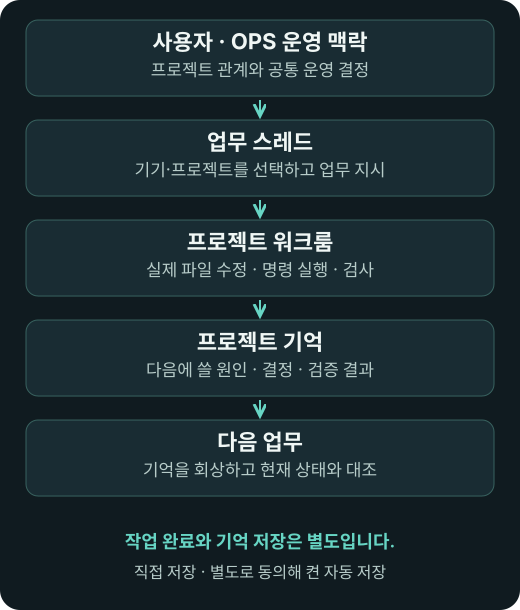
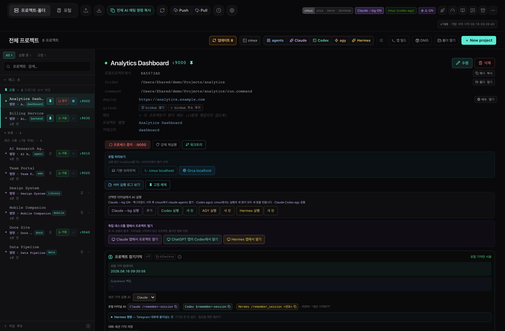
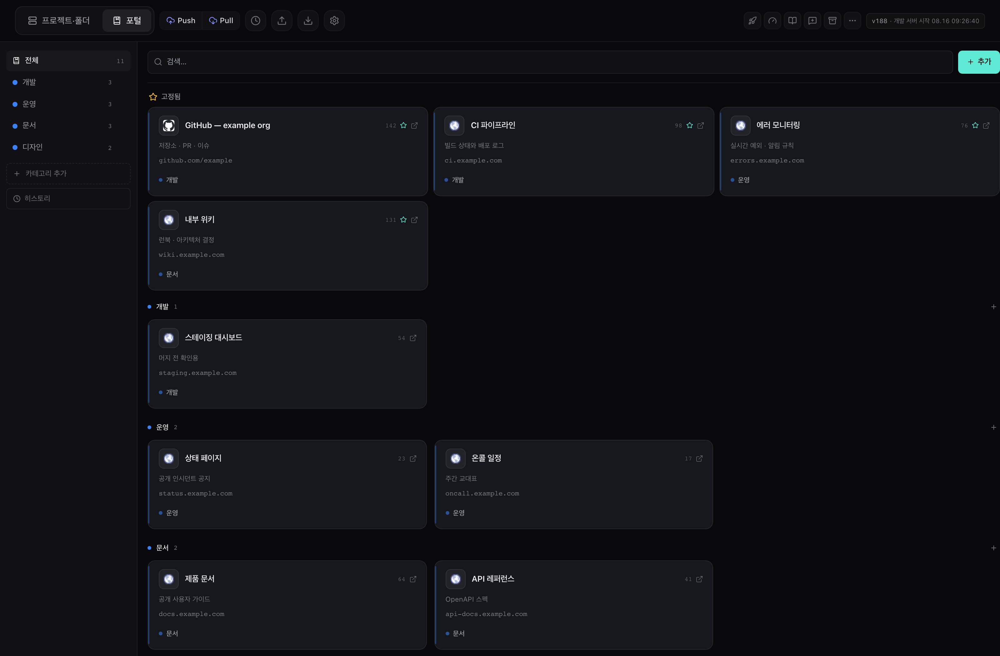
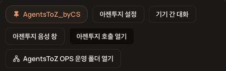
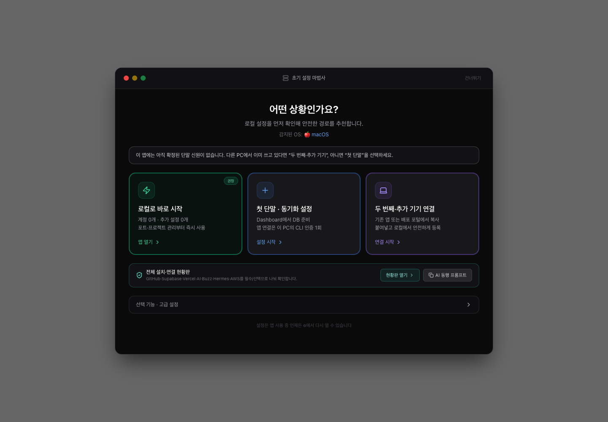
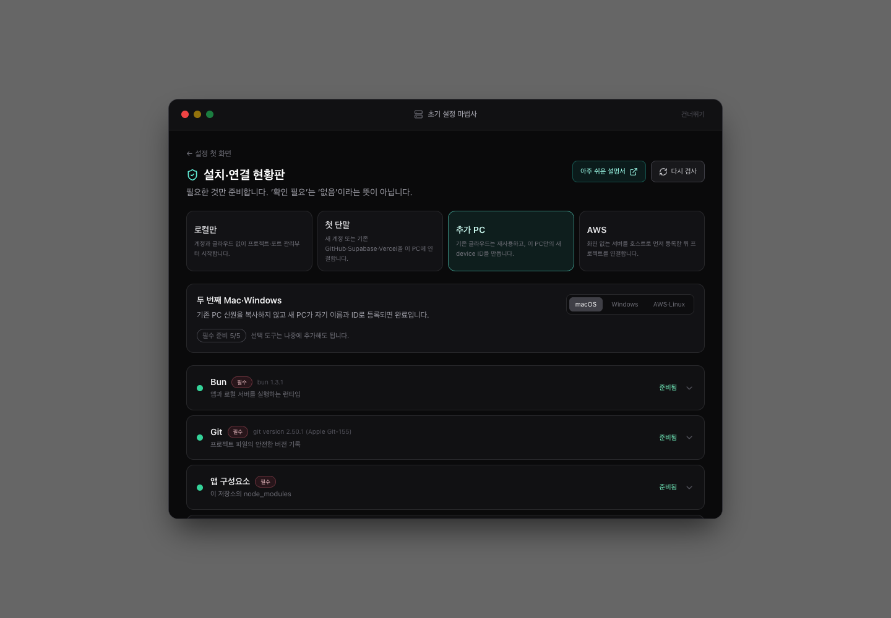
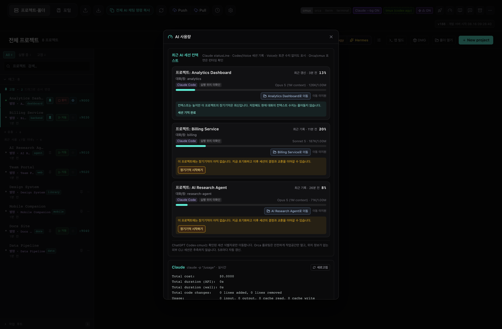

# AgentsToZ — AI와 일하고, 프로젝트의 경험을 쌓는 작업 공간

> **업무 스레드에서 지시하고, 프로젝트 워크룸에서 실행하며, 검증한 경험은 프로젝트 메모리에 남깁니다.** 나를 이해하는 운영 기억부터 여러 기기·AI의 협업까지, 다음 업무를 더 잘 이어가기 위한 앱입니다.

**iPad·iPhone으로 Mac 화면 제어를 테스트한다면:** [공개 Releases](https://github.com/intenet1001-commits/AgentsToZ-public/releases)에서 **Screen 동봉 · Apple Silicon** ZIP 패키지를 선택하세요(macOS 14 이상). 압축을 풀어 메인 앱을 Applications에 복사하고 처음 실행하면 Screen도 독립 앱으로 설치됩니다. 아래 v1165 DMG에는 Screen이 없습니다.

**처음 설치한다면:** [Mac v1165 공증 DMG](https://github.com/intenet1001-commits/AgentsToZ-public/releases/tag/v1165.0.0) · [Mac 간단 설치 안내](docs/user-guide/MAC-INSTALL.md) · [아젠투지 헬프데스크](docs/user-guide/HELPDESK.md) · [Windows 최신 설치 파일](https://github.com/intenet1001-commits/AgentsToZ-public/releases/latest) · [그림으로 따라가는 온라인 시작 설명서](https://agentstoz-guide.vercel.app) · [저장소 안의 사용자 가이드](docs/user-guide/GUIDE.md) · [선택: 내 계정으로 개인 웹 포털 만들기](docs/SELF-HOSTING.md)

| 공개 배포 구분 | 현재 버전 | 확인할 점 |
|---|---|---|
| Mac 공증 DMG | **v1165 · Apple Silicon** | 호출창 오른쪽 헬프데스크·실제 Claude 답변 확인. 새 Mac 첫 설치·핵심 반복은 별도 |
| TestFlight 원격 클라이언트 | **iPhone/iPad · Apple Silicon Mac 호환** | 현재 승인된 내부 테스터가 다른 컴퓨터의 호스트에 연결하는 앱입니다. 프로그램 설치·로컬 CLI·Mac 헬프데스크는 위 공증 DMG에서 제공합니다. |
| Windows 설치 파일 | **v187 · x64** | 이전 공개 설치본입니다. 최신 소스의 업무·기억·원격 기능이 모두 반영됐다고 보장하지 않습니다. 최신 Windows 기능·설치본 검증이 남아 있습니다. |
| 공개 소스 | **이 저장소의 최신 main** | 본문의 기능 설명 기준. 플랫폼별 설치 파일 버전과 다릅니다. |

**Mac 후속 온보딩:** 최신 소스에는 GitHub·Supabase 필수 인증과 본인 Supabase 전용 저장소 자동 준비가 포함됩니다. v1181 공증 후보는 현재 Mac의 격리 환경에서 GitHub·Supabase 실제 인증, 전용 DB 준비, 최종 서명 앱 재시작 후 CLI 연결 유지 검사를 마쳐 로컬 배포 준비를 완료했습니다. 새 Mac·별도 macOS 사용자·GUI 첫 설치·48시간 운영은 미검증입니다. 아래 최신 소스 설명과 v1165 공개 설치본의 제공 범위를 구분해 주세요.

온라인 설치 설명서는 누구나 보는 **공개 설명서 전용 배포**입니다. 사용자의 개인 북마크 포털 주소나 Supabase 연결값을 포함하지 않습니다.

**첫 업무와 저장 결과 확인:** [폴더 등록 → 워크룸 작업 → 기억 저장, 실패 시 이어가는 방법](docs/user-guide/FIRST-WORK-AND-RECOVERY.md)

[](https://bun.sh)
[](https://tauri.app)
[](https://react.dev)
[](https://supabase.com)

## AI에게 맡긴 일이 다음 업무의 경험이 되도록

예를 들어 “홈페이지 가입 오류를 고치고 검사해 줘”라고 요청합니다. **업무 스레드**에서 실행할 기기와 `@홈페이지` 프로젝트를 고르면, 그 프로젝트의 **워크룸**에서 AI가 실제 파일을 수정하고 검사를 실행합니다. 질문과 결과를 확인한 뒤, 다시 쓸 해결 방법과 검증 결과는 **홈페이지 프로젝트 기억**에 저장합니다. 다음 담당 AI는 이 기억을 읽고 일을 이어갑니다.



| 처음 알아둘 개념 | 하는 일 | 남는 내용 |
|---|---|---|
| **사용자 운영 프로필 · AgentsToZ OPS 기억** | 프로젝트 관계와 공통 운영 맥락을 이해하는 운영 담당자 | 프로젝트 별칭·관계·공통 결정 |
| **업무 스레드** | 일을 맡기고 프로젝트별 질문·진행·결과를 모으는 업무방 | 한 업무의 요청과 처리 기록 |
| **프로젝트 워크룸** | 선택한 프로젝트 폴더에서 AI가 실제로 일하는 작업실 | 파일 변경, 명령·검사 실행, 승인·질문 |
| **프로젝트 메모리** | 다음 실무 담당자가 읽는 인수인계 | 설계 이유·해결 방법·사용자 정정·검증 결과 |
| **공통 기억** | 여러 프로젝트가 함께 참고할 지식을 선택해 연결 | 독립된 주제별 지식 그룹 |

**실무 경험은 해당 프로젝트에 쌓입니다.** 특정 AI 한 명에게만 의존하는 기억이 아니라 프로젝트 로컬 파일을 정본으로 관리하며, 연결된 담당 AI가 회상해 사용합니다. 모든 요청을 OPS를 거칠 필요는 없습니다. 프로젝트 워크룸에 직접 일을 맡길 수도 있습니다.

**대화 기록·업무 완료·기억 저장은 별도입니다.** 대화를 이어 여는 것과 재사용할 지식을 정리하는 것은 다릅니다. 기억은 직접 저장하거나 별도로 동의해 켠 자동 저장으로 남깁니다. [예시로 읽는 업무와 기억의 흐름](docs/user-guide/METHODOLOGY.md)

### 아젠투지 헬프데스크로 처음 준비하기

AI나 터미널을 몰라도 앱 안에서 준비를 시작할 수 있습니다. **아젠투지 호출 → 오른쪽 위 헬프데스크 → 처음 설치해요**를 선택하세요. 기본 안내와 프로그램 준비는 AI 로그인 전에 사용할 수 있습니다.

1. **프로그램:** **필요한 프로그램 한 번에 준비**를 누르면 Git·Codex·Claude Code·GitHub CLI·Supabase CLI를 확인하고, 필요한 Node.js·npm을 포함해 빠진 도구를 차례로 준비합니다. 항목별 진행·승인 대기·실패 결과를 확인하고 중단된 준비를 이어갑니다. Vercel CLI는 웹 배포를 할 때 선택합니다.
2. **필수 계정과 저장소:** 이 첫 설치 경로에서는 GitHub·Supabase에 가입하거나 기존 계정으로 공식 브라우저 인증을 마칩니다. 본인의 Supabase 무료 조직을 확인하고 **이 계정에 무료 전용 저장소 만들기**를 누르면 앱이 DB 구성, 실제 저장·조회, 이 Mac 연결까지 확인합니다. SQL·DB 비밀번호·연결 키를 대화에 입력할 필요가 없습니다.
3. **AI 연결:** 사용할 Codex 또는 Claude 계정 하나를 공식 인증하고 연결 상태를 확인합니다.
4. **도움받기:** 첫 프로젝트·워크룸·기억 저장 사용법을 질문하세요. 실제 파일 작업과 명령 실행은 선택한 프로젝트의 워크룸에서 수행합니다.

회원가입, 비밀번호·2단계 인증, macOS 설치·키체인 승인은 본인이 공식 화면에서 처리합니다. 서비스 인증과 DB 준비가 끝났는지는 각각의 실제 결과로 확인합니다. 기존 저장소가 있는 추가 Mac은 **기존 저장소 연결 확인**으로 이동하며, 새 저장소를 중복 생성하지 않습니다.

[헬프데스크 단계별 사용법과 막혔을 때](docs/user-guide/HELPDESK.md) · [새 Mac 따라 하기](docs/user-guide/MAC-NEWCOMER.md)

### 내 기기들이 모이는 작은 업무 커뮤니티

집의 Mac과 사무실의 Mac을 승인해 연결하고, 기기별 채널에서 프로젝트에 일을 맡깁니다. **커뮤니티는 같은 OPS에 참여한 기기들의 업무 공간**입니다. 공개 SNS가 아니며, 일반 단톡방 대화가 AI 명령으로 자동 실행되지 않습니다.

- `#사무실Mac`으로 **실행할 기기**, `@홈페이지`로 **실제로 일할 프로젝트**를 고릅니다.
- 여러 프로젝트를 한 업무에 선택하면 각자의 워크룸에서 처리하고 질문·결과를 같은 스레드로 모읍니다.
- **손에는 iPhone, 실제 작업은 연결한 Mac에서.** 허용된 프로젝트에 요청하고 답변을 확인하며 대화를 이어갑니다. Mac과 앱은 켜져 있어야 합니다. 같은 Wi-Fi의 LAN 연결과 외부 인터넷 연결은 별도로 준비합니다.
- 프로젝트·대화 기록·기억 관리 권한은 각각 확인합니다. 채널 참여만으로 모든 기억이나 파일이 공개되지는 않습니다.

[커뮤니티·업무 스레드 사용법](docs/community-workspace.md) · [다른 기기에 작업 맡기기](docs/cross-device-ops.md) · [원격 워크룸](docs/runtime-execution.md)

### 먼저 한 업무만 완료해 보세요

1. 앱을 설치하고 **로컬로 바로 시작**합니다. 프로젝트 폴더 하나와 사용할 AI 도구·로그인을 준비합니다.
2. **대화 세션 → 커뮤니티 · 업무 스레드**에서 실행 기기와 `@프로젝트`를 선택하고 업무를 맡깁니다.
3. 연결 워크룸에서 실제 작업과 필요한 승인·질문을 확인하고, 스레드에서 결과를 봅니다.
4. 원인·해결 방법·검사 결과를 프로젝트 기억에 저장합니다. 다음 업무에서 그 기억을 참고하도록 요청합니다.

프로젝트·포트 관리, 북마크, Git·워크트리, 공통 기억, 기기 간 협업과 선택형 음성을 필요한 만큼 넓혀 가세요. 로컬 앱 설치부터 GitHub·Supabase·Vercel을 모두 준비할 필요는 없습니다.

> **현재 소스의 제공 범위:** 아젠투지의 OPS 운영 기억, 프로젝트별 기억, 지시 원문인 「내가 한 말」과 [직접 확인한 개인 선호인 「내 프로필」](docs/user-profile.md)을 구분합니다. 개인 프로필은 장기기억에서 관리하며 이 기기의 현재 OS 사용자에게만 암호화해 저장합니다. 기기 간 개인 프로필 공유와 AI의 자동 추론 저장은 제공하지 않습니다. Mac 앱의 **아젠투지 헬프데스크**는 프로그램 준비 → 공식 계정 인증과 본인 저장소 준비 → AI 연결과 사용 질문을 안내합니다. **CEO 업무 색인**은 설계 검토 단계입니다. 설치 파일의 제공 범위와 검증 상태는 각 릴리스 안내를 확인하세요.

<details>
<summary>기존 프로젝트·포트·북마크 화면 한눈에 보기</summary>



</details>

---

## 처음 왔다면

- **Windows 일반 사용자:** 공식 릴리스의 `x64-setup.exe`를 설치하면 됩니다. GitHub 계정·Git·Bun·clone은 필요 없습니다.
- **macOS 공개 사용자:** [v1165 공증 DMG](https://github.com/intenet1001-commits/AgentsToZ-public/releases/tag/v1165.0.0)를 열고 앱을 Applications로 복사하세요. Apple Silicon 전용 테스트 배포이며 최소 macOS 13입니다. GitHub 계정·Git·Bun·clone 없이 로컬로 시작할 수 있습니다. [설치 순서와 계정 연결](docs/user-guide/MAC-INSTALL.md)을 참고하세요.
- **Vercel 개인 웹 포털:** 휴대폰·다른 브라우저용 내 웹 주소를 만드는 선택 기능입니다. 로컬 앱 설치나 내 PC의 Git clone을 대신하지 않습니다.

---

## 내 상황에 맞는 시작 경로

Mac에서는 **도구 및 설정 → 내 기기와 연결 → 이 Mac의 프로그램 준비**에서 사용할 도구만 고르고 **선택한 프로그램 준비 · 이어하기**를 누릅니다. 이미 있는 도구는 다시 설치하지 않으며 **설치·실행 다시 검사**로 실제 실행을 확인합니다. 프로그램 준비와 서비스 계정 인증은 별도 단계입니다. Windows의 **한 번에 설치하기**와 단계별 직접 설치 안내는 해당 기기의 초기 설정에서 사용합니다.

초기 설정 마법사의 **설치·연결 현황판**은 설치 앱과 소스 실행을 먼저 구분한 뒤 필요한 도구와 선택 도구를 보여 주고, 현재 상황에 맞는 AI용 복붙 프롬프트를 만듭니다. 프롬프트를 Claude Code, Codex 등 원하는 AI에 전달하면 AI가 한 단계씩 확인하며 안내합니다. 계정 로그인, 2단계 인증, 비밀키 입력, 외부 프로그램 설치는 사용자가 확인한 뒤 진행합니다.

| 상황 | 시작 위치 | 기존 서비스 재사용 | 기기 신원 |
|---|---|---|---|
| 로컬에서 먼저 체험 | Windows 설치 앱 또는 Mac 공증 DMG 앱 → **로컬로 바로 시작** | GitHub 계정·Supabase·Vercel 불필요 | 로컬 설정만 사용 |
| 첫 Mac·Windows | 새 앱 → **첫 기기 · 동기화 설정** | 기존 프로젝트가 있으면 새로 만들지 않고 연결 | 이 앱이 만든 UUID 사용 |
| 두 번째·추가 Mac·Windows | 기존 앱 → **다른 PC 연결 정보 만들기**, 새 PC → **두 번째·추가 기기 연결** | 설치 파일 사용자는 새 PC에 앱만 설치하고, 소스 사용자는 같은 공개 저장소를 clone합니다. 기존 Supabase와 Vercel 주소는 재사용 | 기존 ID를 복사하지 않고 새 UUID 생성 |
| Ubuntu·AWS·화면 없는 Linux | 포털 **기기 연결 → 클라우드·서버** 또는 앱 **장기기억 → 클라우드 기기** | 기존 Supabase에 호스트를 등록하고 필요할 때 기존 GitHub 저장소를 clone | 호스트를 먼저 등록한 뒤 프로젝트를 그 아래 연결 |

추가 Mac·Windows용 v3 연결 정보에는 공개 가능한 Supabase Project URL·anon/publishable key·추천 기기 이름만 들어갑니다. `service_role` 키, 로그인 토큰, 기존 기기 ID는 전달하지 않습니다. Vercel 포털은 같은 배포 URL을 계속 사용하므로 두 번째 PC마다 다시 배포할 필요가 없습니다.

Claude Code·Codex·Antigravity는 코딩 에이전트, Hermes는 원격/AWS 에이전트, Telegram은 Hermes의 대화 채널, Buzz는 에이전트와 채널을 운영하는 별도 협업 앱입니다. 모두 **선택 기능**이며 포트 관리와 로컬 실행에 필요하지 않습니다. 자세한 설치 순서와 연결 범위는 [온라인 설치 설명서](https://agentstoz-guide.vercel.app)에서 상황별로 확인하세요.

AgentsToZ 로컬 API가 시작되면 Claude(`~/.claude/CLAUDE.md`)·Codex(`~/.codex/AGENTS.md`)·Antigravity(`~/.gemini/GEMINI.md`)의 기존 사용자 지침을 보존하면서 관리 마커 안의 공통 응답 규칙을 맞춥니다. Hermes가 실제로 설치된 기기에서는 `~/.hermes/SOUL.md`에도 같은 규칙을 적용합니다. 이 규칙은 모든 질문을 먼저 한 줄의 영어 번역으로 표시한 뒤 사용자의 언어로 답하게 합니다.

## 무엇을 하는 앱인가

- 로컬 개발 서버의 **포트를 목록으로 관리**하고, 실행 / 중지 / 강제 재실행을 버튼 하나로 처리합니다.
- `.bat` · `.cmd` (Windows) / `.command` · `.sh` (macOS) 실행 파일이 없어도, **폴더 경로만 있으면** `package.json` · `pyproject.toml` · `Cargo.toml`을 탐색해 실행 명령을 자동으로 찾아 기동합니다.
- 프로젝트별로 **Claude Code / Codex / Antigravity 에이전트**를 터미널에 바로 띄우고, git 워크트리를 패널에서 관리합니다.
- **워크룸**에서 Claude Code · Codex · Hermes · Antigravity CLI 세션을 앱 안 터미널로 열고, 새 창으로 분리하거나 다시 시작해 이전 대화를 이어 갑니다. `@프로젝트`로 다른 프로젝트의 AI나 데스크톱 앱(Codex · Claude · Hermes · Antigravity)에 작업을 넘깁니다. ([자세히](#워크룸--커뮤니티--음성))
- 워크룸의 **USE 준비**에서 프로젝트와 사용할 업무를 고르면 해당 DEV 워크룸에서 앱 연결을 구현·검증할 수 있습니다. 앱의 연결 코드를 등록하고 운영기억을 활성화하면 그 앱이 제공한 동작과 입력 양식으로 사용합니다. ([공통 연결](docs/service-use-integration.md#프로젝트-워크룸에서-use-준비-공통-연결-v1))
- USE를 활성화한 제품은 `@ShadowLoop-USE`처럼 DEV와 함께 호출 후보에 표시됩니다. 연결된 외부 CLI·에이전트 앱도 생성되는 공통 스킬을 읽어 `@OPS`·`@프로젝트-DEV`·`@프로젝트-USE`로 작업을 맡기고, `#`로 해당 역할의 기억만 참고합니다. 외부 앱의 자동완성은 그 앱의 지원에 따릅니다. ([연결과 사용법](docs/service-use-integration.md))
- **업무 스레드의 프로젝트 상태 · 조회 묶음 · 작업 팩** — 로컬 DEV 프로젝트 하나의 스레드에서 Git·워크룸·테스터·관련 기억을 미리 보고 필요한 항목만 요청에 붙입니다. 붙인 상태는 전송 직전에 다시 확인합니다. **조회 묶음**은 Git 상태·워크룸 상태·최근 검사 상태·검사 보고서·관련 기억 다섯 가지 읽기를 한 번에 실행하고 영수증을 그 스레드에 남깁니다. 결과를 모르는 요청은 다시 실행하지 않고 같은 요청 번호로 확인만 합니다. 자주 쓰는 **규격 명령**에 조회 계획을 붙이면 **작업 팩**이 되어 다른 프로젝트 스레드에서도 그대로 실행됩니다. 명령 본문이 바뀐 팩은 다시 검토해야 합니다. 이 기능들은 조회만 하며 AI·새 업무·테스트를 실행하지 않습니다. 새 실행은 호스트에서 `AGENTSTOZ_READ_TOOL_BATCH_ENABLED=0`으로 끌 수 있습니다.
- **웹 자료 검토(소스 실행 전용)** — 직접 입력한 HTTP(S) 페이지를 로그인·쿠키 없는 격리 Chromium에서 열어 제목·본문·링크(원하면 화면 미리보기)를 확인하고, 고른 부분만 워크룸 초안에 넣습니다. 자동으로 보내지 않습니다. 설치 앱에는 브라우저가 포함되지 않아 「사용할 수 없음」으로 표시됩니다. ([범위와 보안 정책](docs/plans/browser-context-mvp.md))
- **팀 작전** — 어느 워크룸에서든 지금 쓰는 AI가 리더가 되어, 한 작업을 Codex·Claude·Hermes·Antigravity에 나눠 맡깁니다. 팀원은 각자 새 워크트리와 브랜치의 워크룸에서 (원하면 지정한 모델로) 일하고 보고하며, 리더가 검토·병합·정리합니다. 워크룸 입력창이나 업무 스레드의 「팀 작전」에서 팀을 구성하면 리더 지시문이 입력칸에 채워집니다. 커밋 안 된 작업과 병합 안 된 브랜치는 정리 때도 지우지 않고, push하지 않습니다. ([팀 작전](docs/workroom-team.md))
- **근무 모드** — AgentsToZ 이름 아래 커피 버튼에서 30분~24시간 또는 **연중무휴**를 골라 자동 잠자기를 막습니다. 원하면 화면 꺼짐도 막습니다. 앱을 다시 열면 꺼져 있습니다. Mac은 **덮개를 닫아도 계속 근무**를 고를 수 있습니다(배터리로도 되고, 처음 한 번 관리자 암호로 `pmset` 두 명령만 허용) — 배터리가 5% 아래로 내려가거나 과열되거나 앱이 죽으면 원래대로 돌아가 잠듭니다. 그 밖의 덮개 닫기·배터리 부족은 우회하지 않습니다. ([근무 모드](docs/work-mode.md))
- **화면 언어 7개** — 한국어·English·日本語·简体中文·Español·Français·Deutsch. 공통 메뉴·설정과 새 기능은 7개 언어이고, 세부 화면 일부에는 아직 한국어 문구가 남아 있습니다. ([앱 언어](docs/internationalization.md))
- 여러 Mac을 **커뮤니티**에 입장시키면 한 화면에서 다른 Mac의 워크룸을 고르고, 기기끼리 메시지를 주고받습니다.
- 프로젝트마다 **장기기억**을 쌓습니다 — 세션에서 정해진 것을 append-only 저널에 남기고, 그로부터 "색인 + 섹션별 노트"를 만들어 다음 세션이 **필요한 노트 하나만** 읽게 합니다. ([자세히](#프로젝트-장기기억))
- 상단의 **자주 쓰는 프롬프트**에서 내가한말의 일반 메시지 표본을 비교해 반복 요청을 찾고, 내가 쓴 요청인지 확인한 뒤 가이드를 편집·저장·삭제하거나 고정해 바로 복사합니다. 저장본은 이 기기에 암호화해 보관합니다. 프로젝트 이름과 프로젝트 코드도 한 줄로 복사할 수 있습니다.
- 자주 쓰는 링크를 모으는 **북마크 포털**을 제공하고, 원하면 Vercel로 배포해 휴대폰에서 엽니다.
- **Supabase 동기화(선택)** — 여러 기기의 포트 목록·북마크를 `device_id` 단위로 격리해 Push / Pull 합니다.

### AgentsToZ OPS · 운영 프로필

AgentsToZ OPS는 프로젝트와 AI를 바꿔도 이어 쓰는 운영 프로필입니다. **도구 및 설정 → 아젠투지 설정** 또는 장기기억 화면의 **아젠투지 설정 열기**에서 준비 상태와 저장 후보를 확인합니다. 처음에는 프로젝트 폴더 없이 사용자 전용 앱 데이터에 준비할 수 있습니다. 개발 실행은 별도 AI 작업 탭이 아니라 워크룸에서 시작합니다.

여러 기기에서 공유할 운영 폴더와 그 GitHub 저장소의 이름은 **`AgentsToZ-OPS`**입니다(예전 이름 `AgentsToZ-Control`). 기존 폴더는 앱이 시작할 때 아무도 쓰고 있지 않으면 새 이름으로 옮기고, 옮기기 전에도 두 이름을 같은 OPS로 인식합니다. 기억 ID, `.agentstoz-control-profile.json`, 복원 seed는 바뀌지 않습니다. **AgentsToZ OPS 운영 폴더 열기**는 이미 등록된 이 폴더를 엽니다. OPS는 사용자마다 하나라서 “AgentsToZ, 관제센터 만들어” MCP 흐름은 이미 등록된 OPS가 있으면 새로 만들지 않고 그것을 돌려줍니다. 처음이라면 이 흐름으로 작업 루트를 선택해 운영 문서·Git 초기 이력·장기기억을 준비할 수 있습니다.

초기 설정의 **내 AgentsToZ OPS 준비**는 운영 프로필을 엽니다. 다른 Mac의 운영 폴더가 있다면 **다른 Mac의 AgentsToZ OPS 복원**에서 기존 Private GitHub 저장소를 복원합니다. 이 버튼은 새 기억을 만들지 않습니다. 옛 이름의 폴더는 버튼이 아니라 앱이 시작할 때 안전 조건이 맞으면 `AgentsToZ-OPS`로 옮겨집니다.

OPS에는 프로젝트 별칭·관계·공통 결정처럼 오래 유지할 운영 맥락을 저장합니다. 실제 진행 상태는 미션·워크룸 런타임에, 각 프로젝트의 설계·변경·검증 결과는 해당 프로젝트 장기기억에 남습니다. 프로젝트별 USE/DEV 기억과 OPS 기억을 합치지 않습니다. AI가 만든 저장 후보는 아직 저장된 기억이 아니며 프로필 화면에서 내용과 근거를 검토합니다.

다른 Mac에서 이어 쓰려면 기존 운영 폴더를 별도 GitHub 저장소에 push한 뒤 새 Mac의 **새 프로젝트 → GitHub 주소**로 clone합니다. clone 흐름은 `.agent-memory/config.json`의 `memoryId`와 원격 저장소 계보를 확인하고 Supabase 기억을 먼저 Pull합니다. Git은 운영 문서와 이력을, Supabase는 동일한 `memoryId`의 리비전을 동기화합니다. 개인 운영 내용에는 Private 저장소를 권장하며 공개 범위는 생성할 때 사용자가 명시합니다. 세부 연결 범위와 제한은 [운영 프로필 안내](docs/control-profile.md)를 따릅니다.

앱은 **웹 모드**(브라우저에서 `localhost:9000`)와 **데스크톱 앱 모드**(Tauri) 두 가지로 쓸 수 있습니다. Supabase 없이도 포트 관리 기능은 전부 동작합니다.

자주 쓰는 링크를 모으는 북마크 포털은 별도 탭입니다. 카테고리와 고정(pin)을 그대로 두고 기기 간 공유됩니다.



---

## QR 원격제어

### iPad·iPhone에서 Mac 화면 보기·제어

최신 Mac 설치 패키지는 **AgentsToZ Screen**을 함께 포함합니다. 메인 앱의 첫 실행에서
독립 Screen 앱을 설치하므로 별도 다운로드할 필요가 없습니다. 새 Mac에서는 **근무 모드 →
AgentsToZ Screen 열기**에서 화면 녹화·손쉬운 사용 권한을 직접 허용하고, iPad·iPhone을
그 Mac의 QR로 등록하세요. Screen 기능은 macOS 14 이상에서 지원합니다. 기존 등록 기기와
키체인은 업데이트로 초기화하지 않으며, 권한 허용이나 제어 켜기를 자동 승인하지 않습니다.

`git pull`은 소스만 갱신합니다. 이미 설치한 앱은 새 설치 패키지로 업데이트해야 합니다.
소스에서 Mac 패키지를 만드는 경우에는 Screen의 키체인·권한 신원을 유지할 Developer ID
서명과 provisioning profile이 필요합니다. 이전 공개 v1165 DMG에는 이 동봉 설치가 없습니다.

Mac 앞에서 하던 프로젝트 작업을 휴대폰·iPad에서 이어 하려면 앱의 **더보기**에서 연결 방식을 고릅니다. 같은 개인 Wi‑Fi에서는 **QR 원격제어 · 이 Mac**, Wi‑Fi 밖에서는 **외부 인터넷 QR 원격제어 · 베타**를 사용합니다. 외부 연결은 본인의 개인 배포 포털, Google 로그인, Mac에 표시되는 6자리 승인 확인을 모두 통과해야 열립니다.

- LAN·외부 QR은 모두 30일 동안 한 번만 사용할 수 있습니다. LAN은 같은 기기의 저장된 연결로 최대 30일 안에 재접속하며, Mac·앱 재시작 뒤에도 검증된 연결 기록을 복원합니다. 연결 해제·만료·저장소 초기화에는 새 QR이 필요합니다. LAN 주소가 바뀐 경우의 자동 탐색은 아직 지원하지 않습니다. 외부는 스캔 후 승인 대기가 최대 24시간이고, 승인된 연결은 승인 시점부터 최대 30일 유지됩니다. Mac의 외부 host identity·pairing secret·세션 cursor는 계정 전용 앱 데이터의 0600 vault에 저장되어 재시작 뒤 복원을 시도하며, 사용자가 외부 원격제어를 끄거나 기기 연결을 해제하면 폐기됩니다. 늦은 QR 승인에도 전체 기간을 보장하기 위해 내부 릴레이 호스트 행만 최대 62일 유지됩니다. 외부 인터넷 연결은 종단간 암호화되며, relay는 프로젝트나 실행 기능의 평문을 볼 수 없습니다.
- 등록 프로젝트와 Git에서 발견한 연결 워크트리를 구분해 표시합니다. 실행·중지·재실행, 로컬 브라우저, Orca의 Claude/Codex/AGY/Hermes, Codex/Hermes 앱 열기를 선택할 수 있습니다. **Mac의 Codex 앱에서 처음·이어 열기**는 정확한 프로젝트에 연결된 기존 대화를 먼저 확인합니다. 기존 대화가 없다고 확인된 경우에만 고정 첫 안내문을 1회 준비하고, 해당 프로젝트 소속 저장을 확인한 뒤 앱에 열기를 요청합니다. 확인할 수 없으면 다시 확인하도록 안내하며 새 대화를 추측해서 만들지 않습니다. 열기 요청 수락은 실제 앱 창 선택 확인과 구분합니다. Orca 최초 로그인·약관 동의·폴더 신뢰는 Mac에서 사용자가 한 번 직접 완료합니다. 원격 Hermes는 프로젝트 폴더에서 보이는 Orca Floating 터미널로 열며, 워크트리 생성은 표준 Git형과 Orca 사이드바 등록형 중 하나를 고릅니다.
- **프로젝트 / 워크룸**에서 생성한 정확한 프로젝트를 선택해 작업하거나 Mac의 Codex 앱으로 열 수 있습니다. 인터넷 연결 승인 때 **이 기기에서 워크룸 작업 허용 · 최대 30일**을 선택하고 허용 프로젝트 또는 작업 폴더를 지정합니다. 재접속은 이 동의 범위를 넓히거나 만료를 연장하지 않습니다. 워크룸 원문 입출력은 이 별도 동의를 받은 연결에만 제공됩니다.
- 등록 작업 루트 아래 프로젝트 생성, Commit, 안전한 fast-forward Pull, Push, 충돌 사전검사 후 기본 브랜치 Merge를 지원합니다. 워크트리는 앱과 같은 표준 `worktrees/` 생성과 Orca 사이드바에 등록하는 Orca 관리 생성을 구분합니다. Merge는 로컬 기본 브랜치만 갱신하므로 GitHub 반영은 기본 프로젝트 카드에서 **Push**를 별도로 실행해야 합니다. 워크트리 삭제처럼 복구가 어려운 기능은 원격에 제공하지 않습니다.
- 휴대폰에는 세션용 임시 ID, 표시 이름, 포트, 상태, 고정 기능 목록만 전달합니다. 실제 로컬 경로·실행 명령·PID·환경값·장기기억·What I Said·로컬 저장 credential·service_role·Git/API 로그인 토큰은 전달하지 않으며 임의 경로나 shell 명령도 받을 수 없습니다.
- 같은 Wi‑Fi용 HTTP QR을 인터넷에 공개하거나 공유기 포트 포워딩하지 마세요. 외부에서는 개인 배포 포털의 HTTPS 연결만 사용하고, 작업이 끝나면 해당 기기 연결 또는 원격제어 전체를 끄세요.

QR 원격제어는 What I Said 외부 앱 피드와 별개입니다. 서로 다른 서버 경로·인증 capability를 사용하며, 일반 원격 프로젝트 제어는 프롬프트나 장기기억을 읽지 않습니다. 별도 동의한 워크룸의 터미널 입출력과 지속형 대화 열람 범위는 [실행 문서](docs/runtime-execution.md)를 따릅니다.

---

## 워크룸 · 커뮤니티 · 음성

### 아젠투지를 부르는 곳

Mac의 **도구 및 설정 → 아젠투지 호출 열기**에서 독립 호출 창을 엽니다. **텍스트로만 시작** 또는 음성을 선택하고 글을 입력할 수 있습니다. 음성 제공자와 자막은 호출 창의 설정에서 확인합니다. 호출 창을 여는 일과 실제 요청 전송은 별도입니다.



위 이미지는 **Mac v1157 설치본의 실제 호출 진입 메뉴**입니다. 개인 프로젝트·로그인 정보가 보이지 않는 부분만 캡처했습니다. 아래 초기 설정 이미지는 기능 설명용 예시이며, 운영체제·앱 버전·기기 준비 상태에 따라 표시가 달라질 수 있습니다.

**워크룸**은 프로젝트마다 AI CLI 세션을 앱 안 터미널로 여는 화면입니다.

- Claude Code · Codex · Hermes · Antigravity 중 하나로 시작하고, 실행 중인 세션은 탭으로 오갑니다. **새 창으로 분리**하면 같은 세션을 별도 창에서 이어 쓰며, 창을 닫아도 CLI 세션은 끝나지 않습니다.
- **다시 시작**은 화면이 깨졌거나 CLI가 끝났을 때 같은 프로젝트·AI·권한 모드로 새 CLI를 띄우고, 저장된 대화가 확인되면 그 대화를 이어 엽니다. 확인되지 않으면 추측하지 않고 새 대화로 시작합니다.
- 입력칸에 이미지를 붙여 넣거나 화면 영역을 캡처해 요청에 첨부할 수 있습니다. 파일은 프로젝트가 아니라 앱 데이터에 두고 14일 뒤 정리합니다.
- `@프로젝트`로 다른 프로젝트에 일을 넘깁니다. 받는 쪽은 그 프로젝트의 AI CLI 세션이거나 데스크톱 앱입니다. 받는 세션이 승인·질문 화면에서 멈춰 있으면 입력하지 않고 먼저 묻습니다. 데스크톱 앱으로 보낼 때는 작업 글을 클립보드에 먼저 복사하고, Codex 앱은 입력칸을 채우되 보내지는 않습니다.

**아젠투지 단톡방**은 같은 운영 프로필(OPS)의 여러 Mac이 함께 쓰는 단체방입니다. 각 Mac이 앱의 **기기 간 대화**에서 한 번 입장하면, 워크룸의 **기기** 줄에서 다른 Mac을 골라 그 Mac에서 터미널을 열고 몰 수 있습니다. 입장한 기기의 워크룸 조작만 허용되며 공용 셸·로컬 API는 닿지 않고, 권한 우회 실행은 다른 기기로 보내지 않습니다. 나가면 이미 줄 서 있던 요청도 실행되지 않습니다.

**커뮤니티 · 업무 스레드**에서는 아젠투지별 채널에서 `@프로젝트`를 선택해 일을 맡깁니다. 업무마다 연결 워크룸을 열고, 스레드와 워크룸의 전체 요청 입력칸에서 답한 내용을 같은 기록에 남깁니다. AI 질문·결과와 기억 저장 상태를 확인하며, 불확실한 전송은 같은 요청 번호로 조회합니다. [사용 흐름과 기록·권한 계약](docs/community-workspace.md)을 참고하세요.

**음성 도크**는 모든 화면 아래에 떠 있는 음성 입구입니다. 총괄(OPS)과 말하면 운영 기록에, 프로젝트 담당자로 전환하면 그 프로젝트 기록에 남습니다. 담당자와 말하는 동안에는 말이 그 워크룸에 그대로 입력되고, AI가 만든 지시는 초안으로 읽어 준 뒤 확인을 받고 보냅니다. 음성은 선택 기능이며 OpenAI 또는 Gemini 키가 필요합니다.

**다른 기기에 작업 맡기기**는 음성 도크 메뉴의 **OPS 열고 작업 맡기기 · 기기 이름**에서 시작합니다.
호출한 쪽의 AI와 관계없이 상대 기기에 설정된 AI가 그 기기의 OPS 워크룸을 열어 처리하고,
실제 결과와 수행 근거를 돌려줍니다. 양쪽의 공유 OPS·커뮤니티 참여와 최신 기능이 필요하며,
접수나 창 열림은 완료와 구분합니다. [사용법과 재연결·권한 경계](docs/cross-device-ops.md)를 참고하세요.

---

## 지원 플랫폼

| 기능 | macOS | Windows |
|---|---|---|
| 웹 모드 (`localhost:9000`) | 지원 | 지원 |
| 데스크톱 앱 빌드 | `.app` + `.dmg` (`tauri:build`, `tauri:build:dmg`) | NSIS `.exe` (`tauri:build:win`) |
| 포트 상태 감지 | `lsof` | `netstat -ano` |
| 프로세스 중지 / 강제 종료 | `SIGTERM` → `SIGKILL` | `taskkill /F` (`/T`로 트리 종료) |
| 서버 실행 파일 확장자 | `.command` / `.sh` / `.html` | `.bat` / `.cmd` / `.html` |
| 터미널 선택지 | cmux · Orca · iTerm · Terminal.app | PowerShell · WSL |
| tmux 세션 유지 | 지원 | WSL 터미널 선택 시 지원 |
| Claude Agent View (`--bg`) | 지원 | Windows 네이티브 실행 지원, WSL·tmux는 선택 |
| cmux 연동 버튼 (localhost 미리보기 등) | 지원 | 미지원 — **버튼이 UI에서 자동으로 숨겨짐** |
| DMG 빌드 / DMG 출시하기 | 지원 | 미지원 — 헤더에 `Win 빌드` 버튼으로 대체 |
| Supabase 동기화 | 지원 | 지원 |
| 북마크 포털 / Vercel 배포 | 지원 | 지원 |
| 데이터 저장 경로 | `~/Library/Application Support/com.portmanager.portmanager/` | `%APPDATA%\com.portmanager.portmanager\` |

> macOS 전용 기능(DMG, iTerm, cmux, osascript 기반 동작)은 Windows에서 **비활성화가 아니라 완전히 숨겨집니다.** Windows에 저장된 터미널 설정이 macOS 전용 값이면 앱이 부팅 시 `powershell`로 자동 교정합니다.

---

## 빠른 시작

새 온보딩을 포함한 Mac 소스에서는 빈 프로필의 첫 실행에 헬프데스크를 엽니다. 아래 흐름은 후속 Mac 빌드 기준입니다. 현재 공개 v1165 DMG의 사용법은 [해당 버전 설치 안내](docs/user-guide/MAC-INSTALL.md)를 따르세요. Windows·웹·추가 기기는 기존 초기 설정 경로를 유지하며 로컬 사용도 가능합니다.

[새 Mac 온보딩 안내](docs/user-guide/MAC-NEWCOMER.md)에서 프로그램 준비부터 계정·클라우드 연결까지 따라갈 수 있습니다.

Mac 앱에서는 **아젠투지 호출** 창 오른쪽 위의 **헬프데스크**를 여세요. 채팅에서 **처음 설치해요 / 사용법이 궁금해요 / 문제가 생겼어요**를 고르거나 바로 질문하면 됩니다. 초기 설정과 도구 및 설정에서도 같은 창을 열 수 있습니다.

1. **한 번에 설치:** 필요한 프로그램을 고르고 한 번 누르면 누락된 항목을 순서대로 준비합니다. 기본 선택은 Git·Codex·Claude Code·GitHub CLI·Supabase CLI이며, 필요한 Node.js·npm도 함께 확인합니다. 항목별 진행상황을 표시하고 이미 설치된 프로그램은 보존합니다. OS 승인창은 직접 확인합니다. Vercel CLI는 웹 배포가 필요할 때 선택합니다.
2. **필수 계정·저장소 준비:** GitHub·Supabase 계정이 없으면 공식 화면에서 가입하고, 이미 있으면 같은 계정으로 CLI 인증을 진행합니다. Vercel은 선택입니다. 본인 무료 조직의 전용 저장소 만들기를 선택하면 앱이 필요한 데이터 구조·보안 설정·실제 저장과 조회·이 Mac 연결을 확인합니다. SQL이나 연결 키를 복사할 필요가 없습니다.
3. **AI 인증:** Codex 또는 Claude 중 사용할 AI를 본인의 공식 계정으로 인증합니다. 설치 완료, 인증 확인, 실제 첫 답변은 각각 구분합니다.
4. **질문·설정 마무리:** 내장 안내는 인증 전에도 볼 수 있습니다. 인증 후 첫 프로젝트·워크룸·기억·원격 연결을 질문하고 안내된 앱 화면으로 이어갑니다. 실제 업무는 프로젝트 워크룸에서 실행합니다.

헬프데스크는 최근 지원 요청 12개를 이 기기에 보관합니다. 중단되거나 결과가 불확실한 질문은 자동으로 다시 보내지 않습니다. 비밀번호·토큰·2FA는 공식 인증 화면에서 직접 입력하세요. Windows 구버전 설치 파일에는 이 Mac 기능이 포함됐다고 안내하지 않습니다.

**초기 설정 마법사:** Windows·웹과 기존 환경·추가 기기 연결에서 로컬 시작·기존 환경 이어쓰기 등을 선택하는 기능입니다. Mac의 새 사용자 기본 경로는 위 헬프데스크를 따릅니다.



**설치·연결 현황판:** **도구 및 설정 → 내 기기와 연결**에서 현재 기기의 준비 상태를 확인합니다. 사용할 프로그램 준비와 서비스 계정 로그인은 구분하며, 이미 설치한 도구는 실행 상태를 다시 검사합니다.



### Mac: v1165 공증 DMG로 시작

1. [v1165 설치 파일](https://github.com/intenet1001-commits/AgentsToZ-public/releases/download/v1165.0.0/AgentsToZ_byCS_1165_arm64.dmg)을 엽니다.
2. `AgentsToZ_byCS.app`을 Applications로 복사한 뒤 실행합니다. 업데이트라면 먼저 기존 앱과 작업을 종료하세요.
3. **로컬로 바로 시작**을 선택합니다. 필요한 도구와 계정은 **내 기기와 연결**에서 나중에 준비합니다.

Apple Silicon 전용·최소 macOS 13의 사전 배포입니다. macOS 26.7의 설치 Mac에서 핵심 작업·같은 대화 재개 10회와 대표 재시작 복구를 확인했으며 새 OS 사용자·별도 Mac의 첫 설치 GUI는 미검증입니다. [짧은 설치 안내](docs/user-guide/MAC-INSTALL.md)에 계정 연결이 필요한 경우를 정리했습니다.

### 방법 A: Windows 설치 파일로 시작 (일반 사용자 권장)

1. [공식 최신 Windows 릴리스](https://github.com/intenet1001-commits/AgentsToZ-public/releases/latest)를 엽니다.
2. **Assets**에서 `AgentsToZ_byCS_<버전>_x64-setup.exe`를 받아 실행합니다.
3. 설치한 AgentsToZ_byCS를 열고 **로컬로 바로 시작**을 선택합니다.

이 경로에는 GitHub 계정·Git·Bun·clone이 필요 없습니다. 소스를 직접 수정·실행하려는 개발자만 아래 방법으로 넘어가세요.

### 방법 B: 소스 웹 모드를 AI 에이전트에게 맡기기

이 공개 저장소에는 `AGENTS.md`와 Claude/Codex 온보딩 스킬이 포함돼 있어, 에이전트가 프로젝트 구조와 명령어를 스스로 읽습니다.

Windows 설치 파일 대신 소스 웹 모드를 직접 실행하려면 아래 블록을 PowerShell에 붙여넣으세요. PowerShell 5.1에서도
동작하며, Git이 없으면 먼저 설치한 뒤 clone 전에 안전하게 멈춥니다. 안내가 나오면 PowerShell을
닫고 새로 연 뒤 같은 블록을 다시 붙여넣으면 됩니다. `winget`이 없는 PC에서는 공식 Git 설치
페이지가 열립니다.

```powershell
& {
  if (-not (Get-Command git -ErrorAction SilentlyContinue)) {
    if (-not (Get-Command winget -ErrorAction SilentlyContinue)) {
      Start-Process "https://git-scm.com/download/win"
      Write-Host "Git 설치 페이지를 열었습니다. 설치 후 PowerShell을 닫고 새로 연 뒤 이 블록을 다시 실행하세요." -ForegroundColor Yellow
      return
    }
    winget install --id Git.Git --exact --source winget
    if ($LASTEXITCODE -ne 0) { return }
    Write-Host "Git 설치가 끝났습니다. PowerShell을 닫고 새로 연 뒤 이 블록을 다시 실행하세요." -ForegroundColor Yellow
    return
  }

  git --version
  $devRoot = Join-Path $env:USERPROFILE "dev"
  $projectRoot = Join-Path $devRoot "AgentsToZ_byCS"
  New-Item -ItemType Directory -Path $devRoot -Force | Out-Null
  if (Test-Path (Join-Path $projectRoot ".git")) {
    Write-Host "기존 AgentsToZ_byCS 저장소를 사용합니다."
  } elseif (Test-Path $projectRoot) {
    Write-Host "$projectRoot 폴더가 이미 있지만 Git 저장소가 아닙니다. 폴더 이름을 확인한 뒤 다시 실행하세요." -ForegroundColor Yellow
    return
  } else {
    git clone https://github.com/intenet1001-commits/AgentsToZ-public.git $projectRoot
    if ($LASTEXITCODE -ne 0) { return }
  }
  Set-Location $projectRoot
}
```

저장소 폴더로 이동됐으면 설치되어 있는 AI 하나를 실행합니다.

```powershell
claude    # 또는: codex
```

에이전트에게 이렇게 말하면 됩니다:

```
온보딩 해줘. 먼저 현재 OS와 Bun/Git/node_modules 상태를 진단하고,
로컬 웹 모드로 앱을 실행하게 도와줘. 첫/추가 기기는 로컬 상태를 먼저 확인하고,
개인 포털 설정 화면이 어려우면 Playwright 브라우저 보조로 진행해줘.
```

> 이 저장소에는 온보딩 전용 스킬이 들어 있습니다. Claude Code는 `.claude/skills/onboarding/`, Codex는 `.agents/skills/onboarding/`을 읽고 환경 진단부터 첫 실행까지 단계별로 진행합니다. "온보딩 해줘"라고만 말해도 됩니다.

### 방법 C: 소스 웹 모드 수동 실행

<details open>
<summary><b>Windows (PowerShell)</b></summary>

아래 블록 하나를 붙여넣으세요. Git 또는 Bun을 새로 설치한 경우 clone을 실행하지 않고 멈추므로,
PowerShell을 닫고 새로 연 뒤 **같은 블록을 한 번 더** 붙여넣으면 됩니다. `&&`, 삼항 연산자 등
PowerShell 7 전용 문법을 쓰지 않아 Windows 기본 PowerShell 5.1에서도 동작합니다.

```powershell
& {
  $restartRequired = $false

  if (-not (Get-Command git -ErrorAction SilentlyContinue)) {
    if (-not (Get-Command winget -ErrorAction SilentlyContinue)) {
      Start-Process "https://git-scm.com/download/win"
      Write-Host "Git 설치 페이지를 열었습니다. 설치 후 PowerShell을 닫고 새로 연 뒤 이 블록을 다시 실행하세요." -ForegroundColor Yellow
      return
    }
    winget install --id Git.Git --exact --source winget
    if ($LASTEXITCODE -ne 0) { return }
    $restartRequired = $true
  }

  if (-not (Get-Command bun -ErrorAction SilentlyContinue)) {
    powershell.exe -NoProfile -ExecutionPolicy Bypass -Command "irm https://bun.sh/install.ps1 | iex"
    if ($LASTEXITCODE -ne 0) { return }
    $restartRequired = $true
  }

  if ($restartRequired) {
    Write-Host "Git/Bun 설치가 끝났습니다. PowerShell을 닫고 새로 연 뒤 이 블록을 다시 실행하세요." -ForegroundColor Yellow
    return
  }

  git --version
  bun --version
  $devRoot = Join-Path $env:USERPROFILE "dev"
  $projectRoot = Join-Path $devRoot "AgentsToZ_byCS"
  New-Item -ItemType Directory -Path $devRoot -Force | Out-Null
  if (Test-Path (Join-Path $projectRoot ".git")) {
    Write-Host "기존 AgentsToZ_byCS 저장소를 사용합니다."
  } elseif (Test-Path $projectRoot) {
    Write-Host "$projectRoot 폴더가 이미 있지만 Git 저장소가 아닙니다. 폴더 이름을 확인한 뒤 다시 실행하세요." -ForegroundColor Yellow
    return
  } else {
    git clone https://github.com/intenet1001-commits/AgentsToZ-public.git $projectRoot
    if ($LASTEXITCODE -ne 0) { return }
  }

  Set-Location $projectRoot
  bun install
  if ($LASTEXITCODE -ne 0) { return }
  bun run start
}
```

브라우저에서 <http://localhost:9000> 을 엽니다. 배치 파일 `실행.bat`을 더블클릭해도 같은 결과입니다.

</details>

<details>
<summary><b>macOS (bash / zsh)</b></summary>

아래 블록은 실제 `git --version`부터 확인합니다. Git이 아직 준비되지 않았으면 Apple 명령줄
도구 설치 창만 열고 clone 전에 멈춥니다. 설치를 완료한 뒤 새 Terminal을 열어 같은 블록을
다시 붙여넣으세요. Bun을 새로 설치한 경우에도 새 Terminal에서 한 번 더 실행합니다.

```bash
(
  if ! git --version >/dev/null 2>&1; then
    xcode-select --install 2>/dev/null || true
    echo "Apple 명령줄 도구 설치 창에서 설치를 마친 뒤 새 Terminal에서 이 블록을 다시 실행하세요."
    exit 0
  fi

  if ! command -v bun >/dev/null 2>&1; then
    curl -fsSL https://bun.sh/install | bash
    echo "Bun 설치가 끝났습니다. 새 Terminal을 열고 이 블록을 다시 실행하세요."
    exit 0
  fi

  git --version
  bun --version
  dev_root="$HOME/dev"
  project_root="$dev_root/AgentsToZ_byCS"
  mkdir -p "$dev_root"
  if [ -d "$project_root/.git" ]; then
    echo "기존 AgentsToZ_byCS 저장소를 사용합니다."
  elif [ -e "$project_root" ]; then
    echo "$project_root 폴더가 이미 있지만 Git 저장소가 아닙니다. 폴더 이름을 확인한 뒤 다시 실행하세요."
    exit 0
  else
    git clone https://github.com/intenet1001-commits/AgentsToZ-public.git "$project_root" || exit 1
  fi

  cd "$project_root" || exit 1
  bun install || exit 1
  bun run start
)
```

브라우저에서 <http://localhost:9000> 을 엽니다. `./실행.command`로도 실행할 수 있습니다.

</details>

포트와 설정이 모두 없는 새 로컬 프로필에서는 초기 설정 마법사가 열립니다.
**"로컬로 바로 시작" 또는 "건너뛰기"를 누르면 바로 사용할 수 있습니다.** 이미 사용 중인
프로필에서는 헤더의 로켓(설정) 버튼으로 마법사를 엽니다.

---

## 사전 요구사항

이 절은 **공개 소스를 직접 실행하거나 설치 파일을 직접 만드는 사람만** 봅니다. 공식 Windows
`x64-setup.exe`로 시작한 일반 사용자는 Bun·Git·GitHub clone·`node_modules`를 준비하지 않아도 됩니다.

### Windows

**공개 소스를 직접 실행할 때만 필수**

| 도구 | 설치 (PowerShell) | 검증 |
|---|---|---|
| Bun | `powershell -c "irm bun.sh/install.ps1 \| iex"` | `bun --version` |
| Git | `winget install Git.Git` | `git --version` |

> 공식 설치 파일을 쓰는 사람에게는 위 표가 해당되지 않습니다. 소스 실행을 선택했다면 Bun / Git
> 설치 후 **새 PowerShell 창**을 열어야 PATH가 반영됩니다.

**데스크톱 앱(.exe)을 직접 빌드할 때만 추가로 필요**

| 도구 | 설치 (PowerShell) |
|---|---|
| Rust (1.77.2 이상) | `winget install Rustlang.Rustup` → 새 창에서 `rustup default stable-msvc` |
| Visual Studio Build Tools 2022 (C++ 워크로드) | `winget install Microsoft.VisualStudio.2022.BuildTools --override "--wait --passive --add Microsoft.VisualStudio.Workload.VCTools --includeRecommended"` |
| WebView2 Runtime (Windows 10만) | `winget install Microsoft.EdgeWebView2Runtime` — Windows 11은 기본 내장 |

> NSIS는 별도 설치가 필요 없습니다. Tauri CLI가 빌드 시 `%LOCALAPPDATA%\tauri\NSIS`로 자동 내려받습니다.

**선택**

| 도구 | 설치 | 없으면 |
|---|---|---|
| Windows Terminal | `winget install Microsoft.WindowsTerminal` | 기본 콘솔 사용 |
| Python + Pillow | `winget install Python.Python.3.12` → `pip install Pillow` | 아이콘 우하단 버전 스탬프만 생략 (빌드는 정상 진행) |
| GitHub CLI | `winget install GitHub.cli` → `gh auth login` | GitHub Actions 클라우드 빌드 트리거 불가 |
| Node.js + Vercel CLI | `winget install OpenJS.NodeJS.LTS` → `npm install -g vercel` | 포털 Vercel 배포 불가 |
| Supabase CLI | `irm get.scoop.sh \| iex` → `scoop bucket add supabase https://github.com/supabase/scoop-bucket.git` → `scoop install supabase` | 테이블 자동 생성 불가 (아래 SQL 수동 실행으로 대체 가능) |
| WSL2 + Ubuntu | 관리자 PowerShell에서 `wsl --install` → 재시작 | Windows 네이티브 AI 실행은 가능, WSL 기반 tmux 세션 유지 기능만 사용 불가 |

> Supabase CLI는 앱이 Scoop 기본 경로인 `%USERPROFILE%\scoop\shims`를 함께 확인합니다. Scoop 이외의 방법으로 설치했다면 시스템 PATH에 직접 등록해야 합니다.

### macOS

일반 사용자는 [v1165 DMG](https://github.com/intenet1001-commits/AgentsToZ-public/releases/tag/v1165.0.0)로 앱을 설치합니다. 아래 두 도구는 공개 소스 웹 모드를 직접 실행하는 개발자에게 필요하며, DMG 설치의 선행 조건이 아닙니다. 앱에서 개발 작업에 필요한 도구는 별도로 준비합니다.

**공개 소스 웹 모드에서 필수**

```bash
curl -fsSL https://bun.sh/install | bash   # Bun
xcode-select --install                     # Git 포함 (Tauri 빌드에도 필요)
```

**선택**

| 도구 | 없으면 |
|---|---|
| iTerm2 / cmux / Orca | 해당 터미널 연동 버튼만 동작 안 함 (Terminal.app으로 사용 가능) |
| tmux (`brew install tmux`) | 터미널 창을 닫으면 AI 세션이 함께 종료됨 |
| Python + Pillow (`pip install Pillow`) | 아이콘 버전 스탬프만 생략 |

### AI 에이전트 기능 (양 플랫폼 공통, 선택)

AI 이름·카테고리 생성과 에이전트 실행 버튼은 **API 키가 아니라 로컬 `claude` CLI**를 서브프로세스로 호출합니다. `claude`가 PATH에 없으면 해당 기능만 `503 claude_not_found`로 실패하고, 나머지 앱 기능은 정상 동작합니다.

---

## 설치 및 실행

`package.json`에 정의된 스크립트 전체입니다.

| 명령 | 하는 일 |
|---|---|
| `bun run dev` | 개발 서버 (`dev.ts` 러너 — api-server:3001 + vite:9000 동시 실행, 종료 시 함께 정리) |
| `bun run start` | `dev`와 동일 (`bun dev.ts`) |
| `bun run api` | API 서버(3001)만 실행 |
| `bun run build` | 프론트엔드 프로덕션 빌드 (`vite build`) |
| `bun run build:portal` | 북마크 포털 정적 빌드 (`vite.portal.config.ts`) |
| `bun run build:sidecar` | Tauri 사이드카(API 서버) 실행 파일 컴파일 |
| `bun run preview` | 빌드 결과 미리보기 (`vite preview`) |
| `bun run typecheck` | 타입 체크 (`tsc --noEmit`) — 커밋 전 0 에러 유지 |
| `bun run tauri` | Tauri CLI 패스스루 (`tauri`) |
| `bun run tauri:dev` | Tauri 개발 모드 |
| `bun run tauri:build:win` | **Windows** 설치 파일 빌드 (NSIS `.exe`) |
| `bun run tauri:build` | **macOS** `.app` 빌드 |
| `bun run tauri:build:dmg` | **macOS** DMG 빌드 |
| `bun run update-version` | 이 커밋의 빌드 번호를 버전 파일에 씀 (+ 아이콘 스탬프, 커밋 안 함) |
| `bun run fix-dmg` | macOS DMG 후처리 복구 |
| `bun run test:smoke` | 로컬 스모크 테스트 (Playwright) |
| `bun run test:smoke:vercel` | 배포된 Vercel 포털 대상 스모크 테스트 |
| `bun run test:smoke:mobile` | 모바일 뷰포트 스모크 테스트 |
| `bun run maintainer plan` | Python 우선 검사 계획과 검증 범위 확인 |
| `bun run maintainer run --profile quick` | 핵심 회귀 검사와 장기기억 기반 AI 인계 보고서 생성 |
| `bun run maintainer run --profile web` | 격리된 Mac·모바일 UI 및 초기 렌더링 성능 검사 |
| `bun run maintainer run --profile native` | iOS Swift 통신·시뮬레이터 실제 화면 조작 검사 |

[프로젝트 메인테이너 안내](docs/maintainer.md): 기존 검사를 Python으로 먼저 실행하고 실패한 근거와 관련 장기기억만 AI에 전달합니다. 검사 도구·설정은 Git에 포함하고 실행 보고서는 로컬에 보관합니다. 다른 프로젝트에는 `init --root <프로젝트 경로>`로 설치할 파일을 미리 확인한 뒤 `--apply`로 적용할 수 있습니다.

공식 데스크톱 빌드는 시작 전에 현재 worktree가 깨끗하고 현재 HEAD가 원격의 실제 기본 브랜치 HEAD와 정확히 같은지 확인합니다. 미병합·미Push 변경이나 원격 확인 실패는 버전 번호를 올리기 전에 중단됩니다. 개발 중인 브랜치를 꼭 패키징해야 할 때만 래퍼에 `--allow-unpublished-source`를 직접 넘길 수 있지만, 그 산출물은 공식 설치·배포본으로 사용하지 마세요.

### 공개 저장소 갱신 (배포 유지보수자)

기존 공개 저장소를 받은 다른 Mac이 계속 `git pull --ff-only`로 소스를 갱신해야 한다면,
배포 유지보수자는 검증을 마친 깨끗한 소스 저장소에서 다음 옵션을 명시합니다.

```bash
bun run publish --append-public-history --dry-run
bun run publish --append-public-history
```

이 옵션은 감사한 공개 원격 `main`의 실제 커밋 하나만 새 공개 스냅샷의 부모로 사용합니다.
개발 소스의 비공개 이력은 연결하지 않으며, 공개 원격이 준비 도중 바뀌면 중단합니다.
기본 `bun run publish`는 기존처럼 부모 없는 스냅샷을 만들어 공개 이력을 교체하므로 일반 Pull 연속성이 필요할 때 사용하지 않습니다.
소스 Pull 뒤에도 설치 앱을 갱신하려면 새 macOS 패키지를 설치하거나 해당 Mac에서 빌드해야 합니다.

### Windows 앱 빌드

```powershell
bun run tauri:build:win
```

#### Windows 업데이트와 빌드 중 무엇을 써야 하나요?

| 사용자 | 권장 방법 |
|---|---|
| 소스 코드를 다루지 않는 일반 사용자 | 배포자가 실제 Windows에서 확인한 최신 NSIS `.exe`를 받아 기존 앱 위에 설치 |
| 코드를 수정한 유지보수자 | **실제 Windows PC에서** 헤더의 **Windows 빌드·출시 안내**를 열고 검증 → 빌드 → 설치본 실행 확인 |
| Windows PC에서 빌드할 수 없는 유지보수자 | GitHub Actions 사용을 별도로 승인받은 뒤 `GitHub Windows 빌드`로 아티팩트를 만들고, 내려받은 `.exe`를 실제 Windows에서 최종 확인 |

앱의 **`Windows 빌드·출시 안내`** 버튼은 설치된 앱을 백그라운드에서 자동 교체하는 바이너리 자동 업데이트 기능이 아닙니다. 현재 저장소를 안전하게 갱신하고 테스트한 뒤 NSIS 설치본을 만들도록 **AI 유지보수 프롬프트를 복사하는 기능**입니다. 따라서 일반 사용자는 검증된 설치본을 쓰고, 출시 판단은 실제 Windows 빌드와 설치 앱의 IPC·WebView2·업데이트 경로 확인을 기준으로 합니다.

### macOS 앱 빌드

```bash
bun run tauri:build        # .app
bun run tauri:build:dmg    # .dmg
bun run build:macos-app:developer-id-base       # clean 공개 snapshot의 서명 앱(공증 전)
bun run build:macos-direct-distribution --profile YOUR_PROFILE  # 앱+DMG 공증·staple·Gatekeeper 검사
```

> 버전 문자열은 날짜가 아니라 **빌드 번호**입니다. 번호는 git 기록에서 셉니다: `build-number.json`의 기준점(`buildNumber` + `baseCommit`)에 그 뒤의 커밋 수를 더합니다(`buildVersion.ts`). 그래서 같은 커밋은 어느 기기에서 빌드해도 같은 번호이고, 빌드가 bump 커밋을 만들지 않습니다. `update-version.ts`는 그 번호를 `tauri.conf.json`·`Cargo.toml`·iOS 프로젝트·아이콘에 빌드 동안만 쓰고, 빌드 래퍼가 끝날 때 되돌립니다.

> Developer ID 직접 배포 명령은 일반 개발 빌드와 다릅니다. `AgentsToZ-public`의 clean 원격 기본
> HEAD와 기존 Keychain 공증 profile이 필요하며, 설치·Release 게시를 자동 수행하지 않습니다.
> 자세한 실패 복구와 증거 경계는 [Mac 앱 직접 배포](docs/macos-direct-distribution.md)를 따릅니다.

### 로컬 빌드 없이 GitHub Actions로 빌드하기

Windows 가상머신 비용을 줄이기 위해 Windows 빌드와 검증은 실제 Windows PC에서 진행하는 것이 기본입니다. `.github/workflows/build-windows.yml`은 앱 업데이트·PR마다 자동 실행되지 않습니다. Windows 패키지 요청만으로 Actions를 실행하지 않으며, 사용자가 **GitHub Actions 실행을 명시적으로 요청**했거나 Windows PC에서 빌드할 수 없음을 확인하고 **별도 승인**받은 경우에만 `workflow_dispatch`에서 사유와 목적(`purpose`)을 골라 수동 실행합니다. `verification`(기본)은 디스패치한 커밋을 그대로 빌드하는 검증용 미공개 산출물이고, `release`는 원격 기본 브랜치의 현재 HEAD와 정확히 같을 때만 공식 패키지를 만듭니다(앱의 `GitHub Windows 빌드` 버튼은 `release`로 요청합니다). `windows-latest` 러너가 NSIS `.exe`를 만들고 아티팩트로 올리므로 로컬 Rust · Build Tools 설치는 필요 없습니다. 다만 클라우드 빌드 성공은 실제 사용자의 Windows 데스크톱에서 설치·실행까지 확인했다는 뜻이 아니므로, 출시 전 실기 확인을 생략하지 않습니다.

---

## Windows 전용 안내

### 클론 위치: `C:\Windows\System32\` 하위는 피하세요

`makensis.exe`가 `C:\Windows\System32\` 아래 파일을 읽으려 하면 Windows가 OS 레벨에서 차단합니다(`os error 2` / `os error 5`). 그래서 `build-win.ts`는 다음 두 가지 우회를 수행합니다.

1. `CARGO_TARGET_DIR`을 `%USERPROFILE%\cargo-targets\portmanager`로 강제 고정
2. 사이드카 리소스를 `%USERPROFILE%\cargo-targets\portmanager-resources`로 복사한 뒤, `src-tauri/tauri.conf.json`의 `bundle.resources`를 빌드 동안만 임시 패치 (빌드 후 원본 복원)

권장 클론 위치: `C:\Users\<이름>\dev\AgentsToZ_byCS`

### 빌드 결과물 경로

```
%USERPROFILE%\cargo-targets\portmanager\release\bundle\nsis\*.exe
```

앱 헤더의 **"폴더 열기"** 버튼으로 이 경로를 바로 열 수 있습니다.

### 데이터 저장 위치

| 항목 | 경로 |
|---|---|
| 포트 목록 | `%APPDATA%\com.portmanager.portmanager\ports.json` |
| 포털 설정 (Supabase URL/키, deviceId) | `%APPDATA%\com.portmanager.portmanager\portal.json` |
| 서버 로그 | `%APPDATA%\com.portmanager.portmanager\logs\{portId}.log` |

기기 이전은 ① Supabase Push/Pull ② 앱 내 내보내기/불러오기 ③ `ports.json` 수동 복사 중 하나를 쓰면 됩니다.

### 헤더 버튼 차이

- Windows: `Win 빌드` 버튼 → `Windows 빌드·출시 안내` + `GitHub Windows 빌드` + `폴더 열기`
- macOS: `앱 빌드` + `DMG` + `폴더 열기`

### 터미널 / 에이전트

- 기본 터미널은 `powershell`입니다. 저장된 설정이 macOS 전용 값(cmux/iterm/terminal)이면 앱이 부팅 시 `powershell`로 자동 교정합니다.
- **tmux는 WSL을 선택했을 때만** 사용됩니다. tmux를 쓰는 이유는 하나 — 터미널 창을 닫아도 AI 세션이 죽지 않습니다.
- Agent View 버튼은 Windows 네이티브 `claude --bg`를 우선합니다. WSL을 선택한 경우에만 tmux 지속 세션을 사용합니다.

---

## Supabase 동기화 설정 (선택)

**하지 않아도 앱은 완전히 동작합니다.** 포트 목록은 로컬 `ports.json`에 저장되며, Supabase는 오직 **여러 기기 간 동기화**를 위한 것입니다. 기기가 한 대라면 건너뛰세요.

### 1. 프로젝트 생성

<https://supabase.com> 무료 계정 생성 → New Project. (무료 플랜은 7일간 활동이 없으면 프로젝트가 일시정지되니 주의)

### 2. 정본 DDL을 SQL Editor에서 실행

DDL 사본을 문서에 유지하지 않습니다. 현재 앱의 테이블·`github_urls` 호환 필드·RLS 정책은
[`src/schemaSql.ts`](src/schemaSql.ts)의 `MIGRATION_SQL` 하나가 정본입니다.
owner 이메일을 환경변수로 지정한 뒤 출력 전체를 Supabase Dashboard → **SQL Editor → New query**에 붙여넣고 실행하세요.

macOS/Linux:

```bash
ALLOWED_EMAIL=owner@example.com bun -e "import { migrationSqlForAllowedEmails } from './src/schemaSql.ts'; console.log(migrationSqlForAllowedEmails([process.env.ALLOWED_EMAIL ?? '']))"
```

Windows PowerShell:

```powershell
$env:ALLOWED_EMAIL = 'owner@example.com'
bun -e "import { migrationSqlForAllowedEmails } from './src/schemaSql.ts'; console.log(migrationSqlForAllowedEmails([process.env.ALLOWED_EMAIL ?? '']))"
```

초기 설정 마법사의 자동 설치와 AI 테이블 생성 안내도 같은 정본을 사용합니다.

> **RLS**: 정본 DDL은 anon 역할을 차단합니다. browser/배포 포털은 Google 로그인 JWT를,
> Tauri 데스크톱 앱은 localhost sidecar의 서버 전용 `service_role` 연결을 사용합니다.
> 앱의 service key는 WebView나 `portal.json`으로 전달되지 않습니다.

### 3. 앱에 URL / anon key 입력

Supabase 대시보드 → Project Settings → API 에서 **Project URL**과 **anon public key**를 복사해, 앱의 포털 설정 모달에 입력합니다. 값은 `portal.json`에 저장되어 프로젝트 탭과 북마크 탭이 함께 사용합니다.

### 4. 실행 환경별 인증

Tauri 데스크톱 앱에는 사용자 로그인 단계가 없습니다. 첫/추가 기기 마법사의
`Supabase CLI에서 자동 연결`(또는 설정의 `service_role Key`)을 한 번 완료하면
북마크·기기·장기기억 Push/Pull을 sidecar가 처리합니다.
배포 포털과 browser mode만 <http://127.0.0.1:9000/portal.html>에서 Google 로그인하고,
`portmgr_is_member()`의 이메일 허용 목록을 적용받습니다.

포털의 Google 로그인 버튼은 페이지를 떠나기 전에 Supabase Auth의 공개 설정 엔드포인트를
최대 8초 동안 확인합니다. Auth 서버가 응답하지 않거나 Google provider가 꺼져 있으면 빈
로그인 페이지로 이동하지 않고 현재 화면을 유지하며 점검 항목을 표시합니다. 이 보호 장치는
장애 시 우회 로그인을 허용하지 않으며 RLS·회원 이메일 검증도 그대로 유지합니다.

### 5. 두 번째 기기 연결

Mac·Windows는 이미 등록된 첫 기기 앱의 **초기 설정 → 다른 PC 연결 정보 만들기**에서 바로
초대를 복사할 수 있습니다. 개인 Vercel 포털은 필수가 아닙니다. 포털이 있다면
**기기 연결 → Mac·Windows 연결**을 사용해도 같습니다. 이 정보에는 공개 Project URL·
anon/publishable key·추천 이름만 들어가며,
기존 기기 ID, `service_role` 키, 로그인 토큰은 들어가지 않습니다. 새 PC에 설치한 앱에서
**초기 설정 → 두 번째·추가 기기 연결**을 열어 붙여넣고, 그 PC에서 `supabase login`을 한 번
확인하면 앱이 새 UUID로 등록합니다. 포털은 빈 기기 행을 미리 만들지 않습니다.

이미 등록된 앱에서는 추가 기기 마법사가 현재 신원을 덮어쓰지 못합니다. 같은 물리 기기의
재설치 복구는 장기기억 화면의 **이전 ID 연결**을 사용합니다.

### 개인 웹 포털 배포 (선택)

처음부터 본인 Supabase와 본인 Vercel로 분리하는 전체 순서는 [내 계정으로 개인 포털 만들기](docs/SELF-HOSTING.md)를 먼저 보세요.

폰이나 원격 브라우저에서 북마크·기기 현황을 보려면 **초기 설정 → 선택 기능 · 개인 웹 포털과 고급 설정 → 내 계정에 개인 웹 포털 만들기**를
엽니다. 현재 공개 clone을 Vercel CLI로 직접 배포하므로 GitHub Fork는 필수가 아니고, Git push
자동 재배포가 필요할 때만 선택합니다. 앱은 첫 기기에 저장된 공개 Supabase 연결 정보와 허용
이메일을 Vercel Production 환경 변수에 넣은 뒤 배포 URL을 돌려줍니다.
성공한 `*.vercel.app` 주소는 이 PC의 `portal.json`에 자동 저장되어 이후 **포털 열기**와
**새 기기 등록 링크**가 그 개인 주소를 사용합니다. 공개 소스에는 개인 주소의 기본값이 없으며,
수동 빌드에서만 필요하면 커밋하지 않은 배포 환경의 `VITE_PORTAL_URL`로 지정합니다. 저장된
Vercel origin의 localhost 연동은 장기기억용 제한 경로 네 개에만 적용됩니다. 사용자 지정 도메인은
서버 실행 환경의 `PORTMGR_PORTAL_INTEGRATION_ORIGINS`에 명시적으로 추가해야 합니다.

Google Cloud·Supabase·Vercel 화면을 따라가기 어렵다면 마법사의
**Playwright 브라우저 보조 요청 복사**를 눌러 Codex/Claude에 전달하세요. 에이전트는 현재 화면을
snapshot으로 확인해 메뉴 이동을 돕고, 로그인·2단계 인증·Google Client Secret 입력은 사용자가
브라우저에서 직접 하도록 멈춥니다.

Ubuntu/AWS/Linux는 이 흐름과 분리됩니다. 포털의 **기기 연결 → 클라우드·서버** 또는 앱의
**장기기억 → 클라우드 기기**에서 호스트용 일회용 명령을 만들고 서버에서 실행해 호스트를 먼저
등록한 뒤, 그 아래에서 새 프로젝트·GitHub 복제·장기기억 복원을 진행합니다.

### 6. 기기별 격리 규칙

| 대상 | 격리 단위 | `device_id` 값 |
|---|---|---|
| `portmgr_ports` | 기기별 | 해당 기기 UUID |
| `portmgr_portal_items` (`type = 'web'`) | 전 기기 공유 | `'__shared__'` |
| `portmgr_portal_categories` | 전 기기 공유 | `'__shared__'` |

Pull은 `내 UUID`와 `'__shared__'` 두 결과를 합산합니다. Push는 `sourceDeviceId`가 내 UUID인 항목만 upsert하므로, 다른 기기의 데이터를 덮어쓰지 않습니다.

### 공개 설치판 VOC 수집(선택)

**사용자 오류 신고:** Mac의 **도구 및 설정 → 오류 신고·개선 요청**(⌘⇧V)에서 문제 위치를 고르고 내용을 적습니다.
**개발자에게 오류 신고 · GitHub**를 펼쳐 미리보기를 확인·수정하고, 내용을 복사한 뒤 공개 GitHub 신고창에서 직접 제출합니다.
GitHub 계정이 필요하며 사진·파일·로그는 자동 첨부하지 않습니다. 신고창을 열거나 로컬에 저장한 것만으로 접수가 완료되지는 않습니다.

VOC는 항상 사용자 PC의 `voc/` 폴더에 먼저 저장됩니다. 원격 수집은 기본적으로 꺼져 있습니다.
개발자가 공개 설치판의 VOC도 받으려면 앱 동기화·장기기억용 Supabase와 분리한 **별도 공개 VOC
수신 프로젝트**에 정본 DDL과 Edge Function을 배포하고 `.env`에 엔드포인트를 명시합니다.

```bash
supabase functions deploy submit-voc --no-verify-jwt
```

```dotenv
VITE_VOC_ENDPOINT=https://<project-ref>.supabase.co/functions/v1/submit-voc
```

API 서버 실행 환경에서만 덮어쓸 때는 같은 URL을 `AGENTSTOZ_VOC_ENDPOINT`로 지정할 수 있으며,
이 값이 `VITE_VOC_ENDPOINT`보다 우선합니다. URL은 공개값이며 service-role 키는 Edge Function
안에서만 사용됩니다. 두 변수가 비어 있거나 `off`이면 원격 요청을 보내지 않고 로컬에만 저장합니다.
설치본은 댓글·앱 버전·선택 위치만 명시적 동의 후 전송하고 파일·로그는 보내지 않습니다.
기본 제한은 설치 UUID당 하루 10회이며 앱의
**설정 → 공개 VOC 수집 관리**에서 1~100회, 접수 중지, VOC 전송 차단, 앱 사용 차단과 만료 시각을 관리합니다.
원격 확인 장애는 정상 사용자를 잠그지 않도록 fail-open으로 처리됩니다. 설치 UUID는 재설치로 바뀔 수 있으므로
차단은 반복 스팸 완화 수단이지 하드웨어 수준의 영구 차단은 아닙니다. 개인 동기화 Supabase 주소를
VOC 수신 주소로 재사용하지 마세요. 공개 수신함을 운영하지 않는 포크는 값을 비워 두면 됩니다.

---

## 프로젝트 장기기억

프로젝트마다 **몇 년치 노하우가 쌓여도 잃지 않고, 매번 다 읽지도 않는** 기억을 만드는 기능입니다.
Karpathy의 raw/wiki 패턴(원본은 안 건드리고, 원본에서 정리본을 컴파일)을 따릅니다.

AI 사용량 패널은 진행 중인 세션의 컨텍스트 사용률을 프로젝트별로 묶어 보여 주고,
저장이 필요한 세션에는 그 자리에서 기억을 갱신할 수 있는 버튼을 붙입니다.
**Codex 프로젝트 기억 자동 체크포인트**를 켜면 AgentsToZ 대화형 런타임, ChatGPT Codex, Codex CLI,
Orca/cmux·일반 터미널처럼 표면이 달라도 표준 Codex 세션 기록을 남기는 대화를 한 호스트
서비스가 함께 관찰합니다. 50%·75%·90%를 넘은 뒤 실제 `task_complete`가 기록되고,
등록 프로젝트·워크트리와 장기기억이 정확히 연결되며 새 프로젝트 활동이 있을 때만 저장합니다.
원문 대화 전체를 장기기억으로 복사하는 기능이 아니라 검증된 결정·변경·교훈만 요약하는 기능이며,
기능을 켜기 전의 오래된 고사용량 세션은 일괄 처리하지 않습니다.



### 두 개의 층

```
.agent-memory/
├── journal/            ← ① 검증 요약 원장(대화 원문 아님). append-only
│   └── 2026-08.md         세션마다 한 항목 (요약 + 커밋 + 변경 파일)
├── CORE.md             ← ② 정리본의 색인. 에이전트가 항상 읽는 유일한 파일
├── notes/                 정리본의 본문. 필요한 것 하나만 열어봄
│   ├── manifest.json
│   ├── 02-key-decisions.md
│   └── 04-recurring-issues.md
├── feedback/           ← ③ 적용 결과. 기기별 append-only, Git 제외
│   └── events.jsonl       applied/confirmed/corrected/contradicted
├── config.json         ← 공유 identity(memoryId)·정책
└── state.json          ← 기기별 Pull/Push/remember cursor, Git 제외
```

**① journal — 검증된 요약 근거를 잃지 않기 위한 층.** 대화 원문을 저장하는 곳이 아닙니다. 통합이 항목을 지워도 이 요약 근거는 남으며, 한 번 쓰면 다시 쓰지 않습니다.

**② CORE.md + notes — 읽기 쉽기 위한 층.** 통합할 때마다 다시 만들어집니다.

**③ feedback — 경험을 검증하는 층.** 회상한 항목을 실제로 적용했는지, 성공했는지, 수정·반박됐는지를 이벤트로 남깁니다. 두 번 이상 적용·확인된 항목만 active 후보가 되고, correction/contradiction은 caution 또는 superseded 상태로 강등합니다. 점수는 로그형 상한을 사용해 오래된 항목이 영원히 검색 결과를 독점하지 못합니다.

| | 저장소 전체 | 에이전트가 실제로 읽는 것 |
|---|---|---|
| 이 저장소 실측 | 48KB (노트 7개) | **5KB 색인** |

색인에는 모든 항목의 **제목**이 섹션별로 들어 있습니다. 에이전트는 색인만 보고 "이 작업에 필요한 게 있나?"를 판단한 뒤, **해당 노트 하나만** 엽니다.

### 저장하는 세 가지 방법

| | 앱의 **세션 기억하기** 버튼 | 로컬 터미널 Claude/Codex `/remember-session` | AWS·Telegram Hermes `/remember_session` |
|---|---|---|---|
| 쓰는 주체 | 새 Claude 프로세스가 전체 재생성 | 대화 중인 프로젝트 에이전트가 노트에 직접 | 현재 Telegram 대화를 가진 Hermes agent |
| 아는 것 | git + **세션 기록을 읽어서** | 프로젝트 대화 그 자체 | 현재 Telegram 대화 + 등록 프로젝트의 Git 근거 |
| 언제 | 세션을 이미 닫았을 때 | 작업하던 프로젝트 세션이 살아 있을 때 | `/memory_link <memoryId>`로 연결한 프로젝트 topic에서 저장할 때 |

AWS·Telegram Hermes에서 **기존 프로젝트 기억을 연결**할 때는 `/memory_link <memoryId>`를 사용합니다. **현재 DM topic 전용 새 독립 기억을 만들고 즉시 Supabase에 초기 백업**하려면 `/memory_start [기억 이름]`을 사용합니다.

**새 프로젝트를 폴더째 시작**하려면 `/project_start <이름>`을 사용합니다 — 등록된 작업 루트 아래에 실제 프로젝트 폴더를 만들고, 기억을 깔고, 앱에 등록하고, topic에 바인딩합니다. `/memory_start`가 앱 데이터 폴더 안에 코드를 둘 수 없는 기억 전용 폴더를 만드는 것과 갈리는 지점입니다. git 저장소·초기 커밋·저장소 워크플로까지 함께 만들어, 앱의 **새 프로젝트**와 같은 결과가 나옵니다. 작업 루트가 여럿이면 어디에 만들지 되묻고, 하나뿐이면 묻지 않습니다. 작업 루트가 등록되지 않은 호스트(GUI가 없는 AWS 등)에서는 `~/projects/<이름>`에 만들고 **만든 경로를 함께 알려줍니다** — 위치를 직접 고른 것이 아니므로 어디에 생겼는지 알 수 있어야 하기 때문입니다.

연결·생성 후 평소에는 `/remember_session`으로 현재 대화를 저장합니다. `/memory_sync`는 대화를 저장하지 않고 기존 기억만 해시 기반으로 동기화하며, 앱의 자동 백업 설정이 꺼져 있어도 명시적인 수동 요청으로 실행됩니다. `/remember` 별칭은 제공하지 않으며, `/memory_stop`만 `/memory_unlink`의 호환 별칭입니다. 동명이면 자동 선택하지 않고, gateway cwd를 추측하지 않으며, 양쪽 기억이 바뀌었으면 자동 덮어쓰지 않습니다.

### 화면 없는 AWS/Linux 기기 등록

배포 포털의 **기기 관리 → 클라우드·서버 → 클라우드 등록** 또는 앱 최상위 **장기기억 → 클라우드 기기**에서 먼저 호스트 이름, 환경, 작업 루트와 초대 만료 시간(10분·1시간·24시간)을 고릅니다. 포털이 만드는 일회용 명령을 유효 시간 안에 AWS/Linux 터미널에 붙여넣으면 호스트 등록과 첫 상태 보고가 끝납니다. 그다음 호스트 카드의 **런타임 준비**에서 Bun과 AgentsToZ API 상태를 확인하고, API가 준비된 뒤에만 필요한 프로젝트를 연결합니다. Hermes·Telegram은 이 단계의 필수가 아닌 선택 기능입니다. 명령에는 공개 anon key만 들어가며 service-role key는 들어가지 않습니다.

등록 뒤 서버에는 `~/.local/bin/agentstoz-status`가 설치됩니다. 작업을 마친 뒤 실행하면 기억 content hash, 마지막 확인 시각, 프로젝트 경로와 Git fetch 성공 여부·HEAD·upstream·ahead/behind·dirty 상태가 다시 보고됩니다. 포털에서 **등록 해제**하면 서버 자격만 폐기하고 과거 기억/Git 상태 이력은 지우지 않습니다. 같은 물리 기기가 앱 재설치로 여러 ID를 얻은 경우에는 장기기억 기기 카드의 **이전 ID 연결**을 사용하며, 이것도 원본 리비전을 재작성하지 않습니다.

이 명령들은 **기기당 한 번 설치**해야 뜹니다 — Hermes는 `<HERMES_HOME>/skills/`와 `config.yaml`의
`skills.external_dirs`에 있는 스킬만 슬래시 명령으로 인식하므로, 프로젝트 안에 깔리는 Claude·Codex
어댑터로는 닿지 않습니다. 장기기억 패널의 `AWS·Telegram Hermes` 칸에 「Hermes에 명령 설치」 버튼이 설치가 필요할 때만
뜨고, 누르면 앱이 `templates/hermes/`의 현재 스킬 11개를 깔고 Hermes 설정에 폴더를 등록합니다.
설치 뒤에는 Telegram 대화에서 `/reload_skills`를 한 번 실행합니다. 자동완성 목록이 늦게 갱신돼도 명령을 직접 입력하면 실행됩니다.

### 크기가 커져도 느려지지 않는 이유

파일 하나였을 때는 저장할 때마다 전체를 다시 쓰느라 커질수록 느려졌고, "N바이트 이하로 유지하라"는 지시는 **모델이 자기 출력 바이트를 셀 수 없어서** 지켜지지 않았습니다(실측 3회 연속 초과).

지금은 예산이 **섹션 하나** 단위입니다. 저장 시 12KB를 넘는 섹션 **하나만** 이름과 실제 크기를 붙여 지목하고, 나머지는 건드리지 말라고 지시합니다. 확인 가능한 지시이고, 한 번의 통합 범위가 항상 한 노트로 제한됩니다.

세션 저널은 월별 append-only 파일로 나뉘며, 검색은 앱 데이터 폴더의 재생성 가능한 SQLite FTS 색인을 사용합니다. Supabase 동기화도 매번 원격의 모든 hash를 받지 않고 서버 ingestion cursor와 로컬 SQLite acknowledgement를 사용합니다. 이 SQLite 파일이 손상되거나 사라지면 정본인 로컬 파일·Supabase에서 멱등 재생하므로 기억 원본으로 취급하지 않습니다. 전체 curated 스냅샷 리비전은 기억별 최근 500개로 보존하고, 검증된 journal·feedback은 장기 근거라 삭제하지 않습니다.

확장성 회귀 테스트는 **25,000개 세션**(하루 1회면 약 68년)을 사용합니다. 2026-08-28 Mac 실측은 Push cold 188~259ms, 변경 없는 warm Push 20~21ms, FTS 회상 cold 207ms, warm 18ms였습니다. 알고리즘 일부는 이론적으로 전체 로컬 항목 수에 비례하므로, 수십만 건에서 실측 기준을 넘기면 월별 offset/manifest 계층을 추가합니다.

### 저장이 필요하다는 표시

헤더의 **세션 기억하기 필요** 배지는 두 조건이 **모두** 참일 때만 켜집니다.

| 신호 | 조건 |
|---|---|
| 세션 | 마지막 저장 뒤 Claude/Codex 활동 훅이 한 번 이상 기록됨 |
| 내용 | 프로젝트 지문이 달라졌고 변경량이 임계 이상이거나 HEAD가 이동함 |

둘 중 하나(OR)였을 때는 실측 26개 프로젝트 중 20개(77%)가 상시 점등이라 신호 구실을 못 했습니다.

Codex 프로젝트 기억 자동 체크포인트는 이 배지를 대체하지 않습니다. 컨텍스트 사용률은 체크포인트를
**언제 검토할지**, 위 두 신호는 실제 프로젝트 기억을 **갱신할 내용이 있는지**를 판단합니다.
프로젝트가 등록되지 않았거나 기억이 초기화되지 않았거나 턴이 실행 중이면 자동 쓰기를 하지 않습니다.
한 체크포인트가 여러 임계값을 한 번에 지난 경우에는 가장 높은 임계값 한 번으로 합치며,
작업공간 잠금은 재시도하되 일반 실패는 같은 턴에서 반복 모델 호출하지 않습니다.

### 백업과 복구

앱의 일반 화면은 `Push`·`Pull`을 따로 고르게 하지 않고 **Supabase 동기화** 하나로 안전한 방향을 판정합니다. 로컬만 바뀌면 Push, 원격만 바뀌면 Pull, 둘 다 바뀌면 아무것도 덮어쓰지 않고 충돌 검토를 엽니다. 내부 Push는 문서 전체를 리비전으로, 저널은 **항목 단위**로 올립니다. 되돌리려면 `.agent-memory/backups/`(최근 20개) 또는 Supabase 리비전(최근 500개)에서 복원합니다.

실제 **Private GitHub** 저장소가 연결된 프로젝트는 장기기억 패널에서 `Private 확인·보관 켜기`를 선택할 수 있습니다. 또는 프로젝트의 GitHub 새 저장소를 Private으로 만들 때 재해복구 보관 옵션을 함께 고를 수 있습니다. 이 기능은 매 Push 직전에 GitHub의 `PRIVATE` 상태, 현재 계정의 쓰기 권한, owner/name과 최초 연결 때 저장한 불변 repository node ID를 다시 확인하고, `agentstoz-memory-v1` 전용 branch에 CORE/notes와 암호학적으로 검증된 journal만 보관합니다. 토큰·비밀키·원본 대화로 보이는 값은 차단하며, Public 저장소에는 실행되지 않습니다.

GitHub 사본은 **선택형 cold archive**일 뿐 일상 동기화나 자동 복원의 정본이 아닙니다. Private 저장소도 협업자와 계정 접근자는 내용을 볼 수 있습니다. GitHub 보관 실패는 로컬 기억이나 Supabase 성공을 되돌리지 않고 다음 Push에서 다시 시도합니다. 자동 보관을 꺼도 기존 원격 branch는 삭제하지 않습니다.

Private archive는 백그라운드에서 기존 원격 tree와 전체 검증 journal을 대조하므로 현재 O(total)입니다. 25,000개 합성 세션 보관은 2026-08-28 Mac에서 약 19초였습니다. 일상 Push 응답을 막지는 않지만 journal이 수십만 건으로 커져 이 작업 시간이 운영 기준을 넘으면 archive 전용 증분 manifest/ack를 추가합니다.

> 관련 파일: `project-memory-server.ts`(전체 흐름) · `src/projectMemoryDocument.ts`(분할·색인) · `src/projectMemoryJournalRecall.ts`(저널 FTS) · `src/projectMemoryLedgerState.ts`(증분 cursor/ack) · `src/projectMemoryPrivateGitHubArchive.ts`(선택형 cold archive) · `src/sessionTranscript.ts`(세션 기록 읽기). 공개 구조와 운영 계약은 `AGENTS.md`를 참고하세요.

---

## 자주 겪는 문제

| 증상 | 원인 | 해결 |
|---|---|---|
| `bun : 용어를 인식할 수 없습니다` | Bun 설치 후 PATH 미반영 | PowerShell 창을 **새로** 열기 |
| `running scripts is disabled on this system` | PowerShell 실행 정책 | `Set-ExecutionPolicy -ExecutionPolicy RemoteSigned -Scope CurrentUser` |
| `bun run dev` 시작 직후 ENOENT (`./node_modules/.bin/vite`) | 의존성 미설치 | 저장소 루트에서 `bun install` |
| NSIS 빌드 실패 (`os error 2` / `os error 5`, makensis) | 프로젝트가 `C:\Windows\System32\` 하위 | 홈 디렉터리 하위로 클론. `build-win.ts`가 target dir을 자동 리다이렉트하지만 근본 해결은 위치 이동 |
| `link.exe not found` | MSVC 링커 없음 | Visual Studio Build Tools 2022 + "Desktop development with C++" 설치 |
| `cargo : 용어를 인식할 수 없습니다` | Rust 미설치 | `winget install Rustlang.Rustup` → `rustup default stable-msvc` |
| 설치한 앱 창이 백지 | WebView2 Runtime 없음 (Windows 10) | `winget install Microsoft.EdgeWebView2Runtime` |
| 포트 9000/3001이 이미 사용 중 | 이전 세션 잔여 프로세스 (`dev.ts`의 자동 정리는 macOS 전용) | `netstat -ano \| findstr :9000` → `taskkill /F /PID <pid>` |
| AI 이름 생성 / 에이전트 버튼만 실패 (`claude_not_found`) | 로컬 `claude` CLI가 PATH에 없음 | Claude Code 설치 후 PATH 확인. macOS는 `ln -sf $(which claude) /usr/local/bin/claude` |
| ENAMETOOLONG / 실행 파일을 찾을 수 없음 | GUI 셸의 PATH 누락 또는 명령줄 길이 초과 | 앱을 터미널에서 실행해 재현 확인. 서버 기동은 `bun run start` 경로 사용 |
| Supabase Pull이 0행 반환 | `device_id` 필터가 어긋났거나 원격 데이터가 없음 | 앱에서 401/403이면 설정의 `service_role Key`를 확인하고, 웹에서는 Google 세션을 확인 |
| 아이콘에 버전 숫자가 안 찍힘 | Pillow 미설치 | `pip install Pillow` (무해 — 빌드는 정상 완료) |
| DMG 빌드가 반복 실패 (macOS) | `bundle_dmg.sh` 이슈 | `bun run fix-dmg` |
| tmux 토글을 켜도 Claude가 tmux로 안 뜸 | 기본값 `Claude bg`가 켜져 있어 `--bg` 경로로 조기 반환 | 헤더에서 `Claude bg`를 끄면 tmux 경로 사용 |

---

## 프로젝트 구조

```
AgentsToZ_byCS/
├─ src/                      프론트엔드 (React 19 + Tailwind)
│  ├─ App.tsx                메인 컴포넌트 — 상태·모달·탭 전부 (플랫폼 분기 isWindows())
│  ├─ SetupWizard.tsx        초기 설정 마법사 (Supabase / CLI 설치 안내)
│  ├─ PortalManager.tsx      북마크 포털 + Supabase 설정 UI
│  ├─ i18n.ts                7개 언어 화면 문구 카탈로그 — t(lang, key), 기능 묶음은 CopyShape로 누락 검사
│  ├─ terminalDefaults.ts    터미널별 기본값 · tmux 적용 범위 판정
│  ├─ orcaFloatingTerminal.ts / orcaWorktreeSupport.ts   Orca 연동 (macOS)
│  ├─ worktreeSource.ts      워크트리 소유권 판정 (배지 + 삭제 경로 공용)
│  ├─ projectMemoryDocument.ts   장기기억 분할·색인 생성 (분할 → 합성이 바이트 단위 일치)
│  ├─ sessionTranscript.ts   Claude·Codex 세션 기록 읽기 (버튼 저장에 대화 맥락 주입)
│  └─ schemaSql.ts           Supabase DDL 정본 — 설치 가이드가 보여주는 SQL도 여기서 나온다
├─ src-tauri/                Tauri 백엔드 (Rust)
│  ├─ src/lib.rs             포트 감지·실행·중지 (macOS lsof / Windows netstat)
│  ├─ tauri.conf.json        번들 설정 (app · dmg · nsis)
│  └─ capabilities/default.json   Tauri ACL 권한
├─ api-server.ts             Bun 기반 API 서버 (포트 3001)
├─ project-memory-server.ts  프로젝트 장기기억 — 저널·분해·색인·동기화·세션 주입
├─ dev.ts                    개발 러너 — api-server + vite 동시 실행/정리
├─ build-win.ts              Windows 빌드 래퍼 (CARGO_TARGET_DIR 고정 + 리소스 스테이징)
├─ build-macos.ts            macOS 빌드 래퍼 (.app / --dmg)
├─ build-sidecar.ts          API 서버를 단일 실행 파일로 컴파일
├─ update-version.ts         버전 갱신 (+ stamp-icon.py 호출)
├─ fix-dmg.ts                macOS DMG 후처리
├─ vite.config.ts            앱 프론트엔드 (포트 9000)
├─ vite.portal.config.ts     북마크 포털 정적 빌드
├─ supabase/migrations/      Supabase 마이그레이션 SQL
├─ tests/                    Playwright 스모크 테스트
├─ 실행.bat / start.bat      Windows 실행 배치
├─ 실행.command              macOS 실행 스크립트
└─ AGENTS.md                 개발자·AI 에이전트용 상세 기술 문서
```

---

## 기여

1. 포크 후 브랜치를 만듭니다.
2. 변경 전후로 `bun run typecheck`를 실행해 **0 에러**를 유지합니다.
3. 커밋 후 PR을 엽니다.

**포크 시 함께 바꿔야 하는 파일** (자세한 내용은 [AGENTS.md](AGENTS.md)의 "Fork 후 체크리스트"):

- `src-tauri/tauri.conf.json` — `identifier`를 본인 도메인으로 (그대로 두면 macOS 서명 충돌)
- `.env.example` → `.env` 복사 후 `VITE_SUPABASE_URL`, `VITE_SUPABASE_ANON_KEY`, `VITE_VOC_ENDPOINT`, `VITE_REPO_URL`, `PORTMGR_GITHUB_OWNER`, `PORTMGR_GITHUB_REPO` 채우기
- `package.json` — `homepage`, `repository.url`
- `.github/workflows/build-windows.yml` — Secrets 재설정

API 엔드포인트, 데이터 구조, Tauri 커맨드, 빌드 시스템 상세는 **[AGENTS.md](AGENTS.md)** 를 참고하세요.

---

## 라이선스

© 2025 CS & Company. All rights reserved.

이 저장소는 검토와 기여를 위해 소스가 공개되어 있지만 오픈소스 라이선스가 부여된 것은 아닙니다.
다만 [개인 포털 만들기](docs/SELF-HOSTING.md)에 따라 공개판을 **본인 계정의 Supabase·Vercel에
비상업적으로 배포해 본인이 사용하는 것**은 허용합니다. 제3자 제공·판매·브랜드 변경·수정본
재배포·그 밖의 상업적 사용은 권리자의 별도 서면 허가가 필요합니다. GitHub fork/PR 기여는
계속 환영합니다.


### 화면 테마와 장기기억 API 연결

앱 상단의 팔레트 모양 **화면 설정**에서 밝은 회색·검은 글씨(기본)와 기존 어두운 테마를 선택합니다.
선택은 이 기기에 저장되며 배경·카드·보조 글자에 즉시 적용됩니다.

**장기기억 → 장기기억 API 연결 설정**에서 외부 앱 이름과 읽기를 허용할 기억을
선택해 키를 발급합니다. 각 키는 선택한 ID의 최신 Supabase 백업만 읽으며 90일간
유효합니다. 재발급은 기존 키를 즉시 무효화하고, 연결 해제는 해당 키를 회수합니다.
휴지통의 기억과 합병 전 ID는 제공하지 않습니다. 합병한 기억은 새 ID로 새 연결을 만드세요.

서버 운영자는 `supabase/migrations/20260906010000_project_memory_feed.sql`을 적용한 뒤
연결된 개인 Supabase 프로젝트에 아래 함수를 배포해야 합니다. 일반 설치·기억 스키마
복구 SQL에도 같은 테이블과 RPC가 포함되어 있습니다.

```bash
supabase functions deploy project-memory-feed --no-verify-jwt
```

외부 앱 서버는 복사한 API 주소에 `Authorization: Bearer <발급한 키>` 헤더로 GET합니다.
`limit`은 1~25(기본 10)이며 `hasMore`가 true면 `nextCursor`를 URL 인코딩해 `after`로
전달합니다. 다음 동기화는 `after` 없이 시작하고 `revisionId`로 변경을 비교합니다.
목록은 최신 백업 페이지이며 변경 이벤트 스트림이나 동일 시점의 스냅샷은 아닙니다.
`truncated: true`이면 `content`는 앞 262,144자만 제공된 것입니다.
키당 하루 최대 10,000회이며 초과하면 HTTP 429, 만료·회수된 키는 401을 반환합니다.
키를 외부 앱의 서버 비밀 설정에 저장하고, 공개 프런트 코드나 URL에 포함하지 마세요.
