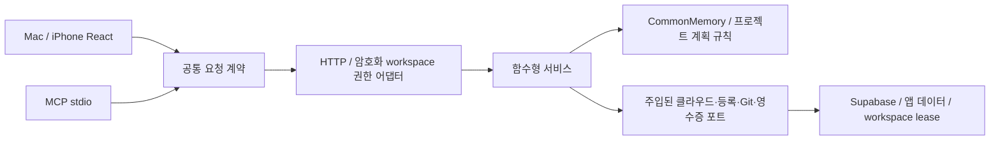

# 아키텍처 설계: 공통기억의 모바일 관리·프로젝트 묶음·Mac 메뉴

> ✅ 확정 아키텍처: 기존 함수형 서비스 + 분리된 bounded 원격 어댑터 + 공유 UI + 고정 구성 계획 (arch-choice 체크포인트, auto default)

## 개요

권장안은 기존 함수형 공통기억 서비스에 작은 원격 어댑터와 프로젝트 추가 서비스를 연결하고, Mac·아이폰·MCP에서 같은 요청 계약과 결과를 사용하는 구조다. 기존 `src/*.ts` 배치를 유지하며 클래스나 별도의 `src/domain` 트리로 재편하지 않는다. 기존 장기기억 파일과 단말별 메타 공통 기억은 각각의 원본·권한·저장소를 유지한다.

**확정된 기능 의미:** ‘공통기억으로부터 만들기’는 **현재 연결된 원본 프로젝트**를 이 단말에 가져오는 작업이다. 공통기억 초안에서도 구성 프로젝트를 확인할 수 있다. 공통기억의 게시 지식을 기존 원본 프로젝트에 자동 적용하지 않는다. 새로운 목표·공통기억 게시본을 프로젝트에 연결하는 작업은 기존 `ProjectCommonMemoryChoice` 및 명시적인 binding 흐름으로 별도 수행한다.

분석 기준은 공개된 HEAD `05164f9a9274004b134a3a868cd6fc6cef3b509b`와 2026-10-11의 해당 작업트리 편집본이다. 아래 실편집 코드의 관측은 구현 완료·테스트 통과를 의미하지 않는다. 도메인 명칭 및 Repository 시그니처의 정본은 [domain-analysis.md](domain-analysis.md)이며 이 문서는 그것을 개명하거나 새 계약으로 대체하지 않는다.

## 레이어 구조

| 레이어 | 기존 파일·확장 위치 | 책임 |
|---|---|---|
| Domain Layer | `src/commonMemory.ts`, `src/commonMemoryProjects.ts`, `src/gitCloneRequest.ts` | 목표·출처·게시본·적용 결과의 규칙, 구성 프로젝트 판정, 계획 비교, GitHub 주소 정규화 |
| Application Layer | `common-memory-server.ts`의 서비스 함수, `common-memory-projects-server.ts`의 주입된 함수형 실행 서비스 | 공통기억 관리·회상·binding, 원본 구성 조회, 프로젝트 추가 계획·단계 실행·영수증 복구 |
| Interface Adapters Layer | `src/commonMemoryRequest.ts`, `src/commonMemoryClient.ts`, `src/metaCommonMemoryRemoteHost.ts`, `src/metaCommonMemoryRemoteClient.ts`, `src/mobileWorkspaceGateway.ts`, React 화면 및 MCP 요청 변환 | 동일한 엄격 요청 계약, bounded DTO, 별도 권한 검사, 입력·출력·미확정 결과 표현 |
| Infrastructure Layer | `api-server.ts` 조립부, 기존 Supabase RPC·테이블, 앱 데이터의 영수증 파일, workspace lease·Git subprocess·등록 저장, Swift WKWebView | 실제 클라우드·파일·프로세스·연결·기기, 수명·동시 실행·중단 복구 |

## Domain Layer

### 정본 명칭과 불변식

`CommonMemory`, `CommonMemoryGoal`, `CommonMemorySelection`, `CommonMemorySourceHead`는 기존 도메인을 그대로 사용한다. `CommonMemoryProjectSource`, `CommonMemoryLocalProject`, `CommonMemoryProjectMember`, `CommonMemoryProjectPlan`, `planCommonMemoryProjects`, `validateCommonMemoryProjectPlan`은 현재 프로젝트 계획 모듈의 이름을 유지한다. 단계 영수증의 제안 명칭은 `CommonMemoryProjectReceipt`다.

- A+B와 B+C는 별개의 공통기억이다. B를 여러 묶음에서 사용해도 B의 원본 `memoryId`, CORE, 목표, 기존 pin을 합치거나 바꾸지 않는다.
- 존재 판정은 실제 등록 프로젝트의 검증된 `memoryId`를 우선한다. 표시 이름만으로 중복을 제거하지 않는다. 동일 저장소·상이한 기억, 폴더 이름 충돌, 읽기 실패를 ‘없음’으로 취급하지 않는다.
- 계획은 group version·goalVersion, 모든 source head/hash, 정규화된 GitHub 주소, scopeId, 등록 root ID 및 root identity를 고정한다. 현재 구성 가져오기이므로 publication revisionId를 요구하지 않는다. 게시 지식 적용의 경우에는 기존 `CommonMemorySelection` 검증을 그대로 사용한다.
- `planHash`는 변경 비교용 fingerprint다. 클라이언트가 계산할 수 있으므로 실행 권한이나 서버 서명이 아니다. 실행 직전에 서버가 신뢰할 수 있는 원본과 현재 단말 상태로 계획을 다시 만들고 비교한다.
- 프로젝트 구성 상태는 `present | missing | conflict | unavailable`의 기존 네 상태를 유지한다. GitHub 주소 부재인 `no-repository`는 `unavailable`의 구조화된 reason/message로 표현하고, 등록 폴더 접근 실패와 구별한다.
- 기존 프로젝트는 Git 자동 pull·remote 변경을 수행하지 않는다. GitHub 주소 변경 안내는 현재 주소·원본 주소를 제시하는 별도 확인 흐름이다.

### Repository Interface

Repository 메서드의 정본은 [domain-analysis.md의 Repository Interface](domain-analysis.md)다. 기존 `createCommonMemoryService` 반환 함수의 `Pick<ReturnType<...>>` 계약을 재사용한다. 신규 `projectsPlan`, `projectsAdd`, `projectReceipt`, 원본 binding 읽기는 그 문서의 시그니처를 그대로 구현한다. 이 문서에서 독자적인 Repository 서명이나 클래스 계층을 추가하지 않는다.

## Application Layer

### 서비스 조율

| 유스케이스 | 기존·확장 매핑 | 결과·경계 |
|---|---|---|
| 공통기억 초기화·목표 변경·검토·게시 | `createCommonMemoryService.action` | 기존 CAS/request receipt·원본 head 검증 유지 |
| 원본·공통기억 목록 및 항목 조회 | `catalog`, `list`, `inspect` | 서버 측 page 및 응답 byte/chunk budget, 전체 조회 여부 명시 |
| 목표 추천·회상·실제 적용 보고 | `recommend`, `recall`, `report` | 선택한 게시본 고정, 회상만으로 적용 성공을 판정하지 않음 |
| 현재 구성 프로젝트 가져오기 계획 | `projectSources` → `planCommonMemoryProjects` → `projectsPlan` | 초안 허용, 구성·원본·현재 단말·root 재검증, 경로 없는 preview |
| 계획의 구성 프로젝트 추가 | `projectsAdd({plan,requestId,memoryId})` | 호출당 **명시한 한 구성원**만 진행, 완료·남은 항목·문제 결과 |
| 미확정 작업 결과 확인 | `projectReceipt` + 동일 `requestId`/`planHash` | 읽기만 수행, 구성원 실행·다음 구성원 진행·자동 재시도 없음 |
| 원본 목표·pin 복원 | 원본 `binding` 읽기 및 기존 durable installer | 원래 프로젝트의 목표·게시 참조를 복원, 선택한 묶음의 지식을 자동 설치하지 않음 |
| 새 목표·게시본을 프로젝트에 적용 | 기존 `selections`, `installProjectCommonMemory`, `bind` | 현재 프로젝트 대상 권한·lease 필요, 구성 가져오기와 별도 선택 |

### 한 구성원 추가의 트랜잭션 경계

1. 등록 root ID를 실제 root에 다시 해석하고 root identity·현재 권한을 확인한다. 클라이언트 경로나 임의 port ID는 실행 근거가 아니다.
2. `projects-add`의 DTO는 `{plan,requestId,memoryId}`다. 영수증을 먼저 읽는다. 같은 requestId는 같은 planHash·memoryId에 결속하며 다른 계획 또는 구성원은 충돌이다. 이미 완료한 clone/복원/등록 단계는 그 구성원의 결과만 반환한다. 같은 requestId 재전송은 다음 구성원을 진행하지 않는다.
3. 아직 실행하지 않은 항목에 대해서만 현재 구성·GitHub 주소·source head·로컬 등록 상태를 재계산한다. 최신 `conflict`/`unavailable`을 실행 가능한 `missing`으로 취급하지 않으며 계획에 없던 항목을 새로 추가하지 않는다.
4. root lease 아래 안전한 staging 폴더에 clone하고 정규화된 origin과 실제 기억 계보를 검사한다. 기존 폴더를 덮어쓰거나 삭제하지 않는다. 새 요청에서 이미 점유된 폴더를 받아들이지 않는다. 재시작 복구로 기존 결과를 이어갈 때는 **이 작업이 이전에 기록한 durable 영수증의 폴더/projectId 소유 증거**를 요구한다. 공개 planHash+memoryId로 계산되는 marker만으로 소유를 증명하지 않는다. clone은 shell 문자열이 아닌 고정 argv로 실행한다.
5. Git에 기억 config가 포함되어 있으면 그 ID를 검증하고 보존한다. 기억이 별도 백업이면 기대한 source memoryId에 합류해 **Pull을 먼저** 수행한다. 빈 기억을 push해서 원본을 대체하지 않는다.
6. 원본 binding이 있으면 원래 goal·scope·정확한 historical selections를 읽어 복원한다. Git에서 제외된 `.agent-memory/common-memory.json`, `COMMON-MEMORY.md`, project intent는 clone만으로 휴대되지 않는다. 원본 binding을 확인할 수 없는 경우 성공과 구분해 ‘기억/목표 복원 확인 필요’를 반환한다. clone 중 원본 head가 바뀌면 기억 복원·등록 직전에 다시 비교해 멈추거나 계획에 고정한 exact revision만 복원한다. 현재 최신 revision으로 조용히 전환하지 않는다.
7. 검증한 폴더를 등록하고 단계·관측 결과를 durable 영수증에 반영한다. 현재 root/member 검증 결과와 완료 증거를 함께 기록해 restart 뒤도 재해석한다.
8. 응답은 해당 구성원 결과와 남은 구성원 목록이다. 부분 실패를 전체 rollback으로 숨기거나 완료된 폴더를 다시 clone하지 않는다. 사용자의 ‘계속 추가’는 **같은 계획 + 새로운 requestId + 명시적으로 선택한 다음 memoryId**로 한 구성원을 진행한다. `projectReceipt`는 읽기만 수행한다.

workspace lease의 소유권을 함수 조립부에서 한 번 정의한다. 이미 lease 안에 있는 서비스가 같은 root lease를 다시 기다리는 재진입 교착을 피한다. 등록 저장은 현재 데이터에 대한 merge를 사용한다. 동시 프로젝트 생성 뒤 오래된 ports 배열로 최신 등록을 덮어쓰지 않는다.

### 동의·연결·미확정 결과

모바일 cloud 관리 서비스는 클라우드 요청 전후와 쓰기 dispatch 직전에 active/consent를 확인한다. 이미 DB/Git에 dispatch한 작업은 응답을 받지 못해도 실제로 완료될 수 있으므로 성공·실패를 추측하지 않는다. 연결 끊김과 명시적인 권한 폐기를 같은 의미로 기록하지 않는다. 진행 중 단계의 실제 결과를 영수증에 남기고 다음 단계 실행 전에 현재 동의를 다시 확인한다. 영수증 확인은 임의 권한 확대나 작업 자동 재개가 아니다.

## Interface Adapters Layer

### 동일 계약, 별도 권한

`parseCommonMemoryRequest`를 HTTP·MCP·암호화 모바일 RPC의 동일한 입력 정규화기로 사용한다. 최상위 필드만 확인하고 중첩 plan/application/evidence를 신뢰하지 않는다. 각 동작의 필드 allowlist·UUID/hash·개수·길이·범위 검증 뒤 도메인 함수로 전달한다.

| 경로·동작 | 어댑터 | 권한·동작 의미 |
|---|---|---|
| `/api/common-memory/*` | localhost HTTP dispatcher | 기존 로컬 origin/관리 capability 경계 유지 |
| `agentstoz_use_*common_memory*` 및 구성 프로젝트 도구 | MCP stdio → 공통 dispatcher | 반환된 project/root IDs 사용, bounded page/요약과 누락 상태 표시 |
| `workspace.action = common-memory` | `mobileWorkspaceGateway` + 같은 multipart host의 `cloud` namespace | 직접 연결한 Mac의 `common-memory.manage` |
| `projects-add` | cloud dispatcher → 단계 서비스 | `common-memory.manage` **및** `projects.add`, 현재 execution consent |
| 원래 프로젝트 binding 변경 | 기존 project binding 경로 | 현재 프로젝트 target grant 및 필요한 memory 쓰기 동의; cloud 전체 관리만으로 허용하지 않음 |
| `workspace.action = meta-memory` | 기존 meta namespace/SQLite 서비스 | 기존 `meta-memory.manage`, cloud 관리 동의와 독립 |

기존 bulk mobile grant의 범위를 넓히지 않는다. 새 권한은 Mac의 연결 설정에서 별도 선택하고 scope label은 클라우드 전체 관리와 프로젝트 Clone·등록의 의미를 분명히 한다. peer device forwarding으로 host-wide 공통기억 권한을 우회하지 않는다. 오래된 host는 `goal-common-memory-v1` 지원 여부로 업데이트 안내를 반환한다.

### 원격 자원·page 경계

기존 transfer host 한 개를 재사용하고 `(owner, kind, rpcId)` namespace를 둔다. **전체 8개, owner 4개, TTL 5분**의 pool이 두 기억 기능에 함께 적용되며 별도의 무제한 pool을 만들지 않는다. 프레임의 escaped JSON byte 기준 4,000, workspace envelope 8,500 byte는 유지한다.

단순히 sourceEntries를 20개로 자르는 것만으로는 충분하지 않다. `inspect`의 전체 group state(최대 1MB)와 `list`의 최대 2,000개/8MB 결과도 원격에서는 별도 page가 필요하다. 목록·원본 항목·검토한 항목·적용 보고를 각각 서버에서 제한하고, 응답이 허용 wire chunk 수 안에 들어오는지 확인한다. **권장 응답 상한은 200개 wire chunk 이하**이며 초과 시 page 크기를 줄인다. 기존 300 transfer/min 안에서 upload/execute/read/release와 다른 정상 요청에 여유를 남기는 것이 목적이다.

연속 16개 clone을 하나의 multipart execute에 넣지 않는다. 5분 TTL보다 긴 작업의 완료 결과가 사라지는 문제를 한 구성원 호출과 durable 영수증으로 해결한다. 단일 단계도 제한시간 초과·앱 restart가 가능하므로 ephemeral transfer 버퍼를 완료 증거로 사용하지 않는다.

### Mac 메뉴·아이폰 UX

Mac은 **‘장기기억’과 ‘공통기억’을 같은 최상위 메뉴 깊이**에 둔다. 기존 `TopLevelTab`/`TOP_LEVEL_TABS` 순서, ARIA tab/tabpanel 연결, Arrow/Home/End 키보드 이동에 공통기억을 함께 반영한다. 공통기억 화면 안에서 ‘목표별 클라우드 공통기억’을 기본 화면으로, ‘이 Mac의 메타 공통 기억’을 별도 내부 선택으로 표시한다. 장기기억 화면에는 공통기억으로 이동하는 관계 안내를 두고 동일 관리 패널의 중복 인스턴스를 없앤다.

Mac·아이폰은 같은 `CommonMemoryPanel`에 주입된 transport/client를 사용한다. `isDeployedWeb()`만으로 실제 연결된 아이폰의 관리 기능을 차단하지 않는다. 화면이 닫혔을 때 조회를 시작하지 않으며 host/cloud 변경 때 이전 응답 generation을 무효화한다. 사용자 입력은 새 목록·상태 응답 때문에 초기화하지 않는다.

아이폰 초기 화면은 이름·목표·원본 선택을 중심으로 두고 고급 범위·검사 기준은 펼쳐 편집한다. 입력은 coarse/mobile에서 최소 16px, 주요 버튼·선택 label의 터치 영역은 44pt를 기준으로 한다. 키보드·동적 글자 확대·safe area 상태에서 저장·이어가기·오류 안내가 접근 가능한지 실제 기기에서 확인한다. pending 쓰기는 requestId와 payload를 유지하며 ‘결과 확인’과 ‘같은 구성원 요청 결과 확인’을 제공한다. 미확정 상태에서 새 UUID로 자동 재전송하지 않는다. 결과를 확인한 뒤 다음 구성원을 추가할 때만 명시한 memoryId와 새 requestId를 사용한다.

### 업데이트 안내

공통기억 조회 및 현재 기기 전환 시 bounded inventory를 비교해 ‘추가할 프로젝트 N개’, ‘확인 필요 N개’를 제시한다. 안내를 누르면 등록 root와 **현재 연결된 원본 프로젝트** preview로 이동한다. 누락 판정은 자동 clone 동의가 아니다. 단말별 오류·원본 주소 변경·기억 계보 충돌은 다른 상태로 유지한다. 자료 조회 실패를 ‘모든 프로젝트가 최신’ 또는 ‘없음’으로 표시하지 않는다.

## Infrastructure Layer

### 조립과 저장

`api-server.ts`는 Supabase client, 현재 consent 검사, root resolver, 등록 inventory, Git clone, 기억 복원, lease, 영수증 store를 서비스에 주입한다. 순수 계획 함수는 `fs`, Bun, React, Supabase를 import하지 않는다. 기존 `createCommonMemoryService(client, assertActive)`의 요청별 pinned client를 유지해 작업 도중 다른 클라우드로 전환되지 않게 한다.

클라우드 공통기억의 기존 CAS·immutable revisions·operations·applications·bindings 스키마를 유지한다. 이번 기능의 단말별 단계 영수증은 앱 데이터의 재시작 가능한 파일/기존 durability 도구를 사용하므로 새 DB 스키마가 필수라는 근거는 없다. 원본 binding을 읽는 경로는 기존 테이블에서 exact project memoryId와 scope를 검증한다. 새로운 DB 변경이 실제로 필요하면 별도 schema/RLS/idempotency 근거를 제시한 뒤 설계한다.

영수증 파일은 앱 소유 경로·0600·엄격 형식·원자 rename/fsync 및 보수적인 복구를 사용한다. 알려진 완료 기록은 정책상 정리할 수 있지만 미확정 작업을 용량 확보를 이유로 삭제하지 않는다. 원격 DTO는 실제 로컬 경로·명령·credential·서비스 키·원문 로그를 포함하지 않는다. 원본 프로젝트 수는 16개, 선택 공통기억은 8개, owner별 진행 계획·전송 수는 유한하게 제한한다.

Git은 기존 clone staging/timeout/non-interactive 인증 전략을 재사용한다. 접근 실패는 private repository 권한 또는 도구 문제로 구분해 보고한다. staging을 완료 폴더로 옮기기 전 root·폴더·origin·memory 계보 검증을 다시 수행한다. SDK도 원본 `memoryId`와 상대 경로 catalog를 보존한 등록 프로젝트로 취급한다. SDK 자동 준비는 `build-and-test`로 승인된 모듈 범위만 실행하며 다른 프로젝트의 arbitrary install scripts를 자동 호출하지 않는다.

### 학습·현재 근거 정합성

| 전달된 학습 | 현재 근거 | 적용 범위 |
|---|---|---|
| #171 기계 관리 기억 마커를 보존 | `project-memory-server.ts:1174-1175`, `common-memory-server.ts:181-184` | 기존 project-memory 마커에 일반 지침을 삽입하지 않고 공통기억 별도 마커·private capsule 사용 |
| #179 gitlink 자식 먼저 출하 | Git의 gitlink 구조에 해당할 때만 적용 | `git ls-files --stage`에서 실제 mode 160000 항목을 먼저 확인한다. 모든 SDK 폴더를 서브모듈로 단정하지 않음 |
| CI에서 검증이 강제된다는 과거 기억 | `.github/workflows/verify.yml:55-62,116-117,154-164` | 현재 Bun/Python/Rust와 native iOS 경로의 실행 근거를 유지한다. 본 기능의 실기기 통과 증거는 별도 필요 |
| poll/list가 실제 출력·응답을 굶겼다는 contested 기록 | `mobileWorkspaceGateway.ts:58-62`의 현재 bounded request budget | 화면 redraw만으로 네트워크 수신이나 실행 성공을 증명하지 않는다. 페이지 조회·상태 poll은 내용 변경 시만, 진행 조회는 bounded하게 수행 |

Contested 내용을 확정된 제품 사실로 승격하지 않는다. Antigravity 관련 과거 메모와 unrelated Starbucks 사례는 이번 기능의 구현·성공 근거로 사용하지 않는다.

### 검증·배포 경계

`typecheck`·Bun/Python·필요한 Rust/iOS 계약 회귀와 actual MCP stdio 결과를 수집한다. 실제 연결된 기기는 iPhone 13 Pro Max, iOS 26.3이며 ‘iPhone 13’ 제품군이라는 요청 맥락과 정확한 실측 모델을 함께 기록한다. noReset 및 foreground 확인을 사용하고 fixture pairing·production pairing 결과를 구분한다. 화면 편의성만으로 cloud mutation 또는 여러 Mac 동기화를 입증하지 않는다. 공식 Mac 설치용 산출물은 clean source와 원격 기본 브랜치 일치 가드를 통과한 후 만든다.

## 아키텍처 결정사항

| 결정 | 선택 | 이유 |
|---|---|---|
| 기존 코드 배치 | 함수형 모듈의 논리적 4레이어 매핑 | 전면 클래스/디렉터리 재편 없이 기존 검증·호환 계약 활용 |
| 기억 저장 | 클라우드 목표 기억·로컬 메타 기억 별도 | 동일 명칭으로 기존 권한과 데이터 의미가 바뀌는 일을 방지 |
| 구성 가져오기 의미 | 현재 source membership, draft 허용 | 사용자의 복수 프로젝트 clone 요구에 직접 대응; 새 지식 적용은 별도 명시 선택 |
| 여러 프로젝트 실행 | one-member 호출 + 단계 영수증 | 5분 전송 TTL, 연결 끊김, 부분 실패, 재시작 뒤 중복 clone 방지 |
| Mac 정보 구조 | 장기기억/공통기억 sibling 메뉴 | 목표별 관리 기능의 발견성과 기존 원본 프로젝트 기억의 관계를 분명히 표현 |
| 원본 pin 휴대성 | 기존 cloud binding 정확한 읽기·복원 | private/Git-ignored capsule은 Git clone만으로 이동하지 않음 |

## 설계 위험·가정·미해결

| 항목 | severity / confidence | 근거·처리 |
|---|---|---|
| planHash를 서버 권한으로 오인하면 조작된 member/root가 실행될 수 있음 | 높음 / 높음 | `src/commonMemoryProjects.ts:25-30`: SHA 비교만으로 발급 증명 불가. 서버 재계산·root/단계 재검증 필수 |
| 기존 target의 public marker를 신뢰하면 fresh 요청이 다른 작업의 폴더를 가져올 수 있음 | 높음 / 높음 | lead의 `common-memory-projects-server.ts` 편집본 검토: 기존 request의 durable receipt/identity로만 복구, 새 요청은 점유 폴더 거부 |
| inspector/list가 정상 큰 데이터에서 transfer byte·rate budget를 넘을 수 있음 | 높음 / 높음 | `common-memory-server.ts:27-38,85-93`, `src/metaCommonMemoryRemoteProtocol.ts:5`, `src/mobileWorkspaceGateway.ts:58-62`: whole state/list도 page 필요 |
| clone-only 구성과 지식 binding을 혼동하면 원본 목표·pin을 덮어쓸 수 있음 | 높음 / 높음 | root 정책 확정으로 해소: 구성 추가는 원본 복원만, 새 binding은 별도 선택 |
| Git-ignored 원본 binding을 복원하지 않은 채 원본 pin 보존을 주장할 수 있음 | 높음 / 높음 | `common-memory-server.ts:178-180` 및 현 서비스의 write-only binding: read/restore 결과를 별도 증명 |
| 호출당 한 member가 5분을 넘거나 앱이 종료될 수 있음 | 중간 / 높음 | transfer TTL는 결과 durability 아님. 단계 영수증 상태 읽기·수동 이어가기 필수 |
| GUI와 MCP의 결과·이유 명칭이 달라질 수 있음 | 중간 / 중간 | 기존 4상태를 유지하고 `no-repository`는 `unavailable`의 reason/message로 구별. 전 surface에서 같은 계약 검증 |
| 실제 기기 UX·production relay·private clone은 분석만으로 검증 불가 | 중간 / 높음 | 실제 실행 로그·화면·대상 프로젝트 등록 및 exact 기억 ID/파일 비교가 필요 |

이번 문서가 실행하거나 검증한 기능은 없다. 정책 결정은 확정되었고, 나머지 항목은 구현·검증 단계의 acceptance 기준이다. briefing_correction: 구성 가져오기의 publication revisionId 누락을 무조건 결함으로 보지 않도록 정정했다. 현재 source membership이라는 확정 의미에서는 group/source/root snapshot이 정본이다.

## 핵심 설계 결정

### 옵션 1 — 기존 함수형 서비스 + 분리된 bounded 원격 어댑터 + 공유 UI + 고정 구성 계획 (권장)

**레이어 목록:** Domain은 기존 `commonMemory.ts`/`commonMemoryProjects.ts`; Application은 `common-memory-server.ts`와 프로젝트 추가 서비스; Interface Adapters는 공통 request parser·HTTP/MCP/암호화 workspace·주입된 React 패널; Infrastructure는 기존 Supabase·local durable receipts·workspace lease·Git·WKWebView다.

**선택한 결정:** 현재 source membership을 한 구성원씩 가져오고, 지식 binding은 별도 명시 선택으로 유지한다. 원본 정체성·목표·pin, 기존 local meta 권한을 보존하며 Mac·아이폰·MCP가 같은 도메인과 request contract를 사용한다. **트레이드오프:** 새로운 저장소와 시스템을 최소화하고 기존 회귀를 활용할 수 있으나, 현재 큰 inspector/list 응답과 기존 UI의 transport 고정은 실제로 분리·pagination해야 한다.

### 옵션 2 — 서버에 장수 batch job + UI는 job 상태만 조회

**레이어 목록:** Domain은 동일한 기억·구성 계획; Application은 batch scheduler와 작업 상태 머신; Interface Adapters는 start/status/cancel 컨트롤러와 shared UI; Infrastructure는 별도 durable queue/worker·동의 복구·기존 cloud/Git다.

**트레이드오프:** 많은 구성원을 장시간 자동 진행하고 재접속 뒤 단순한 상태 조회를 제공한다. 반면 새 queue·취소·동의 수명·restart ownership을 관리해야 하고 사용자가 요청한 16개 이하 구성에 비해 구현·운영 범위가 넓다. 현재는 one-member 영수증으로 필요한 중단 복구를 확보하고, 실제 사용에서 자율적인 대량 설치가 필요하다는 증거가 생길 때 재검토한다.

### 옵션 3 — cloud 직접 모바일 접속 + Mac에는 clone만 위임

**레이어 목록:** Domain은 동일 기억·구성 규칙; Application은 모바일 cloud client와 별도 clone orchestration; Interface Adapters는 브라우저 Supabase auth/RLS 어댑터와 Mac clone 요청; Infrastructure는 모바일 cloud 세션·신규 RPC 권한 정책·relay·Git이다.

**트레이드오프:** 연결된 Mac이 없어도 클라우드 기억의 읽기·관리 접근이 가능하다. 반면 현재 service-role host 관리 계약과 다른 auth/RLS·receipt·source validation 경로를 새로 구현해야 하고 같은 오류·동의 계약이 두 군데로 갈라진다. 이번 실제 iPhone/Mac 연동 범위에서는 기존 암호화 host adapter를 재사용하는 옵션 1이 적합하다.
