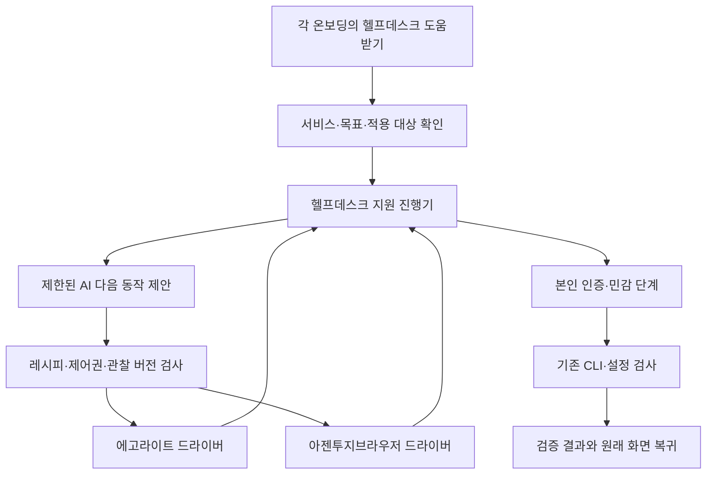

# 헬프데스크 도움받기 — 브라우저로 함께 진행하는 공통 온보딩

상태: 구현 전 계획. 작성일: 2026-10-31.

- 사용자 확정 명칭: **헬프데스크 도움받기(with 에고라이트 또는 아젠투지브라우저)**.
- 기준 소스: **`da76c2996dca259997f10becb858df107c5e020e` · build 1619**. 원격 `origin/main`과 빌드 번호 계산으로 확인했다.
- 작업 브랜치: `codex/onboarding-browser-help-20261031`.
- 작업 폴더: `/Users/cs-work/.codex/worktrees/onboarding-browser-help/AgentsToZ_byCS`.
- 이번 산출물은 계획 문서다. 앱 구현, 계정 가입, OAuth 승인, 설치·배포는 수행하지 않았다.

근거와 확인 한계는 [RESEARCH.md](RESEARCH.md), 구현 순서와 인수 조건은 [CHECKLIST.md](CHECKLIST.md)에 있다.

## 1. 만들 경험

사용자가 gws를 연결하려다 Google Console의 프로젝트·API·동의 화면·JSON 준비에서 막히면,
그 자리의 **헬프데스크 도움받기**를 누른다. 에고라이트 또는 아젠투지브라우저를 골라
헬프데스크와 현재 화면을 함께 진행하고, 본인 인증을 마친 뒤 앱에서 실제 연결 결과를 확인한다.

이 기능을 기존 헬프데스크의 공통 모드로 만든다. gws 전용 안내 복사를 개선하는 데서 시작해,
CLI 설치·등록, 서비스 가입, OAuth, API 키 준비, 모바일 연결의 각 입구에서 같은 모드를 연다.
일반적인 화면 이동과 준비 작업은 처음 선택한 범위 안에서 계속 진행하며 매 클릭마다 허락을 묻지 않는다.

완료 기준은 세 가지다.

1. 사용자가 긴 설명서나 프롬프트 복사를 거치지 않고 현재 단계의 도움을 시작한다.
2. 실제 조작, 사용자에게 넘긴 단계, 아직 확인하지 못한 결과가 화면에 드러난다.
3. 해당 계정·목적의 실제 검사가 성공해야 완료가 된다. 브라우저를 열거나 JSON을 넣은 것만으로 끝내지 않는다.

## 2. 기준 버전에서 재사용할 것과 추가할 것

| 현재 있는 것 | 이번에 연결할 것 |
|---|---|
| `HelpdeskPanel`의 상담·설치·서비스·AI 인증·gws·모바일 안내 | 같은 헬프데스크 안의 `브라우저로 함께 진행` 모드 |
| Google 설정 5단계 가이드와 정적인 Codex 인계문 | 현재 단계·브라우저·실제 검사와 이어지는 지원 세션 |
| Desktop JSON 파일 선택·드롭·검증·OS 자격 증명 저장 | 이 경로로 돌아오는 안내와 진행 연결. JSON 처리는 기존 코드가 계속 담당 |
| 격리된 공식 CLI 로그인과 실제 이메일 확인 | 로그인 작업 ID에 연결해 상태를 읽고 완료를 확인하는 공통 지원 어댑터 |
| 워크룸 브라우저의 사람/AI 제어권, 관찰, 동작 영수증 | 온보딩 소유자도 사용할 수 있는 제한된 브라우저 제어 코어 |
| 에고라이트의 TaskSpace·관찰·클릭·사람에게 넘기기 | 헬프데스크가 소유한 TaskSpace 하나를 관리하는 드라이버 |
| build 1619의 Mac 전체·프로젝트별·새 프로젝트 계정 선택 | 계정 추가 시 같은 도움받기 입구를 제공하고 원래 적용 범위를 유지 |

현재 헬프데스크의 상담은 설명용이다. Claude 실행은 도구를 끄고, Codex는 read-only 실행을 쓴다.
기존 `ask`를 호출하면 브라우저가 움직이는 것으로 간주할 수 없다. 브라우저 지원 실행 계약을 따로 만든다.
또한 현재 아젠투지브라우저 제어는 실행 중인 워크룸의 `sessionId/targetId`를 요구한다.
온보딩을 위해 가짜 프로젝트나 OPS 워크룸을 만들지 않는다.

## 3. 사용자 화면과 시작 방법

### 공통 입구

- 화면의 주 버튼: **헬프데스크 도움받기**.
- 지원 화면 제목: **헬프데스크 도움받기(with 에고라이트 또는 아젠투지브라우저)**.
- 시작 위치의 `서비스 / 목표 / 현재 단계 / 적용 대상`을 가져와 같은 내용을 다시 입력시키지 않는다.
- 이미 같은 지원이 열려 있으면 해당 진행 화면으로 이동한다. 다른 세션을 중복 생성하지 않는다.
- 기존 헬프데스크·Google 가이드와 모달을 중첩하지 않는다. 돌아왔을 때 입력 내용과 포커스를 복원한다.

### 시작 화면 예시

```text
Google Workspace 연결을 함께 준비해요
현재 단계: Google Console에서 데스크톱 앱 JSON 준비
적용 대상: 지금 추가하는 Google 작업 계정

진행할 브라우저   [에고라이트] [아젠투지브라우저]
도움을 줄 AI      [현재 헬프데스크에서 선택한 AI]

함께 할 일: 기존 프로젝트 확인 → 필요한 API·동의 화면 준비
직접 할 일: 로그인·추가 인증·최종 승인·JSON 다운로드와 앱 첨부

[이 범위로 함께 진행]  [직접 따라하기]
```

브라우저와 도움을 줄 AI는 별도 선택이다. 브라우저를 골랐다고 AI 앱·계정·모델을 바꾸지 않는다.
AI가 준비되지 않았다면 기존 설치·인증 버튼과 고정 안내로 계속 진행한다.
첫 AI CLI를 등록하는 데 다른 AI가 반드시 필요해지는 순환을 만들지 않는다.
초기 도움 AI는 현재 헬프데스크의 Codex·Claude를 대상으로 하며, 도움받을 CLI의 종류와 구분한다.

### 진행 화면

- `지금 진행 중인 단계`, `다음으로 할 일`, `검사 결과`를 같은 카드에 표시한다.
- 조작 중에는 `함께 진행 중`, 사람 차례에는 `직접 진행해 주세요`, 검사 중에는 `실제 연결 확인 중`을 표시한다.
- `잠시 멈추기 / 내가 직접 조작하기 / 이어서 진행 / 이 지원 끝내기`를 제공한다.
- 사람이 마우스·키보드로 인수하면 대기 중인 조작도 정지한다. 이어가기 전 새 화면을 확인한다.
- 화면을 닫으면 브라우저 조작과 AI 호출은 멈춘다. 이미 승인·시작된 CLI 로그인은 기존 수명대로 유지하고 결과를 나중에 조회한다.
- 완료에는 검사한 서비스·대상·시각과 남은 단계를 표시한다. 부분 성공은 그대로 남긴다.

## 4. gws 첫 적용 여정

| 단계 | 함께 진행하는 작업 | 사용자가 직접 처리하는 지점 | 완료 근거 |
|---|---|---|---|
| 1. 현재 상태 확인 | gws 설치, 선택한 클라이언트 준비, 기존 계정·진행 중 로그인 확인 | 사용할 Google 계정·프로젝트 선택 | 기존 호스트의 읽기 결과. 실패는 미확인 |
| 2. Console 프로젝트 | 기존 프로젝트를 찾고 선택한 프로젝트를 유지 | 새 프로젝트가 필요하면 구체적 생성 대상을 결정 | 선택한 프로젝트 식별과 후속 단계 일치 |
| 3. API·동의 화면 | 필요한 API, Branding, Audience, Test users 화면을 순서대로 진행 | 조직 정책·공개 범위·본인 정보에 대한 결정 | Console 단계별 확인. CLI 인증 완료와 별도 |
| 4. Desktop client | Clients에서 Desktop app 유형과 입력 내용을 준비 | 비밀값이 표시되기 전 생성 실행·JSON 다운로드·민감 화면 닫기 | 사용자가 앱에 직접 JSON 첨부 → 기존 검증·저장 성공 |
| 5. 공식 Google 인증 | 기존 격리 로그인 작업을 시작하고 상태를 추적 | 계정 선택·비밀번호·2FA·권한 승인·OS 확인창 | 같은 로그인 작업의 완료와 요청한 이메일 일치 |
| 6. 실제 연결 확인 | 해당 계정으로 기존 연결 검사 실행 | 추가 결정이 필요한 오류만 처리 | `drive about get`의 실제 사용자 확인과 앱의 연결 검사 성공 |
| 7. 원래 화면 복귀 | 처음 도움을 요청한 화면과 해당 계정으로 복귀 | 적용 범위에 맞는 기존 계정 선택 동작 | 선택한 범위에만 반영되고 다른 대상 유지 |

세부 결정:

- 처음에는 현재 앱과 같은 **Drive 읽기 권한**을 사용한다. 가이드에 있는 10개 API를 전부 켜거나 모든 scope를 일괄 승인하지 않는다.
- 이미 JSON이 있으면 2~4단계를 건너뛴다. 기존 OAuth client·프로젝트는 먼저 재사용 여부를 확인한다.
- **Console Desktop client JSON**과 고급 등록의 **기존 사용자 OAuth export JSON**은 서로 다른 파일이다. Web client·service account 키도 별개다. 기존 판별기를 그대로 사용한다.
- JSON·토큰을 AI 채팅에 넣거나 파일 경로를 받아 자동 수집하는 동선을 만들지 않는다. 앱의 기존 파일 선택·드롭이 파일 처리의 입구다.
- Google의 인증 정책에 맞는 외부 브라우저로 OAuth를 연다. 아젠투지의 CEF가 화면을 표시할 수 있다는 사실만으로 OAuth에 적합하다고 판단하지 않는다.
- 에고라이트도 실제 지원·정책 적합성을 확인한다. 인증 환경이 맞지 않으면 Chrome/시스템의 공식 인증 경로로 연결하고 완료 뒤 헬프데스크로 돌아온다. UA 위장이나 인증 차단 우회는 사용하지 않는다.
- Google 승인이 성공했어도 CLI 검사에 실패하면 인증/검사 결과를 나눠 표시한다. 다른 Google 계정으로 자동 대체하지 않는다.
- 이 여정으로 Supabase Google Provider, iPhone 로그인 또는 앱 운영 DB가 설정됐다고 표시하지 않는다.

## 5. 다른 온보딩으로 확장하는 방법

모든 입구는 같은 `AssistIntent`와 지원 화면을 사용한다. 서비스별 차이는 레시피와 검증 어댑터로 둔다.
공통 입구를 제공하는 것과 해당 서비스의 자동 조작을 지원하는 것은 구분해 표시한다.

| 적용 대상 | 연결할 기존 입구 | 실제 완료 기준 | 순서 |
|---|---|---|---|
| gws | Google JSON 준비·설정 가이드·헬프데스크 gws·계정 추가 | Desktop client 저장, 공식 로그인, 실제 이메일·Drive 검사 | 첫 수직 여정 |
| GitHub·Supabase·Vercel | 서비스 가입·CLI 계정 관리·1619의 `＋ 다른 계정 로그인해서 추가…` | 해당 공식 로그인과 계정 검사. 가입 화면만으로 완료되지 않음 | 다음 묶음 |
| Codex·Claude·agy·Hermes 등 AI CLI | 도구 준비·AI 인증·계정 추가 | 설치/인증/첫 응답을 별도 검사. 제공자별 현재 지원 범위 표시 | 같은 공통 입구로 순차 확장 |
| API 키 설정 | 해당 음성/기능 설정의 키 발급 안내 | 공식 발급 후 사용자가 앱 보안 입력란에 저장, 기존 연결 검사 | 후속 레시피 |
| 모바일·선택형 Google 로그인 | 헬프데스크 모바일 준비·Google Web client 안내 | 기존 저장소·Provider·허용 사용자 검사와 실제 폰 로그인 구분 | 후속 레시피 |
| 개인 포털·추가 기기·기타 준비 | 해당 온보딩 단계의 도움 버튼 | 해당 기능의 기존 검사. 배포/원격 승인 등은 그 기능의 기존 결정 단계 유지 | 후속 레시피 |

CLI 설치는 기존 제한된 설치 엔진이 담당하고, 브라우저는 공식 가입·설정·인증 화면을 돕는다.
Supabase 관리 계정 연결, 프로젝트 CLI 계정, 앱 DB 연결, 모바일 로그인 사용자는 각자의 목적을 유지한다.
Windows/Linux는 처음부터 동일 버튼을 둘 수 있으나 실제 지원되는 드라이버·호스트 동작만 제공한다.
Mac에서 Windows UI를 흉내 낸 결과로 Windows 지원 완료를 선언하지 않는다.

## 6. 실행 구조



### 6.1 앱이 실행하고 AI는 제한된 다음 동작을 제안

초기 구현은 앱이 브라우저를 관리하는 방식으로 한다. AI에는 해당 레시피에서 허용한 관찰과
`actionId / ref / 허용된 입력값`의 구조화된 응답만 요구한다. AI가 만든 셸·JS·URL·파일 경로를 실행하지 않는다.
결정적인 단계는 고정 동작으로 진행하고, AI는 현재 화면의 다음 대상과 설명을 고르는 데 쓴다.

- `관찰 → 제안 → 호스트 검증 → 동작 예약 → 실행 → 결과 관찰/영수증`의 순서다.
- 각 변경 동작은 현재 run·step·관찰 버전·제어권·대상과 결속한다. 모델 출력만으로 검사를 통과시키지 않는다.
- 페이지 본문은 참고 데이터다. 다른 도메인·계정·권한·셸 작업을 지시할 수 없다.
- 일반 상담의 `ask`, 상담 이력 저장 형식, 프로젝트 워크룸 프롬프트에 브라우저 원문을 섞지 않는다.
- 기존 Claude의 무도구 설정과 Codex의 read-only를 구분한다. Codex read-only만으로 파일 읽기·셸·MCP가 모두 차단됐다고 보지 않는다.
  선택한 CLI에서 제한된 planner 실행이 실제 가능한지 먼저 검증하고, 불가능한 버전은 자동 조작을 제공하지 않는다.
- AI 미연결·미지원·예산 소진 때는 고정 안내와 직접 진행으로 전환한다. 새 AI·모델을 자동 선택하지 않는다.

### 6.2 브라우저 드라이버

공통 계약은 준비 상태 확인, 작업 공간 연결, 제한된 관찰, 허용 동작, 사람에게 넘기기, 결과 조회, 종료다.

**에고라이트:** 설치된 `ego-browser skill`의 현재 API를 기준으로 한다. 한 지원 목표에 TaskSpace 하나를 만들고,
`spaceId/page label`을 확인해 이어간다. `handOff` 후에는 사람 확인 없이 다시 제어하지 않는다.
범용 `nodejs/evaluate/CDP`를 AI에게 제공하지 않고, 호스트의 고정 드라이버 안에서만 사용한다.
기존 개인 탭이나 브라우저 프로필을 임의로 가져오지 않는다.

**아젠투지브라우저:** 기존 CEF·관찰·영수증 코어를 재사용하고 소유자를
`workroom(sessionId,targetId)` 또는 `onboarding(assistRunId)`로 구분한다.
기존 워크룸 계약은 유지하며 온보딩 소유권의 생존·철회 검사는 서버가 한다.
현재 `WorkroomBrowserHost`의 실행 중 워크룸 검사를 단순 삭제하지 않는다.

기존 워크룸 브라우저의 탐색 시 제어권 철회는 그대로 유지한다. 온보딩에서는 처음 검토한 준비 단계의
예상 탐색을 연속 처리하는 별도 제한 권한을 둔다. 이동 직전에 예상 목적지·단계를 예약하고,
도착한 정확한 origin/path와 허용 상태를 **관찰 전에** 검사한다. 이동 후에는 새 epoch·관찰을 사용한다.
로그인·비밀 화면·예상하지 못한 목적지는 사람에게 넘긴다. 기존 Workroom grant를 자동 재발급하는 방식은 쓰지 않는다.
이 경계가 검증되지 않은 드라이버는 단계별 안내만 제공하며 자동 진행을 지원한다고 표시하지 않는다.

두 드라이버 모두 숨김 DOM·브라우저 저장소·쿠키·네트워크 본문을 AI에 제공하지 않는다.
초기 Google 지원은 안전한 준비 화면의 제한된 요소만 관찰하며, 전체 화면 캡처는 기본값으로 켜지 않는다.
비밀번호 필드 하나를 가리는 것만으로 JSON 결과·OTP·토큰 화면이 보호됐다고 주장하지 않는다.
민감 단계에 들어가기 **전** 관찰과 AI 호출을 중지하고, 사용자가 닫은 뒤 새 관찰로 재개한다.

### 6.3 상태·저장·API

```text
prepared → checking → assisting → waiting-human → verifying → completed
                       ↕ paused                    ↓
                    needs-review ← interrupted / failed
어느 단계에서나 cancelled 가능. completed는 검증기만 기록한다.
```

- 지원 세션에는 `recipeId/version`, `runId/revision`, 시작 화면, 목표·적용 범위, step 상태,
  기존 설치/로그인/검사 작업의 ID, 비밀 없는 영수증 요약을 저장한다.
- 브라우저 grant·인증 URL query/fragment·코드·JSON·키·토큰·DOM·스크린샷·AI 내부 제안 원문은 저장하지 않는다.
- 기존 `onboarding/progress` v1은 허용 도구·키가 엄격하고 gws도 포함하지 않는다.
  무리하게 키를 추가하지 않고 `onboarding/assistance-v1.sqlite`에 지원 세션의 연결 정보만 둔다.
  설치·인증·계정·설정 상태의 정본은 기존 호스트와 저장소다.
- 앱 재시작으로 브라우저 조작 권한은 복구되지 않는다. 이전 작업 결과를 조회하고 새 제어권을 받아 이어간다.
- 로컬 관리 경로 제안: 정확한 `POST /api/onboarding/assistance`를 기존 onboarding capability 허용 목록에 추가한다.
  `capabilities / prepare / start / status / pause / resume / cancel / verify`만 정의하고 임의 경로·명령은 받지 않는다.
- `prepare`는 가능한 드라이버와 할 일을 보여준다. `start`는 사용자가 검토한 범위와 revision을 받아 실행한다.
  브라우저 원문과 비밀은 응답 DTO에 없다. 에이전트 MCP 신설은 초기 구현의 전제조건으로 두지 않는다.
- 초기에는 로컬 설치 Mac이 제어 주체다. 기존 휴대폰·다른 기기 권한에 브라우저 조작을 자동 추가하지 않는다.

### 6.4 build 1619 계정 전환과의 결합

지원 의도에는 **계정 추가 / 첫 기기 준비 / 특정 프로젝트에 적용 / Mac 전체 전환**을 구분해 넣는다.
`provider`, `purpose`, 목표 계정/프로젝트, 적용 범위를 요청 ID 결속에 포함하고 변경되면 이전 실행을 멈춘다.

- `login-add-start`는 계정 추가 용도다. 이 Mac 전체 전환은 기존 `native-switch`의 사용자 선택으로만 한다.
- gws는 현재 이메일을 직접 지정하는 로그인 경로다. 이메일 자동 발견을 전제한 `login-add-start`를 그대로 호출하지 않고,
  원래 이메일 검증과 계정 추가 목적을 함께 보존하는 어댑터를 연결한다.
- 첫 설치의 빈 기본값 준비와 다른 계정 추가를 합치지 않는다. `login-onboarding-start`와 기존 이메일 지정 로그인도 목적을 유지한다.
- 프로젝트에서 시작한 추가는 확인된 계정만 해당 프로젝트로 돌려준다. 다른 프로젝트 binding과 실행 중 작업은 유지한다.
- 새 프로젝트의 계정 선택은 등록 완료 시 기존 적용 함수가 처리한다. 지원 세션을 위해 프로젝트를 먼저 생성하지 않는다.
- gws는 Mac 전체 native 전환을 지원한다고 표시하지 않는다. 현재 아젠투지 기기 기본값·프로젝트 연결 규칙을 따른다.
- 도움 시작·완료를 이유로 shell 시작 파일·git helper·CLI 전역 로그인·앱 DB 연결을 새로 수정하지 않는다.
  원래 사용자가 선택한 계정 적용 동작은 기존 1619의 처리와 영수증을 재사용한다.

### 6.5 중단·경합·자원

- 같은 의도의 재시도는 같은 requestId로 결과를 조회한다. 결과 미확정인 프로젝트/client 생성은 새 ID로 반복하지 않는다.
- 같은 브라우저 탭과 같은 로그인 작업은 한 지원만 소유한다. 기존 admission lock과 계정 검사 잠금을 우회하지 않는다.
- 취소·사람 인수 뒤 도착한 늦은 AI 제안·CLI 응답은 원래 epoch/revision으로 검사하고 조작이나 완료를 덮어쓰지 못하게 한다.
- 브라우저 미연결·프로필 변경·계정 불일치·조직 차단·CAPTCHA는 이유와 다음 동작을 표시한다. 자동 재로그인으로 해결하지 않는다.
- 기존 로그인 10분 제한과 브라우저 탭·대기열 상한을 유지한다. 초기 지원은 한 번에 한 조작 루프만 실행한다.
- AI는 새 관찰로 다음 동작을 정해야 할 때만 호출한다. 로그인 대기·상태 폴링·재개 결과 조회는 AI를 호출하지 않는다.
- 지원 화면이 보일 때 단일 상태 조회 타이머만 둔다. 닫힌 화면의 DOM 조회·스크린샷·AI 호출을 계속하지 않는다.
- 지원 자체에 동작 수·시간·응답 크기 예산을 두고 도달하면 같은 run을 일시 정지한다. 초기 수치는 드라이버 실측 후 CHECKLIST의 게이트에서 확정한다.

## 7. 구현 묶음과 출시 기준

1. **P0 — 연결 가능성 확인:** 두 드라이버의 관찰·사람 인수·권한 철회, AI 제한 실행,
   워크룸 없는 CEF 연결, Google 인증 경로를 검증한다. 검증하지 못한 조합은 사용할 수 없다고 표시한다.
2. **P1 — 공통 기반:** 헬프데스크 지원 모드, intent·run·revision·영수증, 제한된 planner/driver 계약,
   로컬 관리 API와 기존 화면 복귀를 구현한다. 가입이나 client 생성 없이 fixture로 경계를 확인한다.
3. **P2 — gws 수직 여정:** 기존 JSON 있음/없음, 두 브라우저, 잘못된 계정, 중단·재개,
   실제 연결 검사까지 완성한다. 복사 전용 인계문은 수동 대안으로 남긴다.
4. **P3 — CLI·계정 공통 적용:** GitHub·Supabase·Vercel과 1619 계정 추가 입구,
   AI CLI 설치·인증에 같은 컴포넌트를 적용한다. 서비스별 검사기를 연결한 것만 자동 지원으로 표시한다.
5. **P4 — 나머지 온보딩:** API 키·모바일 Google Web client·추가 기기·개인 포털로 레시피를 확장한다.
   기존 설정·승인·실기 확인을 재사용한다.

첫 출시의 제품 범위는 **공통 기반 + 두 브라우저의 준비 화면 지원 + gws 실제 연결 확인**이다.
각 묶음은 기존 정상 흐름을 유지하고 독립적으로 검토·검증한다. 첫 구현에서 계정 저장소나 브라우저 엔진 전체를 재작성하지 않는다.
두 번째로 다른 제공자 한 곳을 붙여 공통화가 실제로 가능한지 확인한 뒤 나머지를 넓힌다.

출시 검증은 소스 계약, 격리된 화면 시험, 서명된 설치 Mac의 실제 브라우저·공식 인증·CLI 결과를 구분한다.
기존 OS 사용자의 새 HOME이나 새 Ego TaskSpace를 새 기기의 인증 격리 증거로 삼지 않는다.
세부 작업·행동 기반 회귀·페르소나 여정·남은 결정을 [CHECKLIST.md](CHECKLIST.md)에 기록한다.
