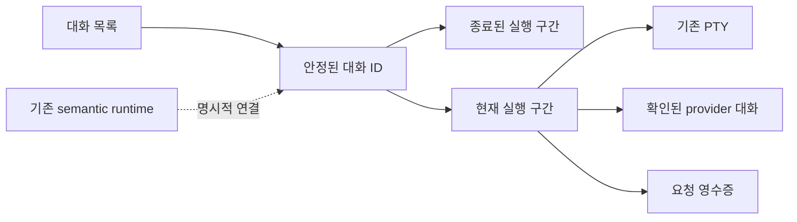
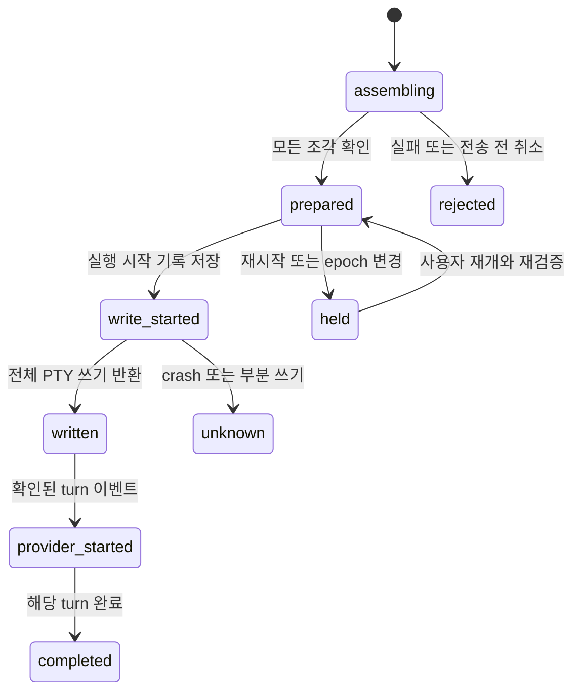

# 대화 복원과 원격제어 개선 설계

2026-10-13 · 설계 초안 v1 · 기준 소스 `8711599f3c928437063a80d3744d36a2cc734db3`

사용자는 앱을 다시 열어도 하던 대화를 찾고, 휴대폰 연결이 끊겨도 작성 내용과 요청 상태를 확인할 수 있어야 한다. **같은 대화의 복원 → 요청 접수·전달 상태 → 원격 재연결 → 대기열·결과 검토** 순서로 개선한다. 안정성 기반을 먼저 구현하면서 제목과 보관함 등 대화 UX를 함께 설계한다.

현재 PTY 실행, 큰 대화 창, 기기별 목록, 화면 스냅샷, QR/SAS/E2EE를 기반으로 한다. 이 문서는 구현 가능한 설계안이며 제품 코드의 구현·출하 기록은 아니다. [연구 근거](../../research/rea-chatgpt-sessions-remote-2026-10-13.md)

첫 A+B 구현과 검증 범위는 [구현 기록](EXECUTION.md)에 분리했다. 아래 API·테이블·원격 권한 중 후속 단계의 제안은 현재 지원 기능으로 해석하지 않는다.

## 1. 제품 계약

| 결정 | 적용 기준 |
| --- | --- |
| 대화와 실행 세션의 ID 분리 | 앱 재시작 뒤 대화 ID는 유지하고 실제 재개 때 새 PTY 실행 구간을 연결 |
| 목록 복원과 실행 재개 분리 | 시작 시 목록만 복원. 실행은 사용자의 `이어 열기`로 시작 |
| 현재 Mac에서 먼저 검증 | Codex/Claude의 증명 가능한 대화 재개부터 제공. Windows와 다른 provider는 실제 지원 확인 뒤 적용 |
| 기기·계정·프로젝트 결속 유지 | 과거 대화를 현재 기본 계정이나 동명 프로젝트로 조용히 연결하지 않음 |
| 요청 접수와 AI 실행 구분 | Mac 접수·PTY 쓰기·provider turn 시작을 확인 가능한 범위까지만 표시 |
| 미확정 실행은 자동 반복 금지 | 같은 요청 ID로 상태 조회. 실행 여부를 입증하지 못하면 `결과 확인 필요` 유지 |
| 원격 권한은 별도 판정 | 새 보관함 조회와 앱 재시작 후 재개를 기존 연결에 암묵적으로 부여하지 않음 |
| 기존 두 실행 방식의 정본 유지 | PTY와 semantic runtime을 명시적으로 연결하되 서로의 상태·영수증을 덮어쓰지 않음 |

## 2. 사용자가 보는 화면

### 대화 목록

기존 `대화 세션` 진입점을 유지한다. 필터는 `실행 중`, `종료된 대화`, `보관함`으로 구성하고 기기·프로젝트 검색을 유지한다. 보관은 목록에서 숨기는 동작이며 실행 종료나 provider 기록 삭제를 수행하지 않는다.

각 행에는 사용자 제목, 원래 기기, 프로젝트/worktree, AI·계정 표시 이름, 확인된 상태와 시각을 보여 준다. 제목이 없으면 기존 프로젝트·AI·시작 시각으로 표시한다. 제목 생성에 추가 AI 호출을 넣지 않는다.

| 행 상태 | 첫 번째 동작 | 보조 동작 |
| --- | --- | --- |
| CLI 실행 중 | `대화 열기` | 이름 변경·보관 |
| 같은 대화 재개 가능 | `이어 열기` | 기록 정보·보관 |
| 대화 식별 확인 필요 | `확인하기` | 새 대화 시작 |
| 원래 프로젝트·계정 없음 | `연결 확인` | 기록 정보·보관 |
| 원래 기기 응답 없음 | `다시 확인` | 보존된 목록 보기 |
| 권한 없음·만료·철회 | `연결 설정 확인` | 보존된 상태 설명 |

첫 단계의 ‘기록 정보’는 제목·실행 이력·재개 가능 여부다. 마지막 terminal 화면이 남아 있다면 별도로 보여 준다. 원문 대화 전체를 새로 수집하는 기능으로 표시하지 않는다.

PTY만 관찰할 때는 `CLI 실행 중`, `터미널 전달 확인`을 사용한다. `AI 답변 중`, `완료`, `승인 필요`, `읽지 않은 답변`은 해당 실행 방식의 확인된 이벤트가 있을 때 제공한다. 최근 출력 시간을 마지막 발언 시간으로 바꾸지 않는다.

### 대화 창

헤더는 `제목 · 기기 · 프로젝트/worktree · AI/계정`이다. 상태와 다음 행동은 작성칸 가까이에 둔다. 창 닫기는 보기만 닫는다. 저장·종료는 기존 SessionFooter의 확인과 영수증 검사를 유지한다.

재개 중에는 초안을 보여 주되 전송을 잠근다. 실패하면 원인에 맞는 버튼을 제공하고 초안을 유지한다. 다른 대화로 자동 전환하거나 새 CLI를 만들어 실패를 감추지 않는다.

첫 단계는 기존 terminal 화면을 사용한다. 후속 단계에서 같은 창 안에 `대화/터미널/변경 사항`을 제공하되 원문 수집과 구조화된 결과 조회의 지원·동의를 각각 확인한다.

### 요청 상태

| 표시 | 근거 | 사용자 동작 |
| --- | --- | --- |
| 작성 중 | 아직 전송하지 않음 | 편집 |
| 전송 준비 중 | 요청 조각을 모으고 있으며 PTY에는 쓰지 않음 | 진행 확인·전송 전 취소 |
| 휴대폰에 보관 중 | 기존 relay outbox에 동일 envelope가 남음 | 연결 확인·고정 전달 기한 표시 |
| Mac 접수 확인 | 영속 manifest/receipt 저장 성공 | 상태 조회 |
| 터미널 전달 확인 | 전체 입력의 PTY 쓰기 반환 | terminal 화면 확인 |
| AI 실행 확인 | 정확한 provider turn 시작 이벤트 | 지원되는 추가 지시·중지 |
| 결과 확인 필요 | 부작용과 기록 사이 crash·응답 유실·부분 쓰기 | 같은 ID로 결과 확인 |

연결 복구만으로 미확정 상태를 지우지 않는다. Mac 접수는 모델이 요청을 이해했거나 실행을 시작했다는 의미가 아니다.

## 3. 대화와 실행 구간



`logicalConversationId`는 UI의 대화 정체성이다. `executionSegmentId`는 한 번의 실행이며 `terminalSessionId`는 그 구간의 PTY다. `providerConversationId`는 호스트 내부에서만 사용한다. 동일한 ID 문자열도 기기·계정이 다르면 같은 대화가 아니다.

첫 단계는 `backendKind=pty`만 등록한다. 기존 semantic runtime은 별도 mapping으로 연결하며, 같은 provider 대화를 두 방식에서 동시에 실행하지 않는다. 동일한 대화임을 증명하지 못한 mapping은 병합하지 않는다.

## 4. 저장 구조

계정 전용 app-data에 새 `workroom-history.sqlite`를 두는 안을 선택한다. 기존 `agent_runtime_conversations`에 PTY를 넣으면 필수 model·turn·provider binding과 상태 계약을 깨뜨리므로 별도 저장소가 적합하다. SQLite 트랜잭션·파일 권한·오류 처리 방식은 현재 journal 구현을 참고한다. 공유 Control 폴더나 프로젝트 기억에 실행 DB를 두지 않는다.

| 테이블 | 주요 필드와 제약 |
| --- | --- |
| `workroom_conversations` | logical ID, host identity, backend kind, target ID, workspace identity digest, provider, account ID, launch-policy reference, title, archivedAt, revision, createdAt, observedActivityAt |
| `workroom_execution_segments` | segment ID, logical ID FK, host boot ID, terminal session ID, startedAt, endedAt, exit reason, input revision, observation state |
| `workroom_provider_bindings` | logical ID FK, provider conversation ID, account/profile revision, 증거 종류·digest·시각, 검증 상태 |
| `workroom_resume_receipts` | 인증된 owner + request ID UNIQUE, logical ID, 이전/새 segment, intent digest, prepared/launching/completed/unknown, 결과 revision |
| `workroom_submission_receipts` | owner + submission ID UNIQUE, logical/segment ID, payload digest, input revision, writer epoch, 상태·시각, 제한된 write 진행 정보 |
| `workroom_write_epochs` | segment ID, writer owner, epoch, expiry, input revision. 현재 boot에 결속 |
| `workroom_read_watermarks` | 후속 구현. 허용된 viewer + logical ID, 확인된 event cursor |

schema version과 migration을 명시한다. 미래 schema, 손상, 소유권 불일치에서는 기존 파일을 덮어쓰지 않는다. DB 권한은 macOS/Linux의 0600과 Windows의 기존 private ACL 계약을 사용한다. SQL transaction 안에서 CLI 실행, 네트워크, 파일 탐색을 await하지 않는다.

저장소마다 영속 `storeInstanceId`를 둔다. capabilities·검토·영수증 조회는 이를 같은 host의 DB 계보로 확인한다. 다른 저장소의 빈 조회를 과거 요청의 미실행으로 해석하지 않는다. 손상된 저장소를 새 ID의 빈 DB로 자동 교체하지 않는다.

초기 저장은 metadata와 digest다. raw prompt, terminal stream, 환경변수, 인증정보는 저장하지 않는다. 본문이 필요한 초안·대기열 저장은 별도 opt-in 암호화 계약을 두고 project-memory 동의를 재사용하지 않는다. DB는 이 host의 정본이며 Supabase로 자동 업로드하지 않는다.

## 5. 같은 대화 재개

1. 앱 시작 시 이전 boot의 실행 구간을 `detached/ended/unknown`으로 분류한다. PID가 있다는 이유만으로 자신의 CLI에 다시 연결하지 않는다. 현재 AiTerminalService가 유지하는 live session의 표시는 계속한다.
2. `이어 열기`는 `resume.review`로 원래 host, 등록 target, canonical workspace와 identity digest, account/profile, provider의 저장된 대화, 현재 writer 충돌을 확인한다.
3. 결과에 `reviewId`, expected revision, binding digest와 짧은 유효기간을 포함한다. 정상 결과라면 같은 클릭 흐름에서 `resume.execute`까지 진행하며 매번 추가 확인창을 넣지 않는다.
4. 실행 직전 grant·account·target·provider binding을 다시 확인한다. DB에 실행 시작 방지 기록을 저장한 뒤 원래 provider 대화로 새 PTY를 시작한다. 새 실행 구간은 같은 logical ID에 연결한다.
5. 시작 영수증을 확인한 뒤 snapshot을 읽고, 이후 delta를 같은 실행 구간·복구 세대에 결속한다. 이전 초기 프롬프트를 다시 보내지 않는다.
6. 시작 도중 crash는 `unknown`으로 남긴다. 영수증과 정확한 실행 증거를 대조하기 전에는 두 번째 CLI를 자동 시작하지 않는다.

서로 다른 요청 ID의 동시 재개도 막아야 한다. 짧은 `BEGIN IMMEDIATE` 트랜잭션에서 expected revision, 현재 실행 구간, 다른 재개 예약이 없는지 확인하고 대화 revision 증가와 launch receipt를 함께 저장한다. 같은 ID는 기존 영수증을 반환하고, 다른 ID의 경쟁 요청은 `CONVERSATION_BUSY` 또는 `REVIEW_STALE`로 거절한다. 실제 spawn은 transaction 밖에서 수행한다.

원래 계정이 삭제·변경됐을 때 다른 계정을 자동 선택하지 않는다. 새 실행 구간은 현재의 안전한 실행 정책을 다시 평가하며 원래 제한을 재현할 수 없다면 재개를 중단한다. 임시 권한 완화를 기억되는 기본값으로 만들지 않는다.

### Provider별 증거

| Provider | 먼저 사용하는 근거 | 증명하지 못한 경우 |
| --- | --- | --- |
| Claude | 시작 시 session ID, 실제 account root, 저장된 user turn. 기존 `claudeConversationSaved` 재사용 | 재개 동작을 막고 이유 표시 |
| Codex | 기존 `resolveAiTerminalResume`의 writer lock 또는 유일한 rollout 증거. 확인한 ID를 저장하고 재개 시 재검증 | 여러 후보라면 추정 재개 금지. live PTY 보기 유지 |
| Hermes/agy | 현재 resolver는 재개 ID를 반환하지 않음 | metadata·live 보기 제공. 재개 가능으로 표시하지 않음 |
| Windows | 기존 Codex resolver의 fallback은 있으나 실기 검증 필요 | 실제 Windows PC 검증 전 cold resume의 출하 gate를 열지 않음 |

binding 수집은 시작, 첫 저장 turn 관측, 정상 종료의 경계에서 수행한다. 상시 전체 rollout을 탐색하지 않는다. 정확한 provider hook/event 도입은 설치 CLI의 schema와 출처를 검증하는 후속 과제로 둔다.

## 6. 긴 입력을 준비한 뒤 전달

기존 raw `input`은 문자·방향키·CLI 메뉴에 유지한다. 작성칸의 명시적 자연어 제출에는 새 `submission` 계약을 추가해 현재 `splitTerminalSubmission`의 부분 입력 문제를 줄인다.

manifest는 `existing-segment`와 `new-conversation`을 구분한다. 새 대화의 첫 요청도 전부 준비한 뒤에만 spawn에 전달하고, launch receipt와 submission ID를 결속해 이중 시작을 막는다. 기존 대화 재개에는 이전 첫 요청을 넣지 않는다. 첫 적용은 텍스트와 opaque 참조 ID이며, 이미지가 포함된 기존 제출은 현재 경로·지원 표시를 유지한다. 새 receipt 기능을 이미지에도 제공하려면 attachment 계약을 별도로 검증해야 한다.

```text
같은 submission ID
  → begin(manifest, size, digest)
  → chunk(index, base64 bytes) 집계
  → commit(완전성·revision·writer epoch·grant 검증)
  → 영속 write_started 기록
  → 기존 writeAiTerminalInput으로 PTY 쓰기
  → written 또는 unknown 영수증
```

PTY에 쓰기 전에 전체 UTF-8, 합계 크기, digest, 참조 프로젝트 allowlist를 확인한다. 중복 chunk는 같은 index와 digest만 받는다. 미완성·timeout·상한 초과·권한 소실 때 Enter를 보내지 않는다. 기존 CPR/DA, paste, 한글, 이미지·참조 프로젝트 규칙을 유지한다.

참조 ID를 실제 폴더 설명으로 확장한 뒤에도 최종 전달 크기를 다시 검사한다. 새 대화는 launch 직전, 기존 대화는 PTY 쓰기 직전에 현재 target·account·권한을 확인한다.

초기 admission 안은 요청당 24,000 UTF-8 bytes, chunk당 4,000 raw bytes, 최대 6개다. base64와 DTO의 실제 encoded bytes를 검사해 기존 8,500-byte workspace message 상한을 지킨다. 이는 새 제출 계약의 한도이며 기존 raw terminal 붙여넣기를 줄이는 변경이 아니다. 편집 초안 1MiB 상한은 전송 한도와 별도로 유지한다.

조립 본문은 크기가 제한된 메모리에만 둔다. 재시작 후 `prepared`는 같은 manifest로 재업로드할 수 있으나 이전 boot의 요청을 자동 commit하지 않는다. 현재 grant·epoch를 확인한 명시적 재개만 받는다. `write_started` 이후 영수증이 있다면 본문 재업로드가 재실행을 만들지 않는다.

PTY 쓰기와 SQLite는 하나의 트랜잭션이 아니다. `write_started` 직후 crash는 실제로 썼는지 알 수 없어 `unknown`으로 남긴다. 짧은 write나 중간 실패도 같은 원칙을 적용한다. **자동 중복 실행을 막는 설계이며 외부 CLI의 exactly-once나 AI 접수 완료를 보장하지 않는다.**

commit은 현재 input revision·writer epoch를 확인하며 실행 구간의 쓰기 자리를 원자적으로 예약한다. 기존 raw 입력도 같은 예약을 확인한다. 한 제출의 쓰기가 끝날 때까지 새 입력과 writer 전환이 끼어들지 않는다. 실제 쓰기는 기존 input revision 규칙을 유지하고, 부분 실패 뒤에는 현재 revision·미확정 상태를 반환해 이전 revision의 제출이 이어 쓰이지 않게 한다.



`status`에 기록이 없다는 이유만으로 미실행이라고 판정하지 않는다. 동일한 host·DB 계보·owner 범위이고 부작용 전 기록이 반드시 남는 계약을 확인해야 한다. 다른 DB나 새 계정의 빈 조회는 안전한 재실행 근거가 아니다.

## 7. 동시 입력과 화면 크기

현재 input revision과 세션별 queue를 유지하면서 자연어 제출·raw 입력이 같은 실행 구간을 다룰 때 write epoch를 추가한다. 여러 단말의 보기는 가능하고 입력 소유자는 하나다.

lease 초기안은 30초다. 입력 소유자의 입력 또는 보이는 화면의 상태 조회로 갱신한다. 시간만으로 권한을 주지 않으며 host boot·owner·connection/grant·segment·epoch·input revision을 실행 직전에 검증한다. epoch는 단조 증가하고 이전 boot의 lease는 부활하지 않는다.

`이 화면에서 조작하기`는 명시적 전환이며 다른 단말의 AI 작업을 종료하지 않는다. 전환은 epoch를 올려 이전 epoch의 미실행 입력을 무효화한다. 현재 PTY 쓰기는 중간에 잘라내지 않고 한 제출의 쓰기가 끝나는 경계에서 전환한다. 중지·저장·명시적 종료의 기존 안전 경로를 일반 입력 queue에 가두지 않는다.

raw 입력도 같은 gate를 통과하며 provider writer 충돌은 별도로 확인한다. PTY 크기는 현재 전면 창 규칙을 유지하되 submit 쓰기 중 resize는 미룬다. 상태·snapshot 조회와 CPR/DA 응답은 사용자 입력으로 세지 않는다.

## 8. 원격 복구와 권한

복구 순서는 `유효한 기존 연결 → grant → target/account/segment → 영수증 → snapshot/cursor → 입력 활성화`다. 일상적인 연결 단절은 해지가 아니며 재연결은 권한 확대가 아니다. host가 응답하지 않는다는 이유로 잠자기 중이라고 단정하지 않는다.

새 workspace action은 `workroom-history-v1` capability로 교섭하고 기존 E2EE envelope 안에 넣는다. 로컬 endpoint는 기존 Agent Runtime 관리 capability를 사용한다. 새 LAN/relay 포트나 provider app-server를 공개하지 않는다.

저장된 metadata 조회와 cold resume는 기존 live terminal 조작을 넘어서는 기능이므로 새 프로젝트별 scope를 제안한다.

- `workroom.history.read`: 저장 metadata와 재개 가능성 조회.
- `workroom.history.resume`: 확인된 같은 대화의 새 실행 구간 시작. 기존 terminal 실행 grant도 필요.
- 이름 변경·보관의 원격 변경은 대응 scope가 정리되기 전까지 로컬에 한정.

이 이름은 제안 계약이며 현재 존재하는 scope가 아니다. 기존 `records.read`, semantic `conversations`, terminal 동의를 이 권한으로 읽어 바꾸지 않는다. 기존 페어링은 새 scope를 자동 취득하지 않는다.

영수증 조회도 현재 grant로 인가한다. 영수증 보존은 실행 권한이 아니므로 철회 후 재개 근거가 되지 않는다. 모바일에는 opaque ID·표시명·상태와 제한된 페이지형 DTO만 전달한다. provider 대화 ID·경로·환경값·credential은 전달하지 않는다.

## 9. API와 코드 연결

로컬 namespace 안은 `POST /api/agent-runtime/terminals/history`다. 요청은 version·operation·request ID·opaque ID를 포함한 strict DTO다. 기존 terminal-v1 keys를 늘려 구버전 strict client를 깨뜨리지 않는다.

| Operation | 효과와 guard |
| --- | --- |
| `capabilities` | 실행 방식·platform별 read/resume/submit/event 지원 |
| `list` / `read` | metadata만 조회. 프로젝트·보관 filter와 keyset cursor |
| `rename` / `archive` / `unarchive` | expected revision·owner·intent digest |
| `resume.review` / `resume.execute` | 검토 결속 재검증·영속 launch 기록 |
| `submission.begin` / `chunk` / `commit` / `status` | 전체 본문 admission·같은 ID·revision/epoch |

목록은 초기안으로 50행 page·화면 200행을 사용한다. 전체 이력 scan과 모든 provider 원문 읽기를 피한다. cursor는 host·filter·generation에 결속한다. 권한·target·account는 변경 작업 직전에 다시 확인하며 화면 cache를 실행 권한으로 쓰지 않는다.

| 코드 | 변경 책임 |
| --- | --- |
| 새 `workroomConversationProtocol.ts` | metadata·capability·상태·strict DTO |
| 새 `workroomConversationJournal.ts` | versioned schema·binding·launch/submit 영수증·write epoch |
| 새 `workroomConversationService.ts` | 등록·재개 검토/실행·PTY 연결 |
| `aiTerminalService.ts` | 시작/종료 hook·같은 계정 실행·input gate·segment 결속 |
| `aiTerminalResume.ts` | 기존 증거 resolver 재사용·과거 binding 재검증 |
| `AiTerminalPanel.tsx` / `aiTerminalScheduling.ts` | 지원되는 submit·같은 ID 상태 조회·epoch. legacy raw 입력 유지 |
| `workroomSessionDirectoryModel.ts` / `WorkroomSessionDirectory.tsx` | live+저장 metadata projection·제목·보관·재개 UI |
| `aiTerminalRemoteGateway.ts` / `mobileWorkspaceProtocol.ts` | capability 교섭·project scope·현재 권한 검사 |
| `api-server.ts` / `packages/runtime-sdk/index.ts` | 로컬 연결·수명/shutdown·필요한 SDK export |

현재 `AgentRuntimeConversationService`의 준비 gate를 우회해 provider 실행을 열지 않는다. semantic 실행이 준비된 뒤 해당 journal을 명시적으로 참조하는 adapter로 연결한다.

## 10. 데이터 수명과 장애 시 동작

초기 budget 안은 SQLite cache 2MiB, 목록 50/화면 200행이다. 동시 CLI 실행은 현재 host 상한을 따른다. submission 조립은 각 24KB, host 최대 32건·owner 최대 4건, 미commit TTL은 최초 begin부터 10분 고정이다. UI 조회는 single-flight로 실행하고 숨겨진 화면의 polling을 멈춘다.

본문 조립 TTL은 기존 relay 전달 기한과 별개의 admission budget이며 재전송마다 연장하지 않는다. 만료 때 미전송 본문 buffer만 해제하고 manifest/receipt 상태를 남긴다. unknown 영수증·미완료 작업·provider 원본·프로젝트 기억을 quota 때문에 삭제하지 않는다.

완료 요청은 본문 대신 owner·ID·digest·결과의 작은 재실행 방지 기록을 유지한다. 디스크 admission 한도에 도달하면 새 영속 작업을 중지하고 이유를 표시하며 이력을 임의로 삭제하지 않는다. 초기 budget 수치는 fixture·실기 측정으로 확정해 [자원 관리 계약](../../resource-management.md)에 추가한다.

저장소가 이용 불가능하면 기존 live terminal의 보기와 안전한 종료를 유지하고 새 영속 작업을 중단한다. 지원된 submit이 미확정 상태가 된 뒤 legacy 입력으로 자동 fallback하지 않는다. history feature를 끄더라도 DB와 미확정 영수증은 보존한다.

## 11. 단계별 구현과 완료 기준

| 단계 | 제공 기능 | 완료 기준 |
| --- | --- | --- |
| A | 로컬 metadata·제목·보관·provider binding 저장 | 재시작 목록·schema migration·다른 계정/target 거절. CLI 자동 시작 0 |
| B | 로컬의 명시적 cold resume | Codex/Claude에서 같은 대화로 추가 turn. 시작 crash·중복 클릭·writer 충돌. 원래 prompt 재전송 0 |
| C | 로컬 submit 영수증·입력 lease | 미완성 chunk의 PTY write 0, write-started crash의 자동 재실행 0, 같은 ID 다른 내용 거절, raw 입력 경합 처리 |
| D | Mac/iPhone history·resume·같은 화면 복구 | 명시적 새 scope·철회·Wi-Fi/셀룰러·epoch/cursor/owner 격리·구버전 호환 |
| E | semantic event·선택형 초안/대기열 저장 | 정확한 turn/읽음 cursor·암호화 opt-in·중단 후 대기열 정지·제한된 diff/test 검토 |

첫 사용자 기능은 **A+B의 로컬 대화 복원과 이어 열기**다. schema/read, binding, resume를 작은 PR로 나눌 수 있지만 같은 대화 재개를 검증한 뒤 단계 공개한다. 원격과 대기열을 한꺼번에 이관하지 않는다.

### 필수 장애 검증

1. 같은 cwd에서 동시에 시작한 두 Codex의 대화를 잘못 선택하지 않는다.
2. 계정/profile 삭제, target/worktree 재생성, 정책 변경으로 다른 대화에 연결하지 않는다.
3. DB launch 기록 전후와 spawn 직전/직후 crash에서 두 번째 CLI를 자동 시작하지 않는다.
4. 긴 입력의 중복·누락·순서 변경·timeout에서 부분 프롬프트나 Enter를 보내지 않는다.
5. PTY 쓰기 도중 crash와 짧은 write를 unknown으로 남기고 재연결 때 재실행하지 않는다.
6. 같은 ID의 다른 본문, 같은 session ID의 다른 host, 동명 프로젝트를 격리한다.
7. writer 전환 중 await·입력 queue·resize·저장/종료에서도 이전 epoch의 write를 막는다.
8. 조회 cache를 실행 인가로 쓰지 않으며 권한 철회 뒤 조회·실행을 차단한다.
9. popup/dialog 닫기는 초안·실행을 유지하고 앱 완전 종료 뒤에는 metadata만 자동 복원한다.
10. 저장 후 종료·CPR/DA·iOS 입력 16px·한글·이미지/참조 프로젝트·기존 relay cursor의 회귀를 통과한다.

구현 시 프로젝트 tester를 한 번 reconcile한 뒤 quick profile, 변경에 맞는 Bun/browser tests, 필요한 Rust와 전체 verify를 실행한다. fixture와 실제 설치 앱·iPhone 증거를 구분하고 운영 세션을 종료하지 않는 격리 프로젝트에서 검증한다. Windows는 실제 Windows PC에서 검증한다.

## 12. 구현 단계에서 해소할 확인 사항

- 동시 Codex에서 binding을 얻을 수 있는 빈도와 기존 resolver의 정확한 account root 처리.
- 설치 앱 shutdown의 PTY 종료 순서와 provider의 저장된 turn 확인 시점.
- 자연어 submit·raw 입력·이미지/참조 프로젝트를 같은 revision/lease에 넣는 순서.
- 새 history scope의 UI와 기존 기기 grant 저장소의 versioned migration.
- 초기 budget과 복구 시간의 기준선. 실측 없이 ChatGPT보다 안정적이라고 판정하지 않음.

각 단계의 완료 기준에서 이를 해소한다. 같은 대화·같은 계정/target, 명시적 재개, 미확정 작업의 자동 재실행 금지는 설계의 고정 계약이다.
