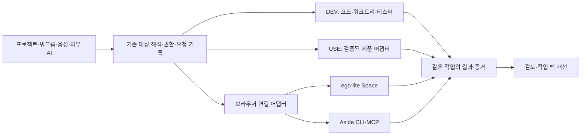

# ego-lite·Aside 기능의 AgentsToZ 적용 분석

> 사용자 정정 반영: 이 문서는 외부 제품 연동으로 요청을 잘못 해석한 초기안이다. 사용자 의도는 ego-lite·Aside를 사용하지 않는 AgentsToZ 자체 기능이다. 이후 제안은 [자체 생태계 기능 분석](agentstoz-native-ecosystem-features-2026-10-23.md)을 기준으로 한다. 아래 외부 연동 제안은 현재 권고안이 아니다.

- 작성일: 2026-10-23 (Asia/Seoul)
- 상태: 제품 분석·설계 제안. 구현·설치·실기 성능 검증 전.
- 작업 브랜치: `codex/ego-aside-analysis`
- AgentsToZ 기준 소스: `3619c91bc90ef83dd3b1ce6888db7e24edb45f09`
- ego-lite 조사 기준: [`d392204d1ea1a8027a591ab2b0129c2e11d85f26`](https://github.com/citrolabs/ego-lite/commit/d392204d1ea1a8027a591ab2b0129c2e11d85f26).

## 1. 제안의 중심

**AgentsToZ의 강점인 프로젝트·워크트리·워크룸·OPS/DEV/USE·기억·테스터에 브라우저 실행과 결과 증거를 연결하는 것이 가장 유망하다.** 사용자는 같은 작업에서 코드 수정, 로그인된 서비스 확인, 제품 사용, 결과 검토를 이어갈 수 있다. 개발자는 검증된 연결 도구와 작업 절차를 재사용하게 된다.

즉시 체감할 기능은 **워크룸에 연결된 브라우저 작업과 검증 증거 묶음**이고, 생태계를 만들 기반은 **제품 USE 어댑터 규격과 검증 가능한 작업 팩**이다. 브라우저 엔진·비밀번호 관리자·새 독립 AI 실행 화면을 만드는 일은 첫 단계의 가치가 낮다.

이 문서의 효율·편의성 평가는 제품 설계 판단이다. 두 제품의 홍보 벤치마크를 AgentsToZ의 성능 향상 수치로 환산하지 않았다.

## 2. 외부 제품에서 확인한 것

### ego-lite

| 기능·상태 | 확인한 내용 | 적용 시 해석 |
|---|---|---|
| 현재 문서화 | 작업별 Space, 기존 로그인 환경 활용, 사용자와 에이전트의 병렬 브라우징 | 사용자의 탭·포커스와 에이전트 작업 화면의 충돌을 줄이는 패턴 |
| 현재 문서화 | Snapshot과 JavaScript 기반 브라우저 조작 | 페이지 관찰과 연속 작업의 도구 호출 부담을 줄일 가능성 |
| 공개 API schema | `TaskSpace`/`Page`, 페이지 label, `handOff()`, `finish({keep})` | 작업 소유권·인계·완료 결과를 Workroom 기록에 연결할 후보 |
| 별도 배포 | 공개 저장소 콘텐츠는 MIT, 브라우저 본체는 별도 무료 다운로드 | 저장소 라이선스를 브라우저 본체의 재배포 권리로 확대하지 않음 |
| 플랫폼 | macOS·Windows 지원, Linux는 로드맵 | Ubuntu/AWS까지 필수 의존성으로 통일할 수 없음 |
| 예정·제한적 제공 | Experience 재사용은 coming soon·limited beta | 완성된 자동 학습 기능으로 도입 효과를 계산하지 않음 |

기능·배포 범위는 [공식 README](https://github.com/citrolabs/ego-lite)와 [LICENSE](https://github.com/citrolabs/ego-lite/blob/d392204d1ea1a8027a591ab2b0129c2e11d85f26/LICENSE), Space의 구조는 [Space 문서](https://lite.ego.app/document/en/docs/space), 객체 API는 [공개 schema](https://github.com/citrolabs/ego-lite/blob/d392204d1ea1a8027a591ab2b0129c2e11d85f26/package/ego-browser/src/public-api-schema.ts), Experience 상태는 [Skills 문서](https://lite.ego.app/document/en/docs/skills)에서 확인했다.

Space는 같은 브라우저 프로세스 안의 작업별 BrowserContext다. 작업 화면을 나누는 기능을 프로젝트·계정 권한을 제한하는 보안 경계와 동일시하면 안 된다. [Space 문서](https://lite.ego.app/document/en/docs/space)

연결 시 버전 확인이 필요하다. 웹 예제와 현재 package 문서 사이에 v1 전역 helper/초 단위와 v2 객체 API/밀리초 단위 차이가 있다. native binding은 설치 앱이 제공하므로 공개 package만으로 AgentsToZ WebView에 같은 브라우저를 넣을 수 있다고 볼 수 없다. [package README](https://github.com/citrolabs/ego-lite/blob/d392204d1ea1a8027a591ab2b0129c2e11d85f26/package/ego-browser/README.md), [native binding 문서](https://github.com/citrolabs/ego-lite/blob/d392204d1ea1a8027a591ab2b0129c2e11d85f26/docs/native-bindings-api.md)

### Aside

사용자가 제시한 [공식 개발자 글](https://aside.com/blog/developers)은 코딩 에이전트가 로그인된 브라우저를 통해 CI 실패, PR 검토, 스테이징 QA, 운영 화면의 근거를 가져오는 사용법을 제시한다. 해당 글은 웹 도구의 직접 열기가 실패하여 공식 서버의 HTML 원문으로 확인했다. 발행일은 2026-06-22다.

| 기능·상태 | 확인한 내용 | 적용 시 해석 |
|---|---|---|
| 공식 개발자 인터페이스 | 자연어 CLI, `--session`, `--account`, `aside mcp`, `aside repl` | 기존 코딩 에이전트에서 외부 브라우저를 선택해 사용 가능 |
| 공식 권한 기능 | 도구별 Allow/Ask/Deny, 세션 설정, 폴더·sandbox 범위 | 프로젝트·사용자·실행 역할별 연결 범위를 보여주는 UX 참고 |
| 공식 루틴 | Cron은 새 작업, Heartbeat는 기존 채팅 재개, 실행 중첩 방지 | 기존 당직·작업 대기를 확장할 패턴 |
| 공식 기억 기능 | 저장 사용 여부, 보존 기간, 내용 편집·변경 이력 | 관찰 자료의 수명과 검증된 교훈을 나누는 설계 참고 |
| 공개 범위 한계 | 조사한 공식 문서에서 브라우저 소스·임베딩 SDK를 확인하지 못함 | 외부 CLI/MCP 연결과 자체 제품 기능 설계를 구분 |

각 근거: [개발자 도움말](https://docs.aside.com/help/developers), [권한](https://docs.aside.com/help/security), [루틴](https://docs.aside.com/help/automation), [기억](https://docs.aside.com/help/memory), [공식 구현 설명](https://aside.com/blog/how-we-built-the-sota-browser-agent-that-outperforms-fable).

Aside의 `Read only` 설명은 파일을 변경하지 않는다는 의미다. 웹 서비스에서의 전송·삭제까지 모두 막아준다고 가정해서는 안 된다. 또한 local-first와 모델 제공자에게 데이터가 전송되지 않는다는 주장은 다르다. 개인정보 처리방침은 호스팅 AI가 선택된 프롬프트·snapshot·screenshot·파일·도구 결과를 받는다고 설명한다. [권한 도움말](https://docs.aside.com/help/security), [개인정보 처리방침](https://aside.com/policy/privacy)

## 3. AgentsToZ에 이미 있는 기반과 추가할 부분

| 영역 | 현재 소스에서 확인한 기반 | 이번 제안으로 추가할 부분 |
|---|---|---|
| Ego Lite | 기본 브라우저 선택, macOS URL 열기, 설치·서명 확인 경로 | Space/브라우저 세션과 Workroom 작업의 결속, 관찰·인계·결과 회수 |
| 워크룸 | CLI PTY, 요청·대화 기록, 재시작·이어 열기 계약 | 브라우저 작업의 소유자·상태·근거를 같은 작업에 표시 |
| USE | `ServiceUseHost`와 검증된 설치 어댑터, status→execute→receipt | 제품별 도구 스키마를 확장하는 버전 계약과 개발자 연결 도구 |
| 플랫폼 계정 | 프로젝트별 GitHub·Vercel·Supabase·Google Workspace CLI 계정 연결 | 브라우저 프로필 선택과 명확히 구별한 프로젝트별 연결 상태 |
| 규격 명령·테스터 | 기존 실행 절차·검사 결과·페르소나 기반 | 입력·권한·산출물·실행 증거를 가진 재사용 작업 팩 |
| 장기기억 | DEV/USE/OPS의 역할 분리, 로컬 정본, 출처·검토 경계 | 짧게 보관할 브라우저 근거와 오래 보관할 검증된 교훈 구분 |

현재 구현 근거: [`browserPreference.ts`](../../src/browserPreference.ts), [`browserProfilesServer.ts`](../../src/browserProfilesServer.ts), [`macSetupCatalog.ts`](../../src/macSetupCatalog.ts), [`macSetupEffects.ts`](../../src/macSetupEffects.ts), [DEV·USE 문맥](../dev-use-context.md), [제품 운영 도구 연결](../service-use-integration.md), [Runtime SDK](../../packages/runtime-sdk/README.md), [프로젝트 문서](../../README.md).

특히 **현재 USE는 범용 플러그인 시장이 아니다.** ShadowLoop 도구 6종과 설치 코드에 등록된 어댑터가 기준이며, 자동 검색·임의 URL 연결·JSON 도구 가져오기·고객용 설치 SDK는 없다. Runtime SDK 0.4.0도 USE용 공개 확장 SDK와 다르다. [확장 방법과 현재 한계](../service-use-integration.md#다른-제품을-연결하려면), [`serviceUseProtocol.ts`](../../src/serviceUseProtocol.ts)

프로젝트 기억에 보존된 “Workroom 중심, 별도 AI 작업 탭과 앱 내 CS-CEO 자동 연동 제거” 결정도 반영한다. 새 기능의 진입점은 기존 프로젝트 카드·워크룸·USE 연결·테스터 결과에 둔다. 과거 Buzz UI 문구에 대한 contested 기억은 현재 동작의 근거로 사용하지 않았다.

## 4. 추천 기능과 우선순위

우선순위는 P0=첫 파일럿, P1=검증 후 확장, P2=재사용 수요가 입증된 후다. 난도는 상대 평가이며 일정·성능을 확정한 수치가 아니다.

| 순서 | 기능 | 사용자에게 달라지는 점 | 재사용할 기반 | 난도·효용 판단 |
|---|---|---|---|---|
| 1 / P0 | **워크룸 브라우저 연결** | “이 워크트리 화면 확인해줘”가 해당 브라우저 작업으로 이어짐. 열기·관찰·사람 확인·완료 위치를 한곳에서 확인 | 기존 Ego 설치/URL 열기, 워크룸 요청 기록 | 중~상 / 자주 겪는 화면 전환 부담 감소 |
| 2 / P0 | **검증 증거 묶음** | commit·URL·화면·관찰·테스트 결과를 함께 검토. AI의 완료 설명을 다시 확인하는 수고 감소 | 테스터 결과, 대화 기록, 브라우저 산출물 | 중 / 개발·리뷰 즉시 가치 |
| 3 / P1 | **프로젝트 연결 준비 상태** | 설치됨·로그인 필요·프로필 미선택·연결됨·검증됨을 구분. 필요한 곳에서 같은 작업으로 복귀 | 설치 엔진, 플랫폼 계정, USE 준비 UI | 중 / 초보자·재접속 편의 |
| 4 / P1 | **제품 USE 어댑터 개발 키트** | 다른 제품도 제한된 업무 기능을 `@제품-USE`로 제공 | ServiceUseHost, 기존 권한·영수증 | 상 / 생태계 핵심 기반 |
| 5 / P1 | **검증 가능한 작업 팩** | “스테이징 점검”, “CI 조사”, “자료 생성” 절차를 프로젝트마다 다시 설명할 필요 감소 | 규격 명령, 스킬, 테스터·페르소나 | 중~상 / 배포·재사용 단위 |
| 6 / P1 | **변화가 있을 때 이어가기** | CI 종료·preview 준비 후 원래 작업의 점검 재개. 불필요한 반복 보고 감소 | 대직의 동의·예산·중복 방지 패턴과 워크룸 기록. CI 감지·작업 재개는 신규 | 중 / 지속 업무 효율 |
| 7 / P2 | **검증된 브라우저 절차 기억** | 사이트 변경 전까지 검증된 절차 재사용, 깨지면 재관찰 | 프로젝트 기억·검토·출처 체계 | 상 / 반복 업무가 쌓인 뒤 가치 |
| 8 / P2 | **연결 도구·작업 팩 카탈로그** | 호환 버전·권한·실행 근거를 보고 선택·활성화·업데이트 | 어댑터 규격과 작업 팩의 안정화가 선행 | 상 / 공급자·사용자 연결 |

작은 편의 기능으로는 **선택한 페이지를 참고 자료로 첨부하기**도 유망하다. URL·선택 영역·snapshot 시점을 사용자가 확인해 워크룸에 붙이면 복사·붙여넣기를 줄일 수 있다. 현재의 `#` 참고와 실행 호출 구분을 재사용하고, 탭 첨부를 전체 브라우저 읽기나 웹 쓰기 허가로 바꾸지 않는다. 이는 P1의 연결 준비·작업 팩 UX에 포함할 후보이며 독립 브라우저 대화 화면은 필요하지 않다.

### 4.1 첫 화면에서 체감할 흐름

1. 사용자가 기존 워크룸에서 “이 워크트리의 회원가입 화면을 확인하고 결과를 붙여줘”라고 요청한다.
2. 호스트가 등록 프로젝트·정확한 워크트리·현재 commit·허용 URL·브라우저 연결을 확인한다. 다른 워크트리의 서버라면 먼저 연결 문제를 표시한다.
3. 선택한 브라우저의 작업 공간에서 점검한다. 계정 확인·로그인·민감한 최종 동작이 필요하면 해당 화면으로 인계하고 같은 작업 ID를 유지한다.
4. 결과에 URL, 관측 시각, 브라우저/viewport, 재현 단계, 화면, 검사 run ID, 실패·미확인 항목을 붙인다.
5. 워크룸에서 “브라우저에서 열기”, “실패 위치 보기”, “다시 검사”를 제공한다. 다시 검사는 사용자가 새 실행을 요청한 경우에만 새 ID로 만든다.

이 단계에서는 브라우저에 코드 수정을 맡길 이유가 없다. DEV가 수정한 결과를 브라우저가 관찰하고 실제 결과를 돌아오게 하는 데 집중한다.

### 4.2 생태계가 만들어지는 경로

**제품 개발자 → 제한된 USE 동작 등록 → 사용자가 연결 승인 → 여러 AI 채널에서 사용 → 작업 팩으로 반복 → 검증된 교훈을 다음 버전에 반영**하는 순환을 만든다.

| 참여자 | 제공·선택하는 것 | 지속적으로 얻는 가치 |
|---|---|---|
| 제품 개발자 | 버전이 있는 USE 어댑터와 테스트 사례 | 제품의 업무 기능을 여러 AI에서 사용하도록 연결 |
| 작업 팩 작성자 | 입력·절차·권한·검사·산출물 정의 | 검증된 절차를 다른 프로젝트에서도 재사용 |
| 사용자·팀 | 제품·계정·허용 동작·보존 범위 | 필요한 기능만 연결하고 완료 근거를 확인 |
| AgentsToZ | 대상 해석, 실행 결속, 권한, 결과·검증 연결 | 모델과 실행 도구가 달라도 같은 프로젝트 문맥 유지 |

초기 카탈로그는 검토된 소수 어댑터로 시작한다. 일반 고객이 제품을 쓰기 위해 소스 저장소·DEV 기억·개발 환경을 먼저 가져야 하는 현재 제약은 별도 해결 과제다. **설치된 제품 identity로 연결하는 고객용 등록 계약**이 준비되어야 개발자 중심 도구에서 제품 생태계로 확장된다. [현행 설치 한계](../dev-use-context.md#제품-설치와-현재-한계)

## 5. 연결 구조 제안

아래 이름은 설계 후보이며 현재 제공 API가 아니다.

브라우저 사용에 내부 AI를 추가하는 방식과 기존 Codex/Claude가 직접 브라우저를 제어하는 방식을 구분한다. 첫 파일럿은 **기존 에이전트 + 브라우저 도구**로 두어 추가 모델 호출·이중 대화 상태를 최소화한다. Aside 자체 에이전트 위임은 이후 별도 실행 방식으로 측정한다.

### 실행·결과 계약

| 계약 | 설계 후보 | 필요한 이유 |
|---|---|---|
| 실행 결속 | projectId, worktree identity, Workroom 요청 ID, 실행 역할, provider/build, profile 식별자, 허용 origin, grant revision | 프로젝트·계정·세션 혼동 방지 |
| 생명주기 | 준비→실행→사람 확인 대기→완료/실패/미확정, 취소 요청과 취소 완료 구분 | 브라우저 창 열기를 업무 성공으로 오인하지 않음 |
| 결과 | 원래 requestId, 실제 URL, 관측 시각, 결과 파일 참조·hash, 검사 run ID, 명시적 성공 조건 | 모델의 요약과 결과 증거를 함께 검토 |
| 재시작 | 원래 요청·Space/session 식별자·영수증 재조회, 소유권·grant 재검증 | 응답 유실 후 중복 실행 방지 |
| 수명 | 동시 실행·대기열·snapshot 크기·산출물 보존에 명시적 예산 | 병렬 탭·본문 누적으로 앱 자원 소진 방지 |

브라우저의 `finish`나 공급자 receipt를 AgentsToZ의 업무 성공으로 그대로 치환하지 않는다. 예를 들어 페이지가 열렸다는 근거, UI 기대값을 확인했다는 근거, 테스트가 통과했다는 근거, 상대 기기에 결과가 도착했다는 근거는 각각 기록한다.

운영 절차는 **이미 검증된 native API/제품 USE 도구 → 프로젝트에 연결한 CLI → 필요한 경우 브라우저** 순으로 선택하는 것을 기본 제안으로 한다. 연결 실패는 원인을 보여주며, 실패한 쓰기를 다른 계정·도구에서 자동 재시도하지 않는다. 이것은 권한을 새로 부여하는 우선순위가 아니다.

### 작업 팩의 최소 정의

작업 팩에는 이름·버전·작성자·출처, 지원 provider/build·플랫폼, 입력 schema, 허용 도메인·동작, 검토가 필요한 단계, 실행 제한·취소, 산출물, 성공 조건, 테스트 근거를 포함한다. 브라우저의 임시 요소 번호는 영구 절차로 저장하지 않는다.

설치·발견·활성화·검증은 별도 상태다. 문서와 실행 코드는 다르게 취급하고, 팩 업데이트가 기존 grant를 넓히면 다시 검토한다. 공유 팩에는 계정·쿠키·프로젝트별 대화·원본 기억을 넣지 않는다. 첫 버전은 설치 코드에서 검토한 팩만 활성화하며, 임의 원격 JavaScript 자동 설치를 열지 않는다.

## 6. 적용할 때 지킬 제품 경계

- **Workroom 유지:** 기존 화면에서 브라우저 연결과 결과를 확장한다. 제거한 독립 AI 작업 탭이나 앱 내 CS-CEO 자동 연동을 되살리지 않는다.
- **권한 분리:** 브라우저 로그인은 OPS·DEV·USE 실행 허가가 아니다. USE에는 임의 JS·raw CDP·셸·전체 OPS MCP를 주지 않는다. 같은 페이지의 클릭도 조회와 전송·삭제를 구분한다.
- **채널 권한:** 기존 원격 터미널·프로젝트 grant는 브라우저 제어·계정/페이지 근거 조회를 자동 허용하지 않는다. 음성·외부 AI·모바일마다 실제 호스트의 별도 scope와 근거 보존·모델 전달 동의를 검토한다.
- **확인 가능한 범위:** 범용 페이지 JS만으로 웹 쓰기를 강제 차단할 수 없다면 “읽기 전용”을 보장한다고 표시하지 않는다. 제한된 작업 팩과 테스트 계정·fixture부터 검증한다.
- **비밀·자료 처리:** 쿠키·비밀번호를 AgentsToZ 기억에 복사하지 않는다. 모델로 보내는 페이지 근거의 범위와 민감정보 제거를 별도로 설계한다. 공유·외부 전송은 실행 결과 생성과 구분한다.
- **기억 역할 유지:** 브라우징 전체 이력은 기본 수집하지 않는다. 근거 파일은 수명·동기화 여부를 별도 설정하고, 오래 보관할 교훈만 출처·검토를 거쳐 DEV/USE/OPS의 맞는 위치에 남긴다.
- **기기 차이 표시:** Ego 자체 Windows 지원과 AgentsToZ의 현재 macOS Ego launcher 지원은 다르다. Windows 실제 연결·실기 확인과 Ubuntu 미지원 안내를 각각 준비한다. 브라우저가 없는 호스트도 기존 기능을 사용한다.

공개 ego 런타임은 Node.js 22+를 개발 요구사항으로 두고 설치 앱의 native binding에 의존한다. Bun 앱 안에 그대로 import해 동작한다고 가정하지 않고 별도 프로세스 연결·지원 버전 협상부터 확인한다. [package.json](https://github.com/citrolabs/ego-lite/blob/d392204d1ea1a8027a591ab2b0129c2e11d85f26/package/ego-browser/package.json), [로컬 개발 문서](https://github.com/citrolabs/ego-lite/blob/d392204d1ea1a8027a591ab2b0129c2e11d85f26/docs/local-runtime-development.md)

## 7. 권장 도입 순서와 검증 기준

### 단계 A — Ego 연결과 결과 증거 파일럿

기존 macOS Ego 설치 기반을 활용한다. 공식 배포 API를 확인한 뒤 프로젝트·워크트리별 Space 결속, 사람 인계, 결과 회수, 워크룸 결과 표시를 한 흐름으로 완성한다. Aside는 같은 결과 계약에 맞추는 두 번째 선택형 provider로 검토한다.

대표 작업은 ① 로컬 온보딩 fixture 점검, ② 승인된 private CI 실패 근거 수집, ③ staging UI 점검, ④ 로그인된 대시보드의 허용된 조회·내보내기다. 첫 작업은 외부 서비스 쓰기 없이 재현 가능한 fixture에서 시작한다.

제안 검증 기준은 다음과 같으며 아직 측정한 결과가 아니다.

- 서로 다른 워크트리 2개에서 동시에 요청해도 URL·결과·브라우저 작업의 소유권이 섞이지 않는다.
- 브라우저 열기 성공만으로 검사 통과를 기록하지 않는다. 대상 commit과 실제 관측 대상의 연결 근거를 남긴다. 연결을 증명할 수 없으면 미확인으로 표시한다.
- 재전송·응답 유실·재시작에서 같은 요청의 영수증을 돌려주며 작업을 자동 중복 실행하지 않는다.
- 잘못된 계정·grant 변경·지원하지 않는 버전·취소·사람 인계에서 상태가 실제 결과와 일치한다.
- snapshot이 읽지 못한 영역은 추가 관찰 또는 미확인으로 남긴다. 화면 하나를 전체 여정 통과로 확대하지 않는다.

### 단계 B — USE 연결 규격과 작업 팩

ShadowLoop의 현재 권한·영수증 계약을 보존하면서 다른 종류의 제품 한 개를 추가해 일반화 범위를 검증한다. host와 제품이 같은 도구 정의 revision을 확인하도록 하고, 제한된 SDK·개발 예제·회귀검사 묶음을 만든다.

두 제품이 같은 방식으로 연결되었다는 증거가 생기면 설치 상태·도구 상태·로그인·실제 준비 상태를 하나의 연결 화면에서 설명한다. 그 위에 스테이징 점검·CI 조사·자료 생성 작업 팩을 제공한다. 처음부터 임의 URL·JSON 도구 목록을 실행 권한으로 받아들이지 않는다.

### 단계 C — 반복 작업과 카탈로그

현재 대직은 카카오 질문 응답 전용이며 앱 재시작 뒤 OFF다. 범용 CI 감시나 원래 Workroom 재개 기능이 완성되어 있다는 뜻이 아니다. 기존 대직의 동의·호출 예산·중복 방지 패턴을 참고하고, CI 완료·preview 준비 감지와 원래 작업 재개는 새로 설계한다. 가능한 상태 API로 저렴하게 확인한 뒤 필요한 변화에서만 브라우저·AI를 호출한다. 제안된 반복 작업은 사용자가 활성화하며 같은 작업이 겹치지 않게 한다. 이 문서는 자동화 생성 요청이나 실행 승인이 아니다. [현재 대직 계약](../cs-duty.md)

실제 재사용되는 팩이 쌓인 뒤 호환 버전·권한·검증 근거·업데이트·되돌리기를 보여주는 카탈로그를 만든다. 실행 코드를 자동 학습·배포하는 기능은 그 이후에 별도로 검증한다.

### 측정

동일 작업·계정·모델·검사 조건으로 현재 경로와 제안 경로를 각각 반복 비교한다. 순서를 교차하고 로그인/캐시 상태와 실패를 기록한다. 작은 파일럿 결과를 다른 서비스나 모델까지 확대하지 않는다.

| 지표 | 확인하려는 것 |
|---|---|
| 성공 조건을 충족한 작업 비율 | 빠른 실패나 일부 성공을 효율 향상으로 잘못 세지 않는가 |
| 작업 시간·모델 토큰·도구 호출 | 실제 전체 비용과 지연이 줄었는가 |
| 사람 개입·재로그인·수동 화면 이동 횟수 | 사용자의 수고가 줄었는가 |
| 프로젝트·계정 오연결·중복 실행 | 기본 실행 계약이 유지되는가 |
| 리뷰어의 결과 확인 시간·근거 누락 | 완료 주장을 더 쉽게 판단하는가 |
| 잔여 탭·프로세스·메모리·대기열 | 반복·병렬 사용 후 자원이 회수되는가 |

수치 목표는 기준선을 측정한 뒤 정한다. 단계 A의 우선 통과 조건은 잘못된 대상·권한 확장·중복 쓰기 없이 근거를 회수하는 것이다.

## 8. 조사 범위와 남은 확인

공식 GitHub·문서·개발자 글과 현재 AgentsToZ 소스를 병렬로 조사했다. canonical 프로젝트 기억은 최신 Pull이 `alreadySynced`였고, 한정 recall의 공통 기억 상태는 `ready`였으나 연결된 그룹·hit는 없었다. 기억 검색 결과의 과거 주장과 후보는 현행 소스 확인 없이 확정 사실로 사용하지 않았다.

이번 결과물은 이 문서 한 개다. 브라우저 설치·로그인·자동화 실행·앱 동작 변경·배포·외부 메시지 전송을 수행하지 않았다. 코드 구현 변경이 없어 프로젝트 테스트를 실행하지 않았다. 문서 변경과 로컬 링크는 별도로 점검한다.

구현 착수 시 확인할 항목은 설치 Ego build의 실제 API·receipt 범위, Aside MCP/REPL의 정확한 세션·프로필 결속, 프로젝트에 맞는 웹 쓰기 제한, 브라우저 결과와 테스터 run의 연결 방식, Windows 실기 연결, 고객용 USE 설치 identity다. 실제 구현 검증에는 프로젝트 tester reconciliation과 기존 정상 프로필·페르소나 검사를 적용한다.
